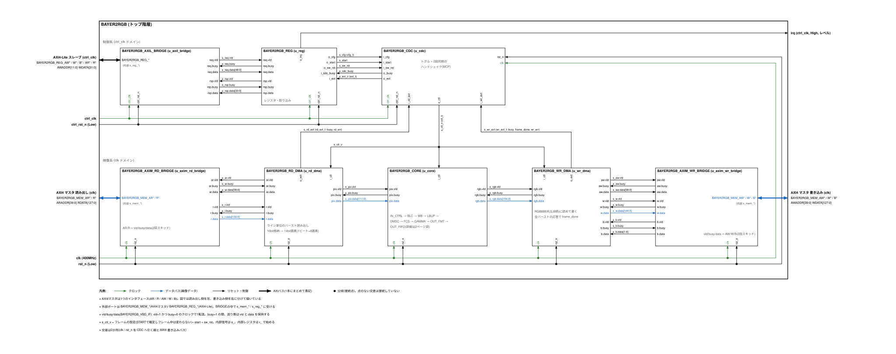

# BAYER2RGB

メモリ上の Bayer 画像(14bit)を RGB888 に変換してメモリへ書き戻す IP です(SystemVerilog)。黒レベル補正、ホワイトバランス、バイリニア補間、エッジ部の彩度抑制、ガンマを内蔵しています。

- 制御: AXI4-Lite スレーブ(`ctrl_clk`)、割り込み `irq`
- データ: AXI4 マスタ(`clk`、128bit / 40bit)
- 最大 3840×2160、1クロック 8画素(PPC=1/2/4/8 を選択可)、400 MHz で 4K 1フレーム 約 3.9 ms

仕様の詳細は [doc/spec/BAYER2RGB_spec.md](doc/spec/BAYER2RGB_spec.md) を見てください。



## ディレクトリ

| パス | 内容 |
|---|---|
| `rtl/` | RTL(`rtl.f`)。`BAYER2RGB.sv` がトップ |
| `model/` | 製品IP(SRAM、同期化セル)の振る舞いモデル(`model.f`) |
| `tb/` | UVM 検証環境(`tb.f`、`tb/uvm/`) |
| `sim/` | Makefile、回帰試験(`run_regress.sh`、`tests.list`)、Xcelium の波形設定(`xrun_waves.tcl`) |
| `tools/` | Python のリファレンスモデル(`b2r_model.py`)、画像の生成・変換、照合、カバレッジの集計、コーディング規約の検査 |
| `doc/arch/` | ブロック図(`bayer2rgb_arch.drawio`、SVG) |
| `doc/spec/` | 仕様書、端子表(`pins/`)、波形図(`wave/`: WaveDrom の JSON と SVG) |
| `doc/tools/` | ブロック図・端子表・波形図・仕様書を作るスクリプト |
| `syn/` | タイミング制約(`constraints/bayer2rgb.sdc`)、Yosys の論理合成(`yosys/`)、合成用の SRAM・同期化のラッパ(`rtl/asap7/`、`rtl/foundry/`)。説明は [syn/README.md](syn/README.md) |
| `pd/` | 物理設計。OpenROAD-flow-scripts + ASAP7(`openroad/`)、Cadence + Foundry の PDK の雛形(`commercial/`)。説明は [pd/README.md](pd/README.md) |

## 使い方

下の表のコマンドは、全部を続けて実行するものではありません。準備のあと、目的の行を選んで実行します。

### シミュレーション(`sim/`)

必要なもの: Verilator 5.053 以降、UVM 1800.2-2017-1.0(Verilator で使える版)、zlib と lz4(FST 出力)、Python 3(numpy、Pillow)。Xcelium でも動かせるようにしています(未実行。仕様書 15.3)。

準備:

```sh
export UVM_HOME=/path/to/uvm-2017-1.0   # src/uvm_pkg.sv があるディレクトリ
cd sim
```

| 目的 | コマンド |
|---|---|
| RTL の lint | `make lint` |
| テストを1つ実行する | `make run TEST=b2r_smoke_test` |
| 波形を出して見る | `make run TEST=b2r_random_test SEED=3 WAVES=1` のあと `gtkwave waves.fst` |
| 回帰試験(全テスト) | `make regress`(結果は `logs/regress.txt`) |
| カバレッジ付きの回帰試験 | `make cov`(結果は `cov/`) |
| Xcelium で実行する | `make xrun TEST=b2r_smoke_test XWAVES=vcd` のあと `gtkwave waves.vcd` |

ふつうは `make regress`(または `make cov`)を実行し、失敗したテストがあれば、そのテスト名とシードで `make run ... WAVES=1` を実行して波形を見ます。

FST の出力に必要な lz4 / zlib を標準以外の場所に入れた場合は `VL_CFLAGS=-I<dir>/include VL_LDFLAGS=-L<dir>/lib` を付けてください。

### 論理合成と配置配線(`syn/`、`pd/`)

必要なもの: Yosys、sv2v、OpenROAD(`openroad`、`sta`)、OpenROAD-flow-scripts(ASAP7)。

準備:

```sh
export ORFS_FLOW=$HOME/OpenROAD-flow-scripts/flow
```

| 目的 | コマンド | 詳しい説明 |
|---|---|---|
| 論理合成と合成後の STA だけ | `make -C syn/yosys` | `syn/README.md` の 2.2 |
| 配置配線を最後まで(論理合成を含む) | `make -C pd/openroad` | `pd/README.md` の 1.2 |
| 配置配線を概略配線まで(論理合成を含む) | `make -C pd/openroad PPC=2 synth floorplan place cts io_latency grt summary` | 同上 |

配置配線のコマンドは論理合成も自動で行うので、`make -C syn/yosys` を先に実行する必要はありません。詳細配線(TritonRoute)は多くのメモリを使います(PPC=2 でも 12 GB 超。32 GB 以上の計算機を勧めます。仕様書 14.4.3)。

## 検証の状況

Verilator 5.053 での結果です(詳細は `sim/results/` と仕様書 13章)。

| 項目 | 結果 |
|---|---|
| 回帰試験(89本: PPC=8/4/2/1、同期化セルの乱数遅延、クロック比の組み合わせ) | PASS 89 / FAIL 0 |
| リファレンスモデルとの照合 | 全フレームでビット一致(SV モデル。Python モデルとも 122 フレームで一致) |
| 機能カバレッジ | 93 / 93 ビン(100%) |
| RTL コードカバレッジ | 行 98.7%、分岐 97.7%(残りは到達しない部分のみ) |
| lint(Verilator -Wall) | 警告 0(PPC=8/4/2/1) |

## 論理合成・配置配線の状況

公開ツールと ASAP7(7nm 相当の予測 PDK)での結果です(詳細は仕様書 14章、`syn/results/`、`pd/openroad/results/`)。Foundry のプロセスの値ではありません。

| 項目 | PPC=8 | PPC=2 |
|---|---:|---:|
| 論理合成: セル数 / 面積 | 166,032 / 26,583 um² | 65,020 / 15,584 um² |
| 論理合成: セットアップ WNS(配線の遅れなし) | +0.639 ns | +0.637 ns |
| 配置配線: ダイの大きさ | 301.7 × 301.7 um | 231.9 × 231.9 um |
| 概略配線の後: セル数 | 182,326 | 77,087 |
| 概略配線の後: セットアップ WNS / ホールド違反 | +2.0 ps / 0 | +3.9 ps / 0 |
| 概略配線の後: 遷移時間の違反 | 5(GAMMA。324 ps / 制限 320 ps) | 0 |
| 詳細配線から後 | 未実行(この環境のメモリでは足りない。仕様書 14.4.3) | 同左 |

合成は PPC=4/1 でも 400 MHz を満たしています(仕様書 10.3)。配置配線の各段階の値と配置の図は `pd/openroad/results/asap7_ppc8/summary.md`、`asap7_ppc2/summary.md` にあります。

## 量産に向けて残っている作業

- SRAM マクロと同期化セルを Foundry の製品IPに置き換える(仕様書 12章。合成用のラッパの雛形は `syn/rtl/foundry/`)
- Foundry のプロセスでの論理合成・配置配線・サインオフ(雛形は `pd/commercial/`)、CDC 検証ツールでの確認(仕様書 11章)
- Xcelium での回帰試験とカバレッジ
- DFT(スキャン、メモリ BIST)の挿入
- ASAP7 の環境の詳細配線から後(配線後の寄生抽出・STA・IR ドロップ)の実行(32 GB 以上のメモリの計算機で。仕様書 14.4.3)

## コーディング規約

- `if( 条件 )`、`for( 初期化; 条件; 処理 )`、`while( 条件 )`。条件の中にはスペースを入れない
- begin / end は省略しない。`end else begin` は1行に書く。インデントは2スペース
- ポート・パラメータ・インスタンスの接続は先頭にカンマを置く(`,.rst_n (rst_n)`)
- AXI のポートは `大文字モジュール名_用途_AXIポート名`(`BAYER2RGB_MEM_AWADDR`)、内部信号は `s_`、FF は `r_` で始める

`python3 tools/style_check.py rtl model tb tools doc/tools` で規約の一部(if / for / while の書き方、begin の位置、インデント、1行1文)を検査できます。
