# BAYER2RGB 仕様書

| 項目 | 内容 |
|---|---|
| IP名 | BAYER2RGB(Bayer → RGB888 変換) |
| 版 | 1.0(VERSION レジスタ = 0x0001_0000) |
| 日付 | 2026-10-25 |
| 対象 | ASIC 量産品(Foundry のプロセス、映像系クロック 400 MHz) |
| RTL | `rtl/`(SystemVerilog IEEE 1800-2017) |

> この文書は `doc/tools/gen_spec.py` で `doc/spec/src/*.md` から作っています。端子表(`doc/spec/pins/`)と波形図(`doc/spec/wave/`)はRTLとシミュレーションの波形から自動で作ったものです。編集は `doc/spec/src/` に対して行ってください。

## 目次

1. [概要](#1-概要)
2. [主な仕様](#2-主な仕様)
3. [設計で決めた事項](#3-設計で決めた事項)
4. [ブロック構成](#4-ブロック構成)
5. [外部インタフェース](#5-外部インタフェース)
6. [画像処理(ビット精度の定義)](#6-画像処理ビット精度の定義)
7. [レジスタ](#7-レジスタ)
8. [内部インタフェース(vld/busy/data)](#8-内部インタフェースvldbusydata)
9. [各ブロックの詳細](#9-各ブロックの詳細)
10. [性能](#10-性能)
11. [クロック乗せ換え(CDC)とタイミング制約](#11-クロック乗せ換えcdcとタイミング制約)
12. [製品IP(SRAM・同期化セル)の扱い](#12-製品ipsram同期化セルの扱い)
13. [検証](#13-検証)
14. [論理合成と物理設計](#14-論理合成と物理設計)
15. [既知の制約と注意事項](#15-既知の制約と注意事項)
16. [参考文献](#16-参考文献)

---

## 1. 概要

BAYER2RGB は、メモリ上の Bayer 画像(1画素14bit、16bitに格納)を読み出し、黒レベル補正、ホワイトバランス、バイリニア補間によるデモザイク、エッジ部の彩度抑制(偽色対策)、ガンマ補正を行って、RGB888(1画素3バイト、R,G,B の順)の画像としてメモリへ書き込む IP です。

```
メモリ(Bayer 16bit/画素) ──AXI4 読み出し──▶ BLC ▶ WB ▶ デモザイク ▶ 彩度抑制 ▶ ガンマ ──AXI4 書き込み──▶ メモリ(RGB888)
                                          ▲
                        AXI4-Lite(レジスタ・割り込み)
```

- 制御: AXI4-Lite スレーブ(`ctrl_clk` ドメイン)。フレームの大きさ、アドレス、画像処理のパラメータをレジスタで設定し、START で1フレーム処理します。完了は割り込み(`irq`)とレジスタで知らせます。
- データ: AXI4 マスタ(`clk` ドメイン、データ幅128bit、アドレス幅40bit)。読み出しと書き込みを同時に行います。
- 1クロックに PPC 画素(既定 8。1/2/4/8 をコンパイル時に選択)を処理します。
- 3840×2160 の1フレームを約 3.9 ms(PPC=8、400 MHz、メモリが毎クロック応答する場合)で処理します。

## 2. 主な仕様

| 項目 | 仕様 |
|---|---|
| 入力画像 | Bayer、1画素14bit。メモリには1画素を16bit(リトルエンディアン)で置き、下位14bitを使う(上位2bitは無視) |
| Bayer の並び | RGGB / GRBG / GBRG / BGGR をレジスタで選択(フレームごと) |
| 出力画像 | RGB888。1画素3バイトを R, G, B の順に隙間なく並べる |
| 画像の大きさ | 幅 16〜3840 画素(8の倍数)、高さ 16〜2160 ライン(偶数)。範囲外の設定値はクランプ・切り捨て(6.1) |
| 画像処理 | 黒レベル補正(BLC)、ホワイトバランス(WB)、バイリニア補間、エッジ部の彩度抑制(FCS)、ガンマ(37点の折れ線)または線形。各機能は個別に無効化できる。バイパス(R=G=B=Bayer値)とテストパターン4種類 |
| 画像の端 | ミラー(reflect-101: x=-1 → x=1、x=W → x=W-2。上下も同じ) |
| 演算精度 | すべて整数演算。リファレンスモデル(SystemVerilog と Python)とビット一致 |
| 1クロックの画素数 | PPC = 1 / 2 / 4 / 8(コンパイル時。`+define+BAYER2RGB_PPC=n`、既定 8) |
| クロック | `clk`: 映像系(AXI4 マスタ、画像処理)400 MHz。`ctrl_clk`: 制御系(AXI4-Lite、レジスタ)。2つは非同期でよい |
| リセット | `rst_n`、`ctrl_rst_n`。Low アクティブ、非同期アサート・同期解除(同期化はIPの外で行う) |
| 制御インタフェース | AXI4-Lite スレーブ。アドレス12bit、データ32bit。ポート名 `BAYER2RGB_REG_*` |
| データインタフェース | AXI4 マスタ。アドレス40bit、データ128bit、ID 4bit(常に0)。ポート名 `BAYER2RGB_MEM_*` |
| バースト | INCR、16バイト/ビート、最大16ビート。4KB 境界をまたがない。同時発行は読み出し4、書き込み4まで |
| 割り込み | `irq`: フレーム完了、読み出しエラー応答、書き込みエラー応答(レベル、High、`ctrl_clk` 同期) |
| 処理時間 | 3840×2160 で約 3.9 ms(PPC=8)。PPC ごとの値は 10 章 |
| パイプラインの遅れ | CORE の入口から出口まで 14 クロック(固定)。画像としては1ライン + 1ビート遅れて出力する |
| 内蔵 SRAM | 1R1W SRAM 5個(ラインバッファ 2、読み出しバッファ 1、書き込みバッファ 1、出力FIFO 1)。合計 約 128 kbit(10.4) |

## 3. 設計で決めた事項

要件のやり取りで決めた内容と、実装で決めた内容です。

| 項目 | 決定 | 理由・補足 |
|---|---|---|
| 用途 | ASIC 量産品(Foundry のプロセス)、映像系 400 MHz | 製品IP(SRAM、同期化セル)はラッパで包み、シミュレーションは振る舞いモデルを使う(12章) |
| 処理範囲 | デモザイクに加えて BLC、WB、ガンマを内蔵 | 前後にISPがなくても使えるようにする |
| デモザイク方式 | バイリニア補間 + 自作のリファレンスモデル | 演算が少なく(加算とシフト)、検証を自前のモデルで閉じられる。MHC [R5] などの方式は特許の確認が必要になる [R4] |
| 偽色対策 | エッジ部の彩度抑制(FCS) | バイリニア補間はエッジに偽色が出やすいため、エッジ量に応じて色差を縮める |
| 入出力 | 入力・出力ともメモリ(AXI4 マスタ) | 当初の AXI4-Stream から変更した。読み出し・書き込みの DMA を内蔵する |
| ポート名 | `大文字モジュール名_用途_AXIポート名`(例: `BAYER2RGB_MEM_AWADDR`、`BAYER2RGB_REG_AWADDR`) | 2つの AXI を用途名(MEM / REG)で区別する。IPの中では `s_mem_awaddr`、`s_reg_awaddr` のような内部信号で受ける |
| 内部の命名 | 内部信号 `s_小文字名`、レジスタ(FF) `r_名前` | 規約どおり |
| BRIDGE | AXI ⇔ vld/busy/data の変換だけを行う | CORE と DMA は AXI を知らない。AXI 側の出力はすべて FF から出す(2段スキッド) |
| 出力の形式 | RGB888、R,G,B の順に詰める | 16バイトのビートにまたがって詰める。ライン末の端数は WSTRB で示す |
| データ幅・アドレス幅 | 128bit / 40bit | |
| クロック | `clk`/`rst_n`(映像系)と `ctrl_clk`/`ctrl_rst_n`(制御系)の2系統 | 制御系は低速のバスにつなげる。乗せ換えはハンドシェイク(11章) |
| 1クロックの画素数 | PPC=8(既定)。1/2/4 も選べる | 4K でも書き込みの帯域で決まる速さまで処理できる。面積を減らしたいときは PPC を下げる(10章) |
| データパスのリセット | 制御のFF(有効ビット、状態)だけリセットする | 面積と配線を減らす。データのFFとSRAMは初期化しない(検証で初期値を乱数にして確かめる) |
| 検証 | UVM(IEEE 1800.2-2017-1.0)。Verilator 5.053 と Xcelium で動かせる構成 | 波形は GTKWave で見られる形式(Verilator: FST、Xcelium: VCD)で出す。Xcelium での実行はこの環境では未確認(15.3) |
| 合否判定 | リファレンスモデルとのビット一致 | SystemVerilog と Python の2つのモデルを持つ |
| 論理合成・配置配線の確認 | 公開ツール(Yosys、OpenROAD-flow-scripts)と ASAP7 で、合成(PPC=8/4/2/1)と配置配線の概略配線まで(PPC=8/2)を 400 MHz で確認。Foundry のプロセスは Cadence のツールの雛形を用意 | Foundry の PDK と商用ツールがこの環境にないため。詳細配線から後はこの環境のメモリが足りないため(14章) |

## 4. ブロック構成

### 4.1 トップ階層

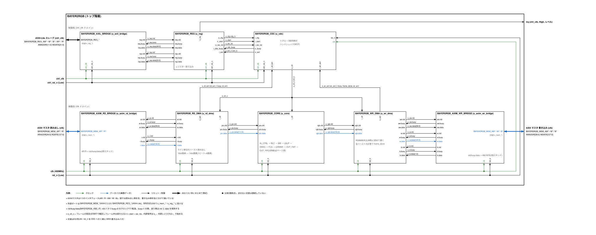

draw.io のファイル: [`doc/arch/bayer2rgb_arch.drawio`](../arch/bayer2rgb_arch.drawio)(1ページ目: トップ、2ページ目: CORE)。SVG にも draw.io のデータが入っているので、SVG を draw.io で開いて編集することもできます。

図の約束: クロックは緑、データパス(画像データ)は青、リセット・制御は黒、AXI はやや太い1本の線。分岐は黒丸、黒丸のない交差は接続していません。

| インスタンス | モジュール | クロック | 機能 |
|---|---|---|---|
| u_axil_bridge | BAYER2RGB_AXIL_BRIDGE | ctrl_clk | AXI4-Lite スレーブ ⇔ レジスタアクセス要求(vld/busy/data) |
| u_reg | BAYER2RGB_REG | ctrl_clk | レジスタ、START/SW_RESET の要求、割り込み |
| u_cdc | BAYER2RGB_CDC | ctrl_clk / clk | 設定と要求を映像系へ、イベントを制御系へ渡す |
| u_axim_rd_bridge | BAYER2RGB_AXIM_RD_BRIDGE | clk | 読み出し要求・データ(vld/busy/data) ⇔ AXI4 AR/R |
| u_rd_dma | BAYER2RGB_RD_DMA | clk | Bayer 画像のライン単位のバースト読み出し、読み出しバッファ |
| u_core | BAYER2RGB_CORE | clk | 画像処理(4.2) |
| u_wr_dma | BAYER2RGB_WR_DMA | clk | RGB888 への詰め替え、書き込みバッファ、ライン単位のバースト書き込み |
| u_axim_wr_bridge | BAYER2RGB_AXIM_WR_BRIDGE | clk | 書き込み要求・データ・応答(vld/busy/data) ⇔ AXI4 AW/W/B |

### 4.2 CORE

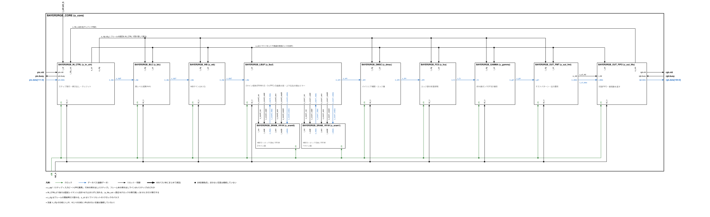

| インスタンス | モジュール | 遅れ(クロック) | 機能 |
|---|---|---:|---|
| u_in_ctrl | BAYER2RGB_IN_CTRL | - | ステップの発行(入力ビート、行末・フレーム末の掃き出し)、クレジット制御 |
| u_blc | BAYER2RGB_BLC | 1 | 黒レベル補正 |
| u_wb | BAYER2RGB_WB | 2 | ホワイトバランス |
| u_lbuf | BAYER2RGB_LBUF | 2 | ラインバッファ(SRAM 2個)と 3ライン×(PPC+2)画素の窓 |
| u_sram0 / u_sram1 | BAYER2RGB_SRAM_1R1W | 1 | ラインバッファ(2ライン前 / 1ライン前) |
| u_dmsc | BAYER2RGB_DMSC | 2 | バイリニア補間とエッジ量 |
| u_fcs | BAYER2RGB_FCS | 3 | エッジ部の彩度抑制 |
| u_gamma | BAYER2RGB_GAMMA | 3 | ガンマ(折れ線)/ 線形、14bit → 8bit |
| u_out_fmt | BAYER2RGB_OUT_FMT | 1 | テストパターンの差し替え、出力ビートの整形 |
| u_out_fifo | BAYER2RGB_OUT_FIFO | 3 | 出力FIFO(32段 + 先読み2段) |

IN_CTRL より後ろは止まらずに流れるパイプラインです(合計14クロック)。出力側(WR_DMA)の詰まりは出力FIFOとクレジット制御で吸収します(9.8)。

### 4.3 ファイル構成

| ディレクトリ | 内容 |
|---|---|
| `rtl/` | RTL(`rtl.f` がファイルリスト)。`bayer2rgb_lint.vlt` は Verilator の lint の除外設定 |
| `model/` | 製品IPの振る舞いモデル(SRAM、同期化セル)。`model.f` |
| `tb/` | UVM 検証環境(`tb.f`)。`tb/uvm/` にクラス |
| `sim/` | Makefile、回帰試験(`run_regress.sh`、`tests.list`)、Xcelium の波形設定 |
| `tools/` | Python のリファレンスモデル、画像の生成・変換、照合、コーディング規約の検査 |
| `doc/arch/` | ブロック図(draw.io、SVG) |
| `doc/spec/` | この仕様書、端子表(`pins/`)、波形図(`wave/`) |
| `doc/tools/` | 図・端子表・波形図・仕様書を作るスクリプト |

## 5. 外部インタフェース

### 5.1 端子表(BAYER2RGB)

極性の「-」はデータ(多ビット)を表します。ビット幅は PPC=8 の値です。

| 信号名 | 入出力 | 信号仕様 | ビット幅 | 極性 |
|---|---|---|---|---|
| clk | 入力 | 映像系クロック(AXI4マスタ・画像処理)。400MHz | 1 | 立ち上がり |
| rst_n | 入力 | 映像系リセット。非同期アサート・同期解除(同期化は外部) | 1 | Low |
| ctrl_clk | 入力 | 制御系クロック(AXI4-Liteスレーブ・レジスタ) | 1 | 立ち上がり |
| ctrl_rst_n | 入力 | 制御系リセット。非同期アサート・同期解除(同期化は外部) | 1 | Low |
| irq | 出力 | 割り込み。IRQ_STATUS と IRQ_ENABLE の論理積のOR(レベル、ctrl_clk同期) | 1 | High |
| BAYER2RGB_REG_AWADDR | 入力 | 書き込みアドレス(バイトアドレス。下位2ビットは見ない) | 12 | - |
| BAYER2RGB_REG_AWPROT | 入力 | 保護属性(使わない) | 3 | - |
| BAYER2RGB_REG_AWVALID | 入力 | 書き込みアドレスが有効 | 1 | High |
| BAYER2RGB_REG_AWREADY | 出力 | 書き込みアドレスを受け付けた | 1 | High |
| BAYER2RGB_REG_WDATA | 入力 | 書き込みデータ | 32 | - |
| BAYER2RGB_REG_WSTRB | 入力 | バイトイネーブル | 4 | - |
| BAYER2RGB_REG_WVALID | 入力 | 書き込みデータが有効 | 1 | High |
| BAYER2RGB_REG_WREADY | 出力 | 書き込みデータを受け付けた | 1 | High |
| BAYER2RGB_REG_BRESP | 出力 | 書き込み応答(常にOKAY) | 2 | - |
| BAYER2RGB_REG_BVALID | 出力 | 書き込み応答が有効 | 1 | High |
| BAYER2RGB_REG_BREADY | 入力 | 書き込み応答を受け取れる | 1 | High |
| BAYER2RGB_REG_ARADDR | 入力 | 読み出しアドレス(バイトアドレス。下位2ビットは見ない) | 12 | - |
| BAYER2RGB_REG_ARPROT | 入力 | 保護属性(使わない) | 3 | - |
| BAYER2RGB_REG_ARVALID | 入力 | 読み出しアドレスが有効 | 1 | High |
| BAYER2RGB_REG_ARREADY | 出力 | 読み出しアドレスを受け付けた | 1 | High |
| BAYER2RGB_REG_RDATA | 出力 | 読み出しデータ(未定義のアドレスは0) | 32 | - |
| BAYER2RGB_REG_RRESP | 出力 | 読み出し応答(常にOKAY) | 2 | - |
| BAYER2RGB_REG_RVALID | 出力 | 読み出しデータが有効 | 1 | High |
| BAYER2RGB_REG_RREADY | 入力 | 読み出しデータを受け取れる | 1 | High |
| BAYER2RGB_MEM_AWID | 出力 | 書き込みID(常に0) | 4 | - |
| BAYER2RGB_MEM_AWADDR | 出力 | 書き込みアドレス(16バイト境界) | 40 | - |
| BAYER2RGB_MEM_AWLEN | 出力 | バーストのビート数-1(0〜15) | 8 | - |
| BAYER2RGB_MEM_AWSIZE | 出力 | 1ビートのバイト数(常に4 = 16バイト) | 3 | - |
| BAYER2RGB_MEM_AWBURST | 出力 | バーストの種類(常に1 = INCR) | 2 | - |
| BAYER2RGB_MEM_AWLOCK | 出力 | 排他アクセス(常に0) | 1 | High |
| BAYER2RGB_MEM_AWCACHE | 出力 | キャッシュ属性(AXI_ATTR.AWCACHE) | 4 | - |
| BAYER2RGB_MEM_AWPROT | 出力 | 保護属性(AXI_ATTR.AWPROT) | 3 | - |
| BAYER2RGB_MEM_AWQOS | 出力 | QoS(AXI_ATTR.AWQOS) | 4 | - |
| BAYER2RGB_MEM_AWVALID | 出力 | 書き込み要求が有効 | 1 | High |
| BAYER2RGB_MEM_AWREADY | 入力 | 書き込み要求を受け付けた | 1 | High |
| BAYER2RGB_MEM_WDATA | 出力 | 書き込みデータ(RGB888をR,G,B順に詰めたもの。バイト0が下位) | 128 | - |
| BAYER2RGB_MEM_WSTRB | 出力 | バイトイネーブル(ラインの最後の端数ビートだけ下位8バイト) | 16 | - |
| BAYER2RGB_MEM_WLAST | 出力 | バーストの最後のビート | 1 | High |
| BAYER2RGB_MEM_WVALID | 出力 | 書き込みデータが有効 | 1 | High |
| BAYER2RGB_MEM_WREADY | 入力 | 書き込みデータを受け付けた | 1 | High |
| BAYER2RGB_MEM_BID | 入力 | 応答ID(見ない) | 4 | - |
| BAYER2RGB_MEM_BRESP | 入力 | 書き込み応答(OKAY以外は IRQ_STATUS.WR_ERR) | 2 | - |
| BAYER2RGB_MEM_BVALID | 入力 | 書き込み応答が有効 | 1 | High |
| BAYER2RGB_MEM_BREADY | 出力 | 書き込み応答を受け取れる(常に受け取る) | 1 | High |
| BAYER2RGB_MEM_ARID | 出力 | 読み出しID(常に0) | 4 | - |
| BAYER2RGB_MEM_ARADDR | 出力 | 読み出しアドレス(16バイト境界) | 40 | - |
| BAYER2RGB_MEM_ARLEN | 出力 | バーストのビート数-1(0〜15) | 8 | - |
| BAYER2RGB_MEM_ARSIZE | 出力 | 1ビートのバイト数(常に4 = 16バイト) | 3 | - |
| BAYER2RGB_MEM_ARBURST | 出力 | バーストの種類(常に1 = INCR) | 2 | - |
| BAYER2RGB_MEM_ARLOCK | 出力 | 排他アクセス(常に0) | 1 | High |
| BAYER2RGB_MEM_ARCACHE | 出力 | キャッシュ属性(AXI_ATTR.ARCACHE) | 4 | - |
| BAYER2RGB_MEM_ARPROT | 出力 | 保護属性(AXI_ATTR.ARPROT) | 3 | - |
| BAYER2RGB_MEM_ARQOS | 出力 | QoS(AXI_ATTR.ARQOS) | 4 | - |
| BAYER2RGB_MEM_ARVALID | 出力 | 読み出し要求が有効 | 1 | High |
| BAYER2RGB_MEM_ARREADY | 入力 | 読み出し要求を受け付けた | 1 | High |
| BAYER2RGB_MEM_RID | 入力 | 応答ID(見ない) | 4 | - |
| BAYER2RGB_MEM_RDATA | 入力 | 読み出しデータ(16bit×8画素。各16bitの下位14bitを使う) | 128 | - |
| BAYER2RGB_MEM_RRESP | 入力 | 読み出し応答(OKAY以外は IRQ_STATUS.RD_ERR) | 2 | - |
| BAYER2RGB_MEM_RLAST | 入力 | バーストの最後のビート | 1 | High |
| BAYER2RGB_MEM_RVALID | 入力 | 読み出しデータが有効 | 1 | High |
| BAYER2RGB_MEM_RREADY | 出力 | 読み出しデータを受け取れる | 1 | High |

AXI4 の AxREGION、AxUSER、WUSER、BUSER、RUSER は持ちません(つなぐ側で0にしてください)。AXI4 には WID がありません [R6]。

### 5.2 AXI4 マスタ(BAYER2RGB_MEM_*)の使い方

| 項目 | 内容 |
|---|---|
| ID | AWID = ARID = 0(1種類だけ)。BID / RID は見ない。応答は要求の順に返る前提(AXI4 の同じIDの順序規則) |
| 転送の大きさ | AxSIZE = 4(16バイト)。すべてのビートが16バイト境界 |
| バースト | AxBURST = INCR、AxLEN = 0〜15(1〜16ビート)、AxLOCK = 0 |
| バーストの切れ目 | ラインごとに、min(16, ラインの残りのビート数, 4KB境界までのビート数) で区切る。4KB 境界はまたがない |
| 同時発行 | 読み出し4バースト、書き込み4バーストまで(応答を受け終えていないバースト数) |
| 読み出しの受け取り | 要求を出す前に読み出しバッファ(64ビート)の空きを予約するので、RREADY は常に1(ソフトリセットの後始末中も受けて捨てる) |
| 書き込みの順序 | 1バースト分のデータが書き込みバッファにそろってから AW を出す。W は AW の受け付けを待たずに出す(AXI4 で許される)。BREADY は常に1 |
| 書き込みの端数 | ラインのバイト数(幅×3)が16の倍数でないとき(幅 ≡ 8 mod 16)、ラインの最後のビートは下位8バイトだけ書く(WSTRB = 0x00FF、残りの WDATA は0) |
| AxCACHE / AxPROT / AxQOS | AXI_ATTR レジスタの値(リセット値: AxCACHE = 0b0011、AxPROT = 0、AxQOS = 0) |
| エラー応答 | RRESP / BRESP が OKAY 以外のとき IRQ_STATUS の RD_ERR / WR_ERR を立てる。データはそのまま使い、処理は続ける(ソフトウェアがそのフレームを捨てる) |
| 出力のFF | AXI 側の出力はすべて FF から出す(BRIDGE の2段スキッド) |

AXI4 の規則(VALID は READY まで下げない、値を保持する、W は AW より先に来てもよい)は ARM の仕様 [R6] に従います。

### 5.3 AXI4-Lite スレーブ(BAYER2RGB_REG_*)の使い方

| 項目 | 内容 |
|---|---|
| アドレス | バイトアドレス12bit。下位2bitは見ない(32bit単位) |
| 書き込み | AW と W は別々に受け取り、両方そろったら書き込む。WSTRB のバイト単位で書く |
| 読み出し・書き込みの順序 | 1つずつ処理する。読み出しと書き込みが同時に待っているときは交互に処理する |
| 応答 | BRESP / RRESP は常に OKAY。未定義のアドレスは書き込みを無視し、読み出しは0 |
| AxPROT | 見ない |
| 応答までのクロック | 書き込み: AW と W がそろってから約4 ctrl_clk。読み出し: AR から約4 ctrl_clk(9.2 の波形) |

### 5.4 メモリ上の形式

#### 入力(Bayer 画像)

- 先頭アドレス `SRC_ADDR`(16バイト境界)、ラインの間隔 `SRC_STRIDE` バイト(16の倍数、幅×2 以上)。
- 1画素 = 16bit(リトルエンディアン)。ビット [13:0] が画素値、[15:14] は無視します。
- 1ラインは 幅×2 バイト(幅は8の倍数なので、16バイトの整数倍)。

```
SRC_ADDR + y*SRC_STRIDE + 2*x : 画素 (x, y) の下位バイト
                         +1   : 画素 (x, y) の上位バイト([15:14] は無視)
```

#### 出力(RGB888)

- 先頭アドレス `DST_ADDR`(16バイト境界)、ラインの間隔 `DST_STRIDE` バイト(16の倍数、幅×3 以上)。
- 1画素 = 3バイト。R, G, B の順に隙間なく並べます。

```
DST_ADDR + y*DST_STRIDE + 3*x + 0 : 画素 (x, y) の R
                              + 1 : 画素 (x, y) の G
                              + 2 : 画素 (x, y) の B
```

- ラインの最後の16バイトのうち、ラインの外側(幅×3 バイトより後ろ)は書きません(WSTRB=0)。
- 入力と出力の領域を重ねないでください(同じ領域での変換はできません)。

### 5.5 割り込み

`irq` = OR(IRQ_STATUS[i] AND IRQ_ENABLE[i])。`ctrl_clk` に同期したレベル出力(High)で、IRQ_STATUS に1を書いてクリアすると下がります(7.2)。

## 6. 画像処理(ビット精度の定義)

ここに書いた式が RTL、SystemVerilog のリファレンスモデル(`tb/uvm/b2r_ref_model.svh`)、Python のリファレンスモデル(`tools/b2r_model.py`)の共通の定義です。`>>` は右シフト(切り捨て)、`>>>` は算術右シフト(負の数は −∞ 方向)を表します。

### 6.1 有効な大きさ

```
W = (clamp(ACTIVE_WIDTH,  16, 3840)) & ~7     // 8の倍数に切り捨て
H = (clamp(ACTIVE_HEIGHT, 16, 2160)) & ~1     // 偶数に切り捨て
K = W / PPC                                   // 1ラインのビート数(CORE)
```

### 6.2 色の位置

BAYER_PHASE = 0:RGGB、1:GRBG、2:GBRG、3:BGGR(画像の左上 2×2 を左→右、上→下に読んだ並び [R1][R2])。

```
site(x, y) = { (y & 1) ^ PHASE[1], (x & 1) ^ PHASE[0] }    // 0:R 1:Gr 2:Gb 3:B
```

Gr は R と同じ行の G、Gb は B と同じ行の G です。

### 6.3 黒レベル補正(BLC)

```
q = BLC_EN ? max(p - blc[site], 0) : p          // p: 入力の14bit、blc[]: 14bit
```

### 6.4 ホワイトバランス(WB)

```
g = WB_EN ? wbg[site] : 0x1000                  // U4.12(0x1000 = 1.0倍、最大 15.9998倍)
q = min(16383, (p * g + 2048) >> 12)            // 四捨五入してクリップ
```

### 6.5 画像の端

デモザイクは 3×3 の近傍を使います。画像の外側はミラー(reflect-101)で補います [R3]。

```
x = -1 → x = 1、x = W → x = W-2、y = -1 → y = 1、y = H → y = H-2
```

### 6.6 デモザイク(バイリニア補間)

中心を c、上下左右を N/S/W/E、斜めを NW/NE/SW/SE とします(すべて 6.4 の出力)。

```
G4 = (N + S + W + E + 2) >> 2
D4 = (NW + NE + SW + SE + 2) >> 2
H2 = (W + E + 1) >> 1
V2 = (N + S + 1) >> 1
```

| 中心の色 | R | G | B | エッジ量 E |
|---|---|---|---|---|
| R | c | G4 | D4 | max(\|N−S\|, \|W−E\|) |
| Gr | H2 | c | V2 | max(\|NW−SE\|, \|NE−SW\|) |
| Gb | V2 | c | H2 | max(\|NW−SE\|, \|NE−SW\|) |
| B | D4 | G4 | c | max(\|N−S\|, \|W−E\|) |

エッジ量は同じ色どうしの差です(R/B の位置では上下・左右の G、G の位置では斜めの G)。

バイパス(CONTROL.BYPASS=1): (R, G, B) = (c, c, c)、E = 0。BLC と WB は通します。

### 6.7 エッジ部の彩度抑制(FCS)

```
Y  = (R + 2G + B + 2) >> 2
ex = max(E - FCS_TH, 0)
t  = (ex * FCS_GAIN) >> 6
k  = (FCS_EN && !BYPASS) ? 256 - min(256, t) : 256
X' = clip(Y + (((X - Y) * k + 128) >>> 8), 0, 16383)      // X = R, G, B
```

k = 256 のとき X' = X、k = 0 のとき X' = Y(無彩色)になります。エッジ量が FCS_TH を超えた分に比例して色差を縮めます。

### 6.8 ガンマ

GAMMA_EN=1 のとき 37点の折れ線で 14bit → 8bit に変換します。折れ点の入力値 x は固定で、出力値(8.4 固定小数点、12bit)はレジスタで設定します。

```
x の折れ点: 0, 16, 32, 48, 64, 80, 96, 112, 128, 160, 192, 224, ..., 8192, 10240, 12288, 14336, 16384
            (64 未満は16ごと、64 以上は 2のべき乗ごとに4区間)

区間 s と区間内の位置 f(0〜2047):
  x < 64      : s = x[5:4]、        f = x[3:0] << 7
  x ≥ 64      : p = 最上位の1の位置(6〜13)
                s = 4 + 4*(p-6) + x[p-1:p-2]、 f = (x の [p-3:0] を11bitに左詰め)
y   = knot[s] + (((knot[s+1] - knot[s]) * f + 1024) >>> 11)
out = min(255, (y + 8) >> 4)
```

GAMMA_EN=0 のとき(線形): `out = min(255, (x + 32) >> 6)`

既定値(リセット値)は sRGB の変換曲線 [R7] を折れ点で近似したものです。

| 番号 | 入力 x(14bit) | 既定値(8.4固定小数点) | 8bit 換算 | 番号 | 入力 x(14bit) | 既定値(8.4固定小数点) | 8bit 換算 |
|---:|---:|---:|---:|---:|---:|---:|---:|
| 0 | 0 | 0 | 0.00 | 19 | 896 | 1058 | 66.12 |
| 1 | 16 | 51 | 3.19 | 20 | 1024 | 1131 | 70.69 |
| 2 | 32 | 103 | 6.44 | 21 | 1280 | 1264 | 79.00 |
| 3 | 48 | 154 | 9.62 | 22 | 1536 | 1381 | 86.31 |
| 4 | 64 | 203 | 12.69 | 23 | 1792 | 1487 | 92.94 |
| 5 | 80 | 244 | 15.25 | 24 | 2048 | 1585 | 99.06 |
| 6 | 96 | 281 | 17.56 | 25 | 2560 | 1762 | 110.12 |
| 7 | 112 | 315 | 19.69 | 26 | 3072 | 1919 | 119.94 |
| 8 | 128 | 346 | 21.62 | 27 | 3584 | 2061 | 128.81 |
| 9 | 160 | 401 | 25.06 | 28 | 4096 | 2191 | 136.94 |
| 10 | 192 | 451 | 28.19 | 29 | 5120 | 2427 | 151.69 |
| 11 | 224 | 495 | 30.94 | 30 | 6144 | 2636 | 164.75 |
| 12 | 256 | 537 | 33.56 | 31 | 7168 | 2826 | 176.62 |
| 13 | 320 | 611 | 38.19 | 32 | 8192 | 3000 | 187.50 |
| 14 | 384 | 677 | 42.31 | 33 | 10240 | 3315 | 207.19 |
| 15 | 448 | 736 | 46.00 | 34 | 12288 | 3594 | 224.62 |
| 16 | 512 | 791 | 49.44 | 35 | 14336 | 3847 | 240.44 |
| 17 | 640 | 890 | 55.62 | 36 | 16384 | 4080 | 255.00 |
| 18 | 768 | 978 | 61.12 |  |  |  |  |

### 6.9 出力とテストパターン

CONTROL.TEST_PATTERN=1 のとき、入力メモリを読まずに(RD_DMA は値0のビートを同じ数だけ CORE に送る)、出力をテストパターンに置き換えます。x, y は出力画素の座標です。

| TPG_SEL | パターン | 値 |
|---|---|---|
| 0 | カラーバー | 幅を8等分(バー番号 b = 0〜7)。白, 黄, シアン, 緑, マゼンタ, 赤, 青, 黒。R = ~b[1]、G = ~b[2]、B = ~b[0]。各ビットを8bitに広げる |
| 1 | ランプ | R = G = B = x[11:4] |
| 2 | チェッカー | 64画素の市松。(x[6] ^ y[6]) ? 255 : 0 |
| 3 | 単色 | TPG_COLOR の {R[23:16], G[15:8], B[7:0]} |

## 7. レジスタ

### 7.1 レジスタマップ

アクセス: RW = 読み書き、RO = 読み出し専用、W1C = 1を書いたビットを0にする、WO = 書き込みのみ(読むと0)。未定義のビットは書き込みを無視し、読むと0です。

| アドレス | 名前 | アクセス | リセット値 | 内容 |
|---|---|---|---|---|
| 0x000 | CONTROL | RW / WO | 0x0000_0002 | 開始、設定の取り込み、バイパス、テストパターン、自動再開、ソフトリセット |
| 0x004 | STATUS | RO | 0x0000_0000 | 動作中 |
| 0x008 | IRQ_STATUS | W1C | 0x0000_0000 | 割り込みの要因 |
| 0x00C | IRQ_ENABLE | RW | 0x0000_0000 | 割り込みの許可 |
| 0x010 | VERSION | RO | 0x0001_0000 | IP の版 |
| 0x014 | HWCFG0 | RO | 0x0870_0F00 | 最大の高さ・幅 |
| 0x018 | HWCFG1 | RO | 0x2810_0E08 | アドレス幅、ビートのバイト数、入力ビット幅、PPC(PPC=8 の値) |
| 0x01C | FRAME_COUNT | RO | 0x0000_0000 | 完了したフレームの数 |
| 0x020 | ACTIVE_WIDTH | RW | 0x0000_0F00 | 幅(画素) |
| 0x024 | ACTIVE_HEIGHT | RW | 0x0000_0870 | 高さ(ライン) |
| 0x028 | BAYER_PHASE | RW | 0x0000_0000 | Bayer の並び |
| 0x02C | FUNC_EN | RW | 0x0000_000F | 機能ごとの有効 |
| 0x030 | BLC_R_GR | RW | 0x0000_0000 | 黒レベル(R、Gr) |
| 0x034 | BLC_GB_B | RW | 0x0000_0000 | 黒レベル(Gb、B) |
| 0x038 | WB_R_GR | RW | 0x1000_1000 | WB ゲイン(R、Gr) |
| 0x03C | WB_GB_B | RW | 0x1000_1000 | WB ゲイン(Gb、B) |
| 0x040 | FCS_PARAM | RW | 0x0010_0100 | 彩度抑制のしきい値と傾き |
| 0x044 | TPG_SEL | RW | 0x0000_0000 | テストパターンの種類 |
| 0x048 | TPG_COLOR | RW | 0x0000_0000 | 単色パターンの色 |
| 0x050 | SRC_ADDR_L | RW | 0x0000_0000 | 入力の先頭アドレス [31:4] |
| 0x054 | SRC_ADDR_H | RW | 0x0000_0000 | 入力の先頭アドレス [39:32] |
| 0x058 | SRC_STRIDE | RW | 0x0000_0000 | 入力のライン間隔(バイト) |
| 0x060 | DST_ADDR_L | RW | 0x0000_0000 | 出力の先頭アドレス [31:4] |
| 0x064 | DST_ADDR_H | RW | 0x0000_0000 | 出力の先頭アドレス [39:32] |
| 0x068 | DST_STRIDE | RW | 0x0000_0000 | 出力のライン間隔(バイト) |
| 0x070 | AXI_ATTR | RW | 0x0000_0033 | AXI4 マスタの AxCACHE / AxPROT / AxQOS |
| 0x100〜0x148 | GAMMA_KNOT0〜18 | RW | sRGB(6.8) | ガンマの折れ点(1ワードに2点) |

### 7.2 各レジスタ

#### CONTROL(0x000)

| ビット | 名前 | アクセス | リセット値 | 内容 |
|---|---|---|---|---|
| 0 | START | WO | 0 | 1を書くとフレームの開始を要求する。動作中に書くと保留し、前のフレームが終わってから開始する(保留は1つ) |
| 1 | REG_UPDATE | RW | 1 | 1: 開始のときに現在のレジスタの値を取り込む。0: 前に取り込んだ設定のまま開始する(ビデオIPの「レジスタ更新」ビットと同じ考え方 [R9]) |
| 4 | BYPASS | RW | 0 | 1: デモザイクを通さず R=G=B=Bayer 値(BLC・WB 後)で出す。FCS は働かない |
| 5 | TEST_PATTERN | RW | 0 | 1: 入力メモリを読まず、テストパターンを出す(6.9) |
| 7 | AUTO_RESTART | RW | 0 | 1: フレームが終わると自動で次のフレームを開始する |
| 31 | SW_RESET | WO | 0 | 1を書くとソフトリセット(7.4)。同じ書き込みの START は無視する |

CONTROL を書くとビット 1/4/5/7 も書き換わります。START だけを立てるときも、これらのビットに今の値を入れて書いてください。

BYPASS と TEST_PATTERN も、REG_UPDATE=1 で開始したときに取り込まれます(フレームの途中では変わりません)。

#### STATUS(0x004)

| ビット | 名前 | 内容 |
|---|---|---|
| 0 | BUSY | 1: 開始の保留中、フレームの処理中、またはソフトリセットの後始末中 |

#### IRQ_STATUS(0x008)/ IRQ_ENABLE(0x00C)

| ビット | 名前 | 内容 |
|---|---|---|
| 0 | FRAME_DONE | フレームの書き込みがすべて終わった(全バーストの書き込み応答を受けた) |
| 1 | RD_ERR | 読み出しのエラー応答(RRESP ≠ OKAY)を受けた |
| 2 | WR_ERR | 書き込みのエラー応答(BRESP ≠ OKAY)を受けた |

IRQ_STATUS は1を書いたビットを0にします。クリアと要因の発生が同じクロックのときは要因を優先します。ソフトリセットでは IRQ_STATUS はクリアしません。

#### VERSION(0x010)、HWCFG0(0x014)、HWCFG1(0x018)

| レジスタ | ビット | 内容 |
|---|---|---|
| VERSION | 31:0 | 0x0001_0000(版 1.0) |
| HWCFG0 | 15:0 | 最大の幅 3840 |
| HWCFG0 | 31:16 | 最大の高さ 2160 |
| HWCFG1 | 7:0 | PPC(1/2/4/8) |
| HWCFG1 | 15:8 | 入力の画素のビット数 14 |
| HWCFG1 | 23:16 | AXI4 マスタの1ビートのバイト数 16 |
| HWCFG1 | 31:24 | AXI4 マスタのアドレス幅 40 |

#### FRAME_COUNT(0x01C)

完了したフレームの数(32bit、一周する)。ソフトリセットで0になります。

#### ACTIVE_WIDTH(0x020)、ACTIVE_HEIGHT(0x024)

| レジスタ | ビット | 内容 |
|---|---|---|
| ACTIVE_WIDTH | 11:0 | 幅(画素)。有効値は 6.1 のとおり(16〜3840、8の倍数に切り捨て) |
| ACTIVE_HEIGHT | 11:0 | 高さ(ライン)。有効値は 6.1 のとおり(16〜2160、偶数に切り捨て) |

レジスタには書いた値がそのまま残ります(読み出し値はクランプ前の値)。

#### BAYER_PHASE(0x028)

| ビット | 内容 |
|---|---|
| 1:0 | 0: RGGB、1: GRBG、2: GBRG、3: BGGR(画像の切り出し・反転で並びが変わるので、フレームごとに設定できるようにしている [R10]) |

#### FUNC_EN(0x02C)

| ビット | 名前 | 内容 |
|---|---|---|
| 0 | BLC_EN | 黒レベル補正 |
| 1 | WB_EN | ホワイトバランス(0 のとき 1.0倍) |
| 2 | FCS_EN | エッジ部の彩度抑制 |
| 3 | GAMMA_EN | ガンマ(0 のとき線形) |

#### BLC_R_GR(0x030)、BLC_GB_B(0x034)

| レジスタ | ビット | 内容 |
|---|---|---|
| BLC_R_GR | 13:0 | R の黒レベル |
| BLC_R_GR | 29:16 | Gr の黒レベル |
| BLC_GB_B | 13:0 | Gb の黒レベル |
| BLC_GB_B | 29:16 | B の黒レベル |

#### WB_R_GR(0x038)、WB_GB_B(0x03C)

| レジスタ | ビット | 内容 |
|---|---|---|
| WB_R_GR | 15:0 | R のゲイン(U4.12、0x1000 = 1.0) |
| WB_R_GR | 31:16 | Gr のゲイン |
| WB_GB_B | 15:0 | Gb のゲイン |
| WB_GB_B | 31:16 | B のゲイン |

#### FCS_PARAM(0x040)

| ビット | 名前 | 内容 |
|---|---|---|
| 13:0 | FCS_TH | 彩度を下げ始めるエッジ量(リセット値 256) |
| 23:16 | FCS_GAIN | 傾き。エッジ量が FCS_TH を 64×256/FCS_GAIN 超えると無彩色になる(リセット値 16 → 1024) |

#### TPG_SEL(0x044)、TPG_COLOR(0x048)

| レジスタ | ビット | 内容 |
|---|---|---|
| TPG_SEL | 1:0 | 0: カラーバー、1: ランプ、2: チェッカー、3: 単色 |
| TPG_COLOR | 23:0 | 単色の色 {R[23:16], G[15:8], B[7:0]} |

#### SRC_ADDR_L / H、SRC_STRIDE、DST_ADDR_L / H、DST_STRIDE(0x050〜0x068)

| レジスタ | ビット | 内容 |
|---|---|---|
| xxx_ADDR_L | 31:4 | 先頭アドレスの [31:4]。[3:0] は書けない(読むと0、16バイト境界) |
| xxx_ADDR_H | 7:0 | 先頭アドレスの [39:32] |
| xxx_STRIDE | 23:4 | ライン間隔(バイト)。[3:0] は書けない(16の倍数) |

SRC_STRIDE ≥ 幅×2、DST_STRIDE ≥ 幅×3 を16の倍数に切り上げた値、としてください(IP は検査しません)。

#### AXI_ATTR(0x070)

| ビット | 名前 | リセット値 |
|---|---|---|
| 3:0 | ARCACHE | 0b0011(Normal Non-cacheable Bufferable) |
| 7:4 | AWCACHE | 0b0011 |
| 10:8 | ARPROT | 0 |
| 14:12 | AWPROT | 0 |
| 19:16 | ARQOS | 0 |
| 23:20 | AWQOS | 0 |

#### GAMMA_KNOT0〜18(0x100〜0x148)

| レジスタ | ビット | 内容 |
|---|---|---|
| GAMMA_KNOTn(アドレス 0x100 + 4n) | 11:0 | 折れ点 knot[2n] の出力値(8.4 固定小数点) |
| GAMMA_KNOTn | 27:16 | 折れ点 knot[2n+1] の出力値(n = 18 は無し。knot は 0〜36) |

### 7.3 使い方

#### 1フレームの処理

```
1. IRQ_ENABLE に割り込みの許可を書く(使う場合)
2. ACTIVE_WIDTH / ACTIVE_HEIGHT / BAYER_PHASE / FUNC_EN / BLC / WB / FCS / TPG / GAMMA_KNOT を書く
3. SRC_ADDR_L/H、SRC_STRIDE、DST_ADDR_L/H、DST_STRIDE を書く
4. CONTROL に START=1、REG_UPDATE=1(と BYPASS / TEST_PATTERN / AUTO_RESTART)を書く
5. irq を待つ(または IRQ_STATUS.FRAME_DONE を読んで待つ)
6. IRQ_STATUS を読み、RD_ERR / WR_ERR が0なら出力は正しい
7. IRQ_STATUS に読んだ値を書いてクリアする
```

開始のとき(REG_UPDATE=1)にレジスタの値を取り込むので、処理中にレジスタを書き換えても処理中のフレームには影響しません。次のフレームの設定を処理中に書いておけます。

#### 連続処理(AUTO_RESTART)

- AUTO_RESTART=1 で START を書くと、フレームが終わるたびに次のフレームを自動で開始します。
- REG_UPDATE=1 のときは、自動で開始するたびにその時点のレジスタの値を取り込みます。設定をまとめて変えたいときは、REG_UPDATE=0 にしてからレジスタを書き、最後に REG_UPDATE=1 に戻します(次の開始で全部が同時に変わる)。
- 止めるときは AUTO_RESTART=0 を書きます(処理中のフレームは最後まで処理する)。すぐに止めるときはソフトリセットを使います。

### 7.4 ソフトリセット(CONTROL.SW_RESET)

SW_RESET に1を書くと、処理中のフレームを中断して初期状態に戻します。

1. 制御系: 保留中の START を取り消し、FRAME_COUNT を0にする。STATUS.BUSY は後始末が終わるまで1。
2. 映像系: CORE の各段の有効ビットを消す。RD_DMA / WR_DMA は新しい要求を出すのをやめる。
3. 発行済みのバーストは AXI の規則どおり終える。読み出しはデータを受けて捨てる。書き込みは AW を出したバーストの W を送り切り、応答を受ける。まだ AW を出していないデータは捨てる。
4. すべての応答を受けたら(DMA が止まったら)制御系に完了を知らせ、STATUS.BUSY が0になる。

- レジスタの設定値と IRQ_STATUS は変わりません。中断したフレームの FRAME_DONE は立ちません。
- 出力メモリには中断したフレームの一部が書かれています。
- BUSY=0 になってから次の START を書いてください(BUSY=1 の間に書いた START は後始末の後に開始します)。

### 7.5 エラー応答

RD_ERR / WR_ERR が立っても処理は止めません。フレームの終わり(FRAME_DONE)で IRQ_STATUS を確認し、エラーがあればそのフレームを使わないでください。

## 8. 内部インタフェース(vld/busy/data)

BRIDGE、DMA、CORE の間は `BAYER2RGB_VBD_IF` でつなぎます。

| 信号 | 向き | 内容 |
|---|---|---|
| vld | 送り側 → 受け側 | data が有効 |
| busy | 受け側 → 送り側 | 受け取れない |
| data | 送り側 → 受け側 | データ(幅はパラメータ DW) |

- vld=1 かつ busy=0 のクロックで1つ転送します。
- busy=1 の間、送り側は vld と data を保持します。
- vld は busy に組み合わせで依存してはいけません(busy は vld に依存してよい)。

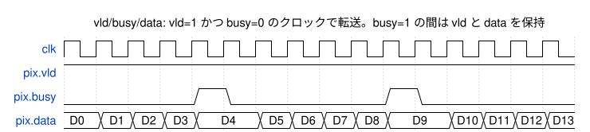

<details><summary>WaveDrom の記述(wave/vbd_if.json)</summary>

```wavedrom
{"signal": [
  {"name": "clk", "wave": "p..............."},
  {"name": "pix.vld", "wave": "1..............."},
  {"name": "pix.busy", "wave": "0...10....10...."},
  {"name": "pix.data", "wave": "=====.=====.====", "data": ["D0", "D1", "D2", "D3", "D4", "D5", "D6", "D7", "D8", "D9", "D10", "D11", "D12", "D13"]}
],
 "head": {"text": "vld/busy/data: vld=1 かつ busy=0 のクロックで転送。busy=1 の間は vld と data を保持"},
 "config": {"hscale": 1}
}
```

</details>

| リンク | 送り側 → 受け側 | data の型 | 幅 |
|---|---|---|---:|
| s_req | AXIL_BRIDGE → REG | regreq_t {we, strb[3:0], addr[11:0], wdata[31:0]} | 49 |
| s_rsp | REG → AXIL_BRIDGE | regrsp_t {resp[1:0], rdata[31:0]} | 34 |
| s_ar | RD_DMA → AXIM_RD_BRIDGE | axreq_t {qos[3:0], prot[2:0], cache[3:0], len[7:0], addr[39:0]} | 59 |
| s_r | AXIM_RD_BRIDGE → RD_DMA | rbeat_t {resp[1:0], last, data[127:0]} | 131 |
| s_pix | RD_DMA → CORE | PPC 画素 × 14bit | 112 |
| s_rgb | CORE → WR_DMA | obeat_t {eof, eol, sof, rgb[PPC×24-1:0]} | 195 |
| s_aw | WR_DMA → AXIM_WR_BRIDGE | axreq_t | 59 |
| s_w | WR_DMA → AXIM_WR_BRIDGE | wbeat_t {last, strb[15:0], data[127:0]} | 145 |
| s_b | AXIM_WR_BRIDGE → WR_DMA | BRESP[1:0] | 2 |

## 9. 各ブロックの詳細

各ブロックについて、機能、端子表、代表的な信号の波形を示します。波形図は検証環境のテスト `b2r_wave_test`(PPC=8、clk 400 MHz、ctrl_clk 100 MHz)の波形から作ったものです。最初のフレームは 40×16 画素(入力は一様乱数、blc=800、WB: R=1.75 / B=1.5、fcs_th=4000 / fcs_gain=4)、2つ目は 64×16 画素で処理の途中にソフトリセット、3つ目は 32×16 画素で書き込み側の WREADY を 40% にしています。波形図の作り方は 13.8 にあります。

端子表の共通事項:
- `clk` / `rst_n` は映像系、`ctrl_clk` / `ctrl_rst_n` は制御系のクロックとリセットです(リセットは Low、非同期アサート・同期解除)。
- vld/busy/data のポート(`BAYER2RGB_VBD_IF`)は `.vld` / `.busy` / `.data` の3行に分けて書いています。
- `cfg_t` などの構造体の中身は `rtl/BAYER2RGB_PKG.sv` にあります。

### 9.1 BAYER2RGB(トップ階層)

8つのブロックをつなぎます(4.1)。トップ階層には論理はありません。

1フレームの流れ(40×16 画素の例)を下に示します。この図だけは、8クロックを1目盛りにまとめ、その区間に転送があれば1としています。

- 制御系で START を書くと、CDC を通って映像系に start が出ます。
- RD_DMA は読み出しバッファの空きの分だけ先にバーストを出し、CORE は読み出しデータが来ると処理を始めます。
- CORE は1ライン + 1ビート遅れて出力を始めます。WR_DMA はバースト分(このサイズでは1ライン = 8ビート)のデータがそろうと AW を出します。
- 最後のバーストの書き込み応答で frame_done になり、制御系で IRQ_STATUS.FRAME_DONE と irq が立ちます。

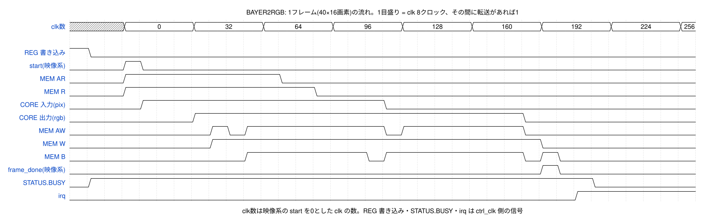

<details><summary>WaveDrom の記述(wave/top_frame.json)</summary>

```wavedrom
{"signal": [
  {"name": "clk数", "wave": "x..=...=...=...=...=...=...=...=...=", "data": ["0", "32", "64", "96", "128", "160", "192", "224", "256"]},
  {},
  {"name": "REG 書き込み", "wave": "10.................................."},
  {"name": "start(映像系)", "wave": "0..10..............................."},
  {"name": "MEM AR", "wave": "0..1........0......................."},
  {"name": "MEM R", "wave": "0..1..........0....................."},
  {"name": "CORE 入力(pix)", "wave": "0...1.............0................."},
  {"name": "CORE 出力(rgb)", "wave": "0......1..................0........."},
  {"name": "MEM AW", "wave": "0.......101.......01......0........."},
  {"name": "MEM W", "wave": "0.......1..................0........"},
  {"name": "MEM B", "wave": "0.........1......01.......010......."},
  {"name": "frame_done(映像系)", "wave": "0..........................10......."},
  {"name": "STATUS.BUSY", "wave": "01............................0....."},
  {"name": "irq", "wave": "0............................1......"}
],
 "head": {"text": "BAYER2RGB: 1フレーム(40×16画素)の流れ。1目盛り = clk 8クロック、その間に転送があれば1"},
 "config": {"hscale": 1},
 "foot": {"text": "clk数は映像系の start を0とした clk の数。REG 書き込み・STATUS.BUSY・irq は ctrl_clk 側の信号"}
}
```

</details>

### 9.2 BAYER2RGB_AXIL_BRIDGE

AXI4-Lite スレーブを、レジスタアクセス要求(`req`)と応答(`rsp`)の vld/busy/data に変換します。

- AW、W、AR はそれぞれ1つずつ受け取って保持します(受け取ったチャネルの READY は、その要求を REG に出すまで0)。AW と W が両方そろったら書き込み要求を出します。
- 読み出しと書き込みが同時に待っているときは交互に出します。要求は1つずつ処理します。
- AXI 側の出力(READY、BVALID、RVALID、RDATA など)はすべて FF から出します。

| 信号名 | 入出力 | 信号仕様 | ビット幅 | 極性 |
|---|---|---|---|---|
| ctrl_clk | 入力 | 制御系クロック(AXI4-Liteスレーブ・レジスタ) | 1 | 立ち上がり |
| ctrl_rst_n | 入力 | 制御系リセット。非同期アサート・同期解除(同期化は外部) | 1 | Low |
| BAYER2RGB_REG_AWADDR | 入力 | 書き込みアドレス(バイトアドレス。下位2ビットは見ない) | 12 | - |
| BAYER2RGB_REG_AWPROT | 入力 | 保護属性(使わない) | 3 | - |
| BAYER2RGB_REG_AWVALID | 入力 | 書き込みアドレスが有効 | 1 | High |
| BAYER2RGB_REG_AWREADY | 出力 | 書き込みアドレスを受け付けた | 1 | High |
| BAYER2RGB_REG_WDATA | 入力 | 書き込みデータ | 32 | - |
| BAYER2RGB_REG_WSTRB | 入力 | バイトイネーブル | 4 | - |
| BAYER2RGB_REG_WVALID | 入力 | 書き込みデータが有効 | 1 | High |
| BAYER2RGB_REG_WREADY | 出力 | 書き込みデータを受け付けた | 1 | High |
| BAYER2RGB_REG_BRESP | 出力 | 書き込み応答(常にOKAY) | 2 | - |
| BAYER2RGB_REG_BVALID | 出力 | 書き込み応答が有効 | 1 | High |
| BAYER2RGB_REG_BREADY | 入力 | 書き込み応答を受け取れる | 1 | High |
| BAYER2RGB_REG_ARADDR | 入力 | 読み出しアドレス(バイトアドレス。下位2ビットは見ない) | 12 | - |
| BAYER2RGB_REG_ARPROT | 入力 | 保護属性(使わない) | 3 | - |
| BAYER2RGB_REG_ARVALID | 入力 | 読み出しアドレスが有効 | 1 | High |
| BAYER2RGB_REG_ARREADY | 出力 | 読み出しアドレスを受け付けた | 1 | High |
| BAYER2RGB_REG_RDATA | 出力 | 読み出しデータ(未定義のアドレスは0) | 32 | - |
| BAYER2RGB_REG_RRESP | 出力 | 読み出し応答(常にOKAY) | 2 | - |
| BAYER2RGB_REG_RVALID | 出力 | 読み出しデータが有効 | 1 | High |
| BAYER2RGB_REG_RREADY | 入力 | 読み出しデータを受け取れる | 1 | High |
| req.vld | 出力 | REGへのアクセス要求が有効 | 1 | High |
| req.busy | 入力 | REGが要求を受け取れない | 1 | High |
| req.data | 出力 | 要求 {we, strb[3:0], addr[11:0], wdata[31:0]}(regreq_t) | 49 | - |
| rsp.vld | 入力 | REGからの応答が有効 | 1 | High |
| rsp.busy | 出力 | 応答を受け取れない(AXI側の応答を出している) | 1 | High |
| rsp.data | 入力 | 応答 {resp[1:0], rdata[31:0]}(regrsp_t) | 34 | - |

波形: IRQ_ENABLE(0x00C)への書き込み、VERSION(0x010)の読み出し、ACTIVE_WIDTH(0x020)と ACTIVE_HEIGHT(0x024)への書き込み。VALID から応答(BVALID / RVALID)まで4クロックです。

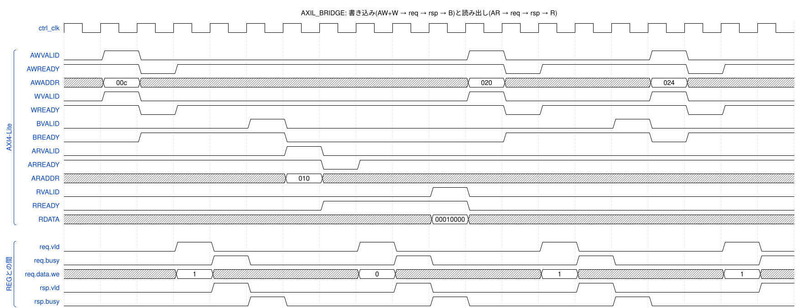

<details><summary>WaveDrom の記述(wave/axil_bridge.json)</summary>

```wavedrom
{"signal": [
  {"name": "ctrl_clk", "wave": "p..................."},
  {},
  ["AXI4-Lite",
    {"name": "AWVALID", "wave": "010........10...10.."},
    {"name": "AWREADY", "wave": "1.01........01...01."},
    {"name": "AWADDR", "wave": "x=x........=x...=x..", "data": ["00c", "020", "024"]},
    {"name": "WVALID", "wave": "010........10...10.."},
    {"name": "WREADY", "wave": "1.01........01...01."},
    {"name": "BVALID", "wave": "0....10........10..."},
    {"name": "BREADY", "wave": "0.1...0.....1...01.."},
    {"name": "ARVALID", "wave": "0.....10............"},
    {"name": "ARREADY", "wave": "1......01..........."},
    {"name": "ARADDR", "wave": "x.....=x............", "data": ["010"]},
    {"name": "RVALID", "wave": "0.........10........"},
    {"name": "RREADY", "wave": "0......1...0........"},
    {"name": "RDATA", "wave": "x.........=x........", "data": ["00010000"]}
  ],
  {},
  ["REGとの間",
    {"name": "req.vld", "wave": "0..10...10...10...10"},
    {"name": "req.busy", "wave": "0...10...10...10...1"},
    {"name": "req.data.we", "wave": "x..=x...=x...=x...=x", "data": ["1", "0", "1", "1"]},
    {"name": "rsp.vld", "wave": "0...10...10...10...1"},
    {"name": "rsp.busy", "wave": "0....10...10...10..."}
  ]
],
 "head": {"text": "AXIL_BRIDGE: 書き込み(AW+W → req → rsp → B)と読み出し(AR → req → rsp → R)"},
 "config": {"hscale": 2}
}
```

</details>

### 9.3 BAYER2RGB_REG

レジスタ(7章)を持ち、START と SW_RESET を CDC に1つずつ送り、映像系からのイベントで割り込みの要因とフレーム数を更新します。

- START は保留ビット `r_start_pend` に入れ、CDC が空いていて、フレームの処理中でもソフトリセットの後始末中でもないときに `o_start` を1クロック出します。
- SW_RESET は START より優先します。`o_sw_rst` を出してから、映像系の後始末が終わる(`i_evt.srst_done`)まで `r_srst_wait`=1 です。
- `o_irq` は FF から出します(IRQ_STATUS が変わった次のクロックで変わる)。
- `o_cfg` は現在のレジスタの値です。CDC が START のときに取り込みます。

| 信号名 | 入出力 | 信号仕様 | ビット幅 | 極性 |
|---|---|---|---|---|
| ctrl_clk | 入力 | 制御系クロック(AXI4-Liteスレーブ・レジスタ) | 1 | 立ち上がり |
| ctrl_rst_n | 入力 | 制御系リセット。非同期アサート・同期解除(同期化は外部) | 1 | Low |
| req.vld | 入力 | アクセス要求が有効 | 1 | High |
| req.busy | 出力 | 要求を受け取れない(応答を返している) | 1 | High |
| req.data | 入力 | 要求 {we, strb, addr, wdata}(regreq_t) | 49 | - |
| rsp.vld | 出力 | 応答が有効 | 1 | High |
| rsp.busy | 入力 | AXIL_BRIDGEが応答を受け取れない | 1 | High |
| rsp.data | 出力 | 応答 {resp, rdata}(regrsp_t) | 34 | - |
| o_cfg | 出力 | 現在のレジスタ値(cfg_t)。STARTのときにCDCが取り込む | 795 | - |
| o_start | 出力 | フレーム開始の要求(1クロックのパルス)。CDCが受け付けられるときだけ出す | 1 | High |
| o_sw_rst | 出力 | ソフトリセットの要求(1クロックのパルス) | 1 | High |
| i_cdc_busy | 入力 | CDCが要求を受け渡し中 | 1 | High |
| i_evt | 入力 | 映像系からのイベント {frame_done, rd_err, wr_err, srst_done}(各1クロックのパルス) | 4 | - |
| o_irq | 出力 | 割り込み(レベル) | 1 | High |

波形1: START の書き込み(we=1、addr=0x000)の次のクロックで `r_start_pend`、その次で `o_start`。CDC が受け取ると `i_cdc_busy` が受け渡しの間1になります。`r_frm_busy` は frame_done まで1です。その後のアクセスはソフトウェアが IRQ_STATUS(0x008)を読んでいるところです。

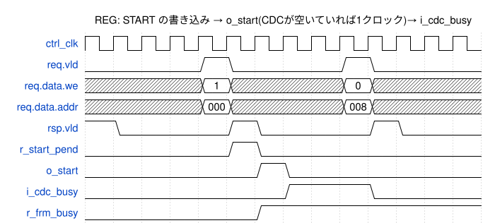

<details><summary>WaveDrom の記述(wave/reg_start.json)</summary>

```wavedrom
{"signal": [
  {"name": "ctrl_clk", "wave": "p............."},
  {"name": "req.vld", "wave": "0...10...10..."},
  {"name": "req.data.we", "wave": "x...=x...=x...", "data": ["1", "0"]},
  {"name": "req.data.addr", "wave": "x...=x...=x...", "data": ["000", "008"]},
  {"name": "rsp.vld", "wave": "10...10...10.."},
  {"name": "r_start_pend", "wave": "0....10......."},
  {"name": "o_start", "wave": "0.....10......"},
  {"name": "i_cdc_busy", "wave": "0......1..0..."},
  {"name": "r_frm_busy", "wave": "0.....1......."}
],
 "head": {"text": "REG: START の書き込み → o_start(CDCが空いていれば1クロック)→ i_cdc_busy"},
 "config": {"hscale": 1}
}
```

</details>

波形2: `i_evt.frame_done` で `r_frm_busy` が0、IRQ_STATUS[0] が1、FRAME_COUNT が+1 になり、次のクロックで `o_irq` が1になります。ソフトウェアが IRQ_STATUS を読み(we=0)、1を書く(we=1)と IRQ_STATUS[0] が0になり、次のクロックで `o_irq` が0になります。

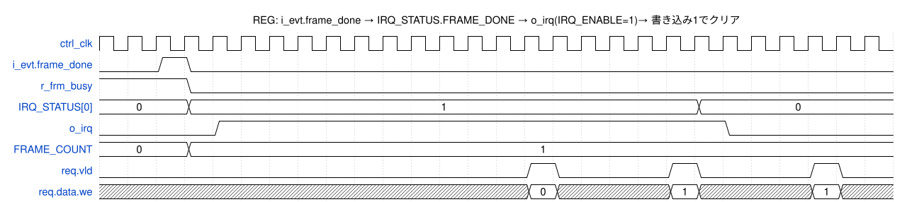

<details><summary>WaveDrom の記述(wave/reg_irq.json)</summary>

```wavedrom
{"signal": [
  {"name": "ctrl_clk", "wave": "p..........................."},
  {"name": "i_evt.frame_done", "wave": "0.10........................"},
  {"name": "r_frm_busy", "wave": "1..0........................"},
  {"name": "IRQ_STATUS[0]", "wave": "=..=.................=......", "data": ["0", "1", "0"]},
  {"name": "o_irq", "wave": "0...1.................0....."},
  {"name": "FRAME_COUNT", "wave": "=..=........................", "data": ["0", "1"]},
  {"name": "req.vld", "wave": "0..............10...10...10."},
  {"name": "req.data.we", "wave": "x..............=x...=x...=x.", "data": ["0", "1", "1"]}
],
 "head": {"text": "REG: i_evt.frame_done → IRQ_STATUS.FRAME_DONE → o_irq(IRQ_ENABLE=1)→ 書き込み1でクリア"},
 "config": {"hscale": 1}
}
```

</details>

### 9.4 BAYER2RGB_CDC

制御系と映像系の間で、設定・要求・イベントを受け渡します。多ビットのデータは同期化セルを通さず、トグルの要求と応答(ACK)だけを2段同期化します(MCP 方式 [R8])。

| 方向 | 内容 | 方式 |
|---|---|---|
| 制御系 → 映像系 | START(+ 設定 `cfg_t`)、SW_RESET | 要求トグル `r_req_c` → 2段同期 → 映像系で変化を検出。映像系が受け取った値(`r_req_d_v`)を ACK として返す。要求中は `r_pl_cfg` を変えない |
| 映像系 → 制御系 | frame_done、rd_err、wr_err、srst_done | イベントを保留ビット `r_ev_pend_v` にためて、まとめて1回のハンドシェイクで送る。送る順番は入れ替わらない |

- START: REG_UPDATE=1 なら `i_cfg` を `r_pl_cfg` に取り込んでから要求を出します。映像系は変化を検出したクロックで `r_pl_cfg` を `r_cfg_v`(フレームの設定)に移し、`o_ctl.start` を1クロック出します。
- SW_RESET: 映像系で `o_ctl.sw_rst` を1クロック出し、`r_abort_v`=1 にします。RD_DMA と WR_DMA の busy が両方0になったら `srst_done` イベントを送ります。
- 制御系の `o_busy` は要求を出してから ACK が戻るまで1です。REG はこの間に次の要求を出しません。

| 信号名 | 入出力 | 信号仕様 | ビット幅 | 極性 |
|---|---|---|---|---|
| ctrl_clk | 入力 | 制御系クロック(AXI4-Liteスレーブ・レジスタ) | 1 | 立ち上がり |
| ctrl_rst_n | 入力 | 制御系リセット。非同期アサート・同期解除(同期化は外部) | 1 | Low |
| i_cfg | 入力 | REGの現在の設定(cfg_t)。STARTのとき REG_UPDATE=1 なら取り込む | 795 | - |
| i_start | 入力 | フレーム開始の要求(パルス) | 1 | High |
| i_sw_rst | 入力 | ソフトリセットの要求(パルス) | 1 | High |
| o_busy | 出力 | 要求の受け渡し中(この間は次の要求を出さない) | 1 | High |
| o_evt | 出力 | 映像系からのイベント(evt_t、ctrl_clkの1クロックのパルス) | 4 | - |
| clk | 入力 | 映像系クロック(AXI4マスタ・画像処理)。400MHz | 1 | 立ち上がり |
| rst_n | 入力 | 映像系リセット。非同期アサート・同期解除(同期化は外部) | 1 | Low |
| o_ctl | 出力 | フレームの設定 + start + sw_rst(ctl_t、clk同期。start と sw_rst は1クロックのパルス) | 797 | - |
| i_rd_evt | 入力 | RD_DMAの状態 {busy(レベル), rd_err(パルス)} | 2 | - |
| i_wr_evt | 入力 | WR_DMAの状態 {busy(レベル), frame_done(パルス), wr_err(パルス)} | 3 | - |

波形1(START): 制御系で `i_start` → `r_req_c` が反転、`o_busy`=1。映像系で2段同期後の `s_req_v` が変わり、次のクロックで `o_ctl.start` と設定(`o_ctl.cfg.width` が 3840 → 40)が出ます。`r_req_d_v` が制御系で同期化されて `s_ack_c` になり、`o_busy` が0になります。

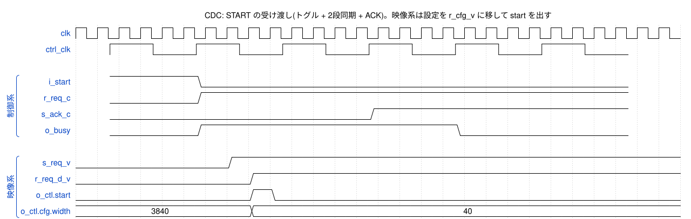

<details><summary>WaveDrom の記述(wave/cdc_start.json)</summary>

```wavedrom
{"signal": [
  {"name": "clk", "wave": "p..........................."},
  {"name": "ctrl_clk", "wave": "p.....", "period": 4, "phase": -1.58},
  {},
  ["制御系",
    {"name": "i_start", "wave": "10....", "period": 4, "phase": -1.58},
    {"name": "r_req_c", "wave": "01....", "period": 4, "phase": -1.58},
    {"name": "s_ack_c", "wave": "0..1..", "period": 4, "phase": -1.58},
    {"name": "o_busy", "wave": "01..0.", "period": 4, "phase": -1.58}
  ],
  {},
  ["映像系",
    {"name": "s_req_v", "wave": "0......1...................."},
    {"name": "r_req_d_v", "wave": "0.......1..................."},
    {"name": "o_ctl.start", "wave": "0.......10.................."},
    {"name": "o_ctl.cfg.width", "wave": "=.......=...................", "data": ["3840", "40"]}
  ]
],
 "head": {"text": "CDC: START の受け渡し(トグル + 2段同期 + ACK)。映像系は設定を r_cfg_v に移して start を出す"},
 "config": {"hscale": 1}
}
```

</details>

波形2(イベント): 映像系の `i_wr_evt.frame_done` を保留ビットに入れ、次のクロックで `r_ev_req_v` を反転して送ります。制御系では同期化後の `s_ev_req_c` の変化で `o_evt.frame_done` を1クロック出します。ACK(`s_ev_ack_v`)が戻ると `r_ev_busy_v` が0になり、次のイベントを送れます。

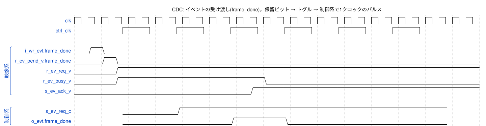

<details><summary>WaveDrom の記述(wave/cdc_event.json)</summary>

```wavedrom
{"signal": [
  {"name": "clk", "wave": "p............................."},
  {"name": "ctrl_clk", "wave": "p.....", "period": 4, "phase": -3.58},
  {},
  ["映像系",
    {"name": "i_wr_evt.frame_done", "wave": "010..........................."},
    {"name": "r_ev_pend_v.frame_done", "wave": "0.10.........................."},
    {"name": "r_ev_req_v", "wave": "0..1.........................."},
    {"name": "r_ev_busy_v", "wave": "0..1..........0..............."},
    {"name": "s_ev_ack_v", "wave": "0............1................"}
  ],
  {},
  ["制御系",
    {"name": "s_ev_req_c", "wave": "01....", "period": 4, "phase": -3.58},
    {"name": "o_evt.frame_done", "wave": "0.10..", "period": 4, "phase": -3.58}
  ]
],
 "head": {"text": "CDC: イベントの受け渡し(frame_done)。保留ビット → トグル → 制御系で1クロックのパルス"},
 "config": {"hscale": 1}
}
```

</details>

波形3(ソフトリセット): SW_RESET の書き込みで `r_srst_pend` → `o_sw_rst`、`r_srst_wait`=1。映像系で `o_ctl.sw_rst` が出ると、次のクロックで CORE のクリア(`s_clr`)と DMA の後始末(`r_abort`)が始まります。WR_DMA は発行済みのバーストの応答を待ち(`r_ost` が 2 → 1 → 0)、DMA が止まると `r_abort_v` が0になって `srst_done` を送ります。制御系で `i_evt.srst_done` を受けると `r_srst_wait` が0になり、STATUS.BUSY が0になります。

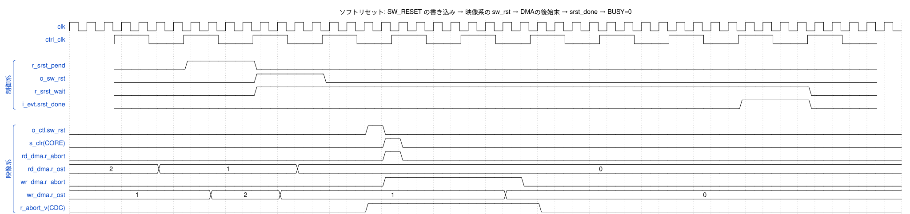

<details><summary>WaveDrom の記述(wave/sw_reset.json)</summary>

```wavedrom
{"signal": [
  {"name": "clk", "wave": "p..............................................."},
  {"name": "ctrl_clk", "wave": "p..........", "period": 4, "phase": -2.58},
  {},
  ["制御系",
    {"name": "r_srst_pend", "wave": "010........", "period": 4, "phase": -2.58},
    {"name": "o_sw_rst", "wave": "0.10.......", "period": 4, "phase": -2.58},
    {"name": "r_srst_wait", "wave": "0.1.......0", "period": 4, "phase": -2.58},
    {"name": "i_evt.srst_done", "wave": "0........10", "period": 4, "phase": -2.58}
  ],
  {},
  ["映像系",
    {"name": "o_ctl.sw_rst", "wave": "0................10............................."},
    {"name": "s_clr(CORE)", "wave": "0.................10............................"},
    {"name": "rd_dma.r_abort", "wave": "0.................10............................"},
    {"name": "rd_dma.r_ost", "wave": "=....=.......=..................................", "data": ["2", "1", "0"]},
    {"name": "wr_dma.r_abort", "wave": "0.................1.......0....................."},
    {"name": "wr_dma.r_ost", "wave": "=.......=...=............=......................", "data": ["1", "2", "1", "0"]},
    {"name": "r_abort_v(CDC)", "wave": "0................1.........0...................."}
  ]
],
 "head": {"text": "ソフトリセット: SW_RESET の書き込み → 映像系の sw_rst → DMAの後始末 → srst_done → BUSY=0"},
 "config": {"hscale": 1}
}
```

</details>

### 9.5 BAYER2RGB_AXIM_RD_BRIDGE

読み出し要求(`ar`)と読み出しデータ(`r`)の vld/busy/data を AXI4 の AR / R に変換します。

- AR と R はそれぞれ2段スキッドバッファ(9.20)を通します。AXI 側の出力はすべて FF から出ます。
- ARID=0、ARSIZE=4(16バイト)、ARBURST=INCR、ARLOCK=0 に固定します。RID は見ません。
- 遅れ: `ar` → ARVALID が1クロック、RVALID → `r` が1クロック。

| 信号名 | 入出力 | 信号仕様 | ビット幅 | 極性 |
|---|---|---|---|---|
| clk | 入力 | 映像系クロック(AXI4マスタ・画像処理)。400MHz | 1 | 立ち上がり |
| rst_n | 入力 | 映像系リセット。非同期アサート・同期解除(同期化は外部) | 1 | Low |
| BAYER2RGB_MEM_ARID | 出力 | 読み出しID(常に0) | 4 | - |
| BAYER2RGB_MEM_ARADDR | 出力 | 読み出しアドレス(16バイト境界) | 40 | - |
| BAYER2RGB_MEM_ARLEN | 出力 | バーストのビート数-1(0〜15) | 8 | - |
| BAYER2RGB_MEM_ARSIZE | 出力 | 1ビートのバイト数(常に4 = 16バイト) | 3 | - |
| BAYER2RGB_MEM_ARBURST | 出力 | バーストの種類(常に1 = INCR) | 2 | - |
| BAYER2RGB_MEM_ARLOCK | 出力 | 排他アクセス(常に0) | 1 | High |
| BAYER2RGB_MEM_ARCACHE | 出力 | キャッシュ属性(AXI_ATTR.ARCACHE) | 4 | - |
| BAYER2RGB_MEM_ARPROT | 出力 | 保護属性(AXI_ATTR.ARPROT) | 3 | - |
| BAYER2RGB_MEM_ARQOS | 出力 | QoS(AXI_ATTR.ARQOS) | 4 | - |
| BAYER2RGB_MEM_ARVALID | 出力 | 読み出し要求が有効 | 1 | High |
| BAYER2RGB_MEM_ARREADY | 入力 | 読み出し要求を受け付けた | 1 | High |
| BAYER2RGB_MEM_RID | 入力 | 応答ID(見ない) | 4 | - |
| BAYER2RGB_MEM_RDATA | 入力 | 読み出しデータ(16bit×8画素。各16bitの下位14bitを使う) | 128 | - |
| BAYER2RGB_MEM_RRESP | 入力 | 読み出し応答(OKAY以外は IRQ_STATUS.RD_ERR) | 2 | - |
| BAYER2RGB_MEM_RLAST | 入力 | バーストの最後のビート | 1 | High |
| BAYER2RGB_MEM_RVALID | 入力 | 読み出しデータが有効 | 1 | High |
| BAYER2RGB_MEM_RREADY | 出力 | 読み出しデータを受け取れる | 1 | High |
| ar.vld | 入力 | 読み出し要求が有効 | 1 | High |
| ar.busy | 出力 | 要求を受け取れない(スキッドが満杯) | 1 | High |
| ar.data | 入力 | 要求 {qos, prot, cache, len, addr}(axreq_t) | 59 | - |
| r.vld | 出力 | 読み出しデータが有効 | 1 | High |
| r.busy | 入力 | RD_DMAがデータを受け取れない | 1 | High |
| r.data | 出力 | データ {resp, last, data[127:0]}(rbeat_t) | 131 | - |

波形: フレームの始めに4バースト(1ライン = 40画素 × 2バイト = 80バイト = 5ビート、ARLEN=4、SRC_STRIDE=80)を続けて出し、RDATA を1クロック遅れで `r` に渡します。

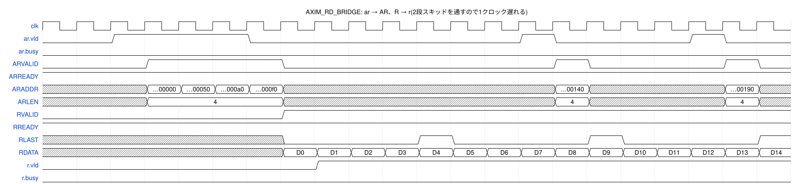

<details><summary>WaveDrom の記述(wave/axim_rd_bridge.json)</summary>

```wavedrom
{"signal": [
  {"name": "clk", "wave": "p....................."},
  {"name": "ar.vld", "wave": "0.1...0.......10...10."},
  {"name": "ar.busy", "wave": "0....................."},
  {"name": "ARVALID", "wave": "0..1...0.......10...10"},
  {"name": "ARREADY", "wave": "1....................."},
  {"name": "ARADDR", "wave": "x..====x.......=x...=x", "data": ["…00000", "…00050", "…000a0", "…000f0", "…00140", "…00190"]},
  {"name": "ARLEN", "wave": "x..=...x.......=x...=x", "data": ["4", "4", "4"]},
  {"name": "RVALID", "wave": "0......1.............."},
  {"name": "RREADY", "wave": "1....................."},
  {"name": "RLAST", "wave": "x......0...10...10...1"},
  {"name": "RDATA", "wave": "x......===============", "data": ["D0", "D1", "D2", "D3", "D4", "D5", "D6", "D7", "D8", "D9", "D10", "D11", "D12", "D13", "D14"]},
  {"name": "r.vld", "wave": "0.......1............."},
  {"name": "r.busy", "wave": "0....................."}
],
 "head": {"text": "AXIM_RD_BRIDGE: ar → AR、R → r(2段スキッドを通すので1クロック遅れる)"},
 "config": {"hscale": 2}
}
```

</details>

### 9.6 BAYER2RGB_RD_DMA

Bayer 画像をライン単位のバーストで読み出し、PPC 画素ずつ CORE に送ります。

- バースト長 = min(16, ラインの残りのビート数, 4KB 境界までのビート数)。ラインの終わりで次のライン(+SRC_STRIDE)に移ります。
- 読み出しバッファ(SFIFO、SRAM 64ビート)の空き(`r_credit`)をバースト長だけ予約してから AR を出します。R は止めません(RREADY=1)。
- 同時発行は4バーストまで(`r_ost`)。
- 1ビート(16バイト = 8画素)の各16bitの下位14bitを画素とし、PPC 画素ずつ CORE に送ります(PPC<8 のときは1ビートを 8/PPC 回に分ける)。
- テストパターンのときはメモリを読まず、値0のビートを同じ数だけ送ります。
- RRESP ≠ OKAY のとき `o_evt.rd_err` を1クロック出します(データはそのまま使う)。
- ソフトリセット: 新しい AR を止め、発行済みのバーストのデータを受けて捨てます(`r_abort`)。出力レジスタに残った AR は AXI の規則どおり出し切ります。

| 信号名 | 入出力 | 信号仕様 | ビット幅 | 極性 |
|---|---|---|---|---|
| clk | 入力 | 映像系クロック(AXI4マスタ・画像処理)。400MHz | 1 | 立ち上がり |
| rst_n | 入力 | 映像系リセット。非同期アサート・同期解除(同期化は外部) | 1 | Low |
| i_ctl | 入力 | フレームの設定 + start(開始パルス)+ sw_rst(ソフトリセットパルス)(ctl_t) | 797 | - |
| ar.vld | 出力 | 読み出し要求が有効 | 1 | High |
| ar.busy | 入力 | BRIDGEが要求を受け取れない | 1 | High |
| ar.data | 出力 | 要求(axreq_t) | 59 | - |
| r.vld | 入力 | 読み出しデータが有効 | 1 | High |
| r.busy | 出力 | データを受け取れない(通常は0。バッファの空きを予約済み) | 1 | High |
| r.data | 入力 | データ(rbeat_t) | 131 | - |
| pix.vld | 出力 | 画素ビートが有効 | 1 | High |
| pix.busy | 入力 | COREが受け取れない | 1 | High |
| pix.data | 出力 | PPC画素 × 14bit。画素 i は [14i+13:14i] | 112(PPC×14) | - |
| o_evt | 出力 | 状態 {busy(フレーム処理中・ソフトリセットの後始末中), rd_err(パルス)} | 2 | - |

波形: `i_ctl.start` で動き始め、空き 64 から 5ビートずつ予約しながら4バーストまで出します(`r_credit` 64 → 59 → 54 → 49 → 44、`r_ost` 0 → 4)。データが届くと CORE に送り(`pix.vld`)、CORE が受け取ったビートの分だけ空きが戻ります。`pix.busy`=1 は CORE が行末の掃き出しなどで入力を受けないクロックです。

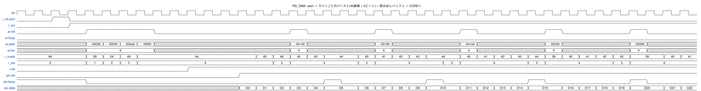

<details><summary>WaveDrom の記述(wave/rd_dma.json)</summary>

```wavedrom
{"signal": [
  {"name": "clk", "wave": "p......................................."},
  {"name": "i_ctl.start", "wave": "0.10...................................."},
  {"name": "r_act", "wave": "0..1...................................."},
  {"name": "ar.vld", "wave": "0...1...0.......10...10...10...10...10.."},
  {"name": "ar.busy", "wave": "0......................................."},
  {"name": "ar.addr", "wave": "x...====x.......=x...=x...=x...=x...=x..", "data": ["…00000", "…00050", "…000a0", "…000f0", "…00140", "…00190", "…001e0", "…00230", "…00280"]},
  {"name": "ar.len", "wave": "x...=...x.......=x...=x...=x...=x...=x..", "data": ["4", "4", "4", "4", "4", "4"]},
  {"name": "r_credit", "wave": "=...====......=====.=====.===========.==", "data": ["64", "59", "54", "49", "44", "45", "46", "42", "43", "44", "45", "41", "42", "43", "44", "40", "41", "42", "43", "44", "39", "40", "41", "42", "43", "39", "40", "41"]},
  {"name": "r_ost", "wave": "=...====.......==...==...==...==...==...", "data": ["0", "1", "2", "3", "4", "3", "4", "3", "4", "3", "4", "3", "4", "3", "4"]},
  {"name": "r.vld", "wave": "0.........1............................."},
  {"name": "pix.vld", "wave": "0............1.........................."},
  {"name": "pix.busy", "wave": "1...0.............10....10....10....10.."},
  {"name": "pix.data", "wave": "x............======.=====.=====.=====.==", "data": ["D0", "D1", "D2", "D3", "D4", "D5", "D6", "D7", "D8", "D9", "D10", "D11", "D12", "D13", "D14", "D15", "D16", "D17", "D18", "D19", "D20", "D21", "D22"]}
],
 "head": {"text": "RD_DMA: start → ラインごとのバースト(40画素 = 5ビート)→ 読み出しバッファ → COREへ"},
 "config": {"hscale": 2}
}
```

</details>

### 9.7 BAYER2RGB_CORE

画像処理のパイプラインです(4.2)。IN_CTRL がステップを発行し、その後ろは固定の遅れで止まらずに流れます。

| 段 | ブロック | 遅れ | 出力 |
|---|---|---:|---|
| 0 | IN_CTRL | - | `s_stp0`(stp_t) |
| 1 | BLC | 1 | `s_stp1`(stp_t) |
| 2 | WB | 2 | `s_stp2`(stp_t) |
| 3 | LBUF | 2 | `s_win`(win_t) |
| 4 | DMSC | 2 | `s_dm`(dm_t) |
| 5 | FCS | 3 | `s_fc`(fc_t) |
| 6 | GAMMA | 3 | `s_gm`(gm_t) |
| 7 | OUT_FMT | 1 | `s_of_vld` / `s_of_data`(obeat_t) |
| 8 | OUT_FIFO | 3(書き込みから読み出し側まで) | `rgb`(vld/busy/data) |

設定(`s_cfg`)とソフトリセットのクリア(`s_clr`)は IN_CTRL で1段受け直してから各段に配ります。各段は `vld` などの制御だけリセットし、データの FF はリセットしません。

| 信号名 | 入出力 | 信号仕様 | ビット幅 | 極性 |
|---|---|---|---|---|
| clk | 入力 | 映像系クロック(AXI4マスタ・画像処理)。400MHz | 1 | 立ち上がり |
| rst_n | 入力 | 映像系リセット。非同期アサート・同期解除(同期化は外部) | 1 | Low |
| i_ctl | 入力 | フレームの設定 + start(開始パルス)+ sw_rst(ソフトリセットパルス)(ctl_t) | 797 | - |
| pix.vld | 入力 | 画素ビートが有効 | 1 | High |
| pix.busy | 出力 | 受け取れない(クレジット不足・掃き出し中) | 1 | High |
| pix.data | 入力 | PPC画素 × 14bit。画素 i は [14i+13:14i] | 112(PPC×14) | - |
| rgb.vld | 出力 | 出力ビートが有効 | 1 | High |
| rgb.busy | 入力 | WR_DMAが受け取れない | 1 | High |
| rgb.data | 出力 | {eof, eol, sof, rgb[PPC×24-1:0]}(obeat_t)。rgbのバイト3i/3i+1/3i+2が画素iのR/G/B | 195(PPC×24+3) | - |

波形: ライン1・列1 のステップ(最初の出力になる)が各段を進む様子です。LBUF の窓はライン1の列1のステップで最初に出ます(出力ライン0・列0)。IN_CTRL の出力から OUT_FMT の出力まで 1+2+2+2+3+3+1 = 14 クロックです。出力 FIFO に入ってから3クロックで `rgb.vld` が1になります。

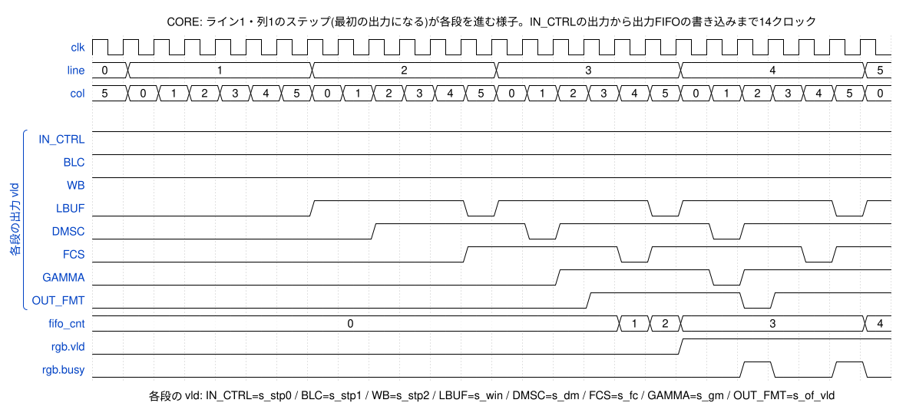

<details><summary>WaveDrom の記述(wave/core_pipe.json)</summary>

```wavedrom
{"signal": [
  {"name": "clk", "wave": "p........................."},
  {"name": "line", "wave": "==.....=.....=.....=.....=", "data": ["0", "1", "2", "3", "4", "5"]},
  {"name": "col", "wave": "==========================", "data": ["5", "0", "1", "2", "3", "4", "5", "0", "1", "2", "3", "4", "5", "0", "1", "2", "3", "4", "5", "0", "1", "2", "3", "4", "5", "0"]},
  {},
  ["各段の出力 vld",
    {"name": "IN_CTRL", "wave": "1........................."},
    {"name": "BLC", "wave": "1........................."},
    {"name": "WB", "wave": "1........................."},
    {"name": "LBUF", "wave": "0......1....01....01....01"},
    {"name": "DMSC", "wave": "0........1....01....01...."},
    {"name": "FCS", "wave": "0...........1....01....01."},
    {"name": "GAMMA", "wave": "0..............1....01...."},
    {"name": "OUT_FMT", "wave": "0...............1....01..."}
  ],
  {"name": "fifo_cnt", "wave": "=................===.....=", "data": ["0", "1", "2", "3", "4"]},
  {"name": "rgb.vld", "wave": "0..................1......"},
  {"name": "rgb.busy", "wave": "0....................10.10"}
],
 "head": {"text": "CORE: ライン1・列1のステップ(最初の出力になる)が各段を進む様子。IN_CTRLの出力から出力FIFOの書き込みまで14クロック"},
 "config": {"hscale": 1},
 "foot": {"text": "各段の vld: IN_CTRL=s_stp0 / BLC=s_stp1 / WB=s_stp2 / LBUF=s_win / DMSC=s_dm / FCS=s_fc / GAMMA=s_gm / OUT_FMT=s_of_vld"}
}
```

</details>

### 9.8 BAYER2RGB_IN_CTRL

CORE の入口です。入力ビートを受けてステップを発行し、フレームの設定とソフトリセットのクリアを1段受け直して後段に配ります。

1フレームは (H+1) ライン × (K+1) ステップです。

| ライン | 列 0〜K-1 | 列 K |
|---|---|---|
| 0〜H-1 | 入力ビート(`pix` から1ビート受ける) | 行末の掃き出し(`fcol`、入力なし) |
| H | フレーム末の掃き出し(`frow`、入力なし) | `fcol` かつ `frow` |

- LBUF はステップ (line, col) で出力 (y, oc) = (line-1, col-1) の窓を作ります。掃き出しのステップは右端・下端の出力を作るためのものです。
- 後段は止まらないので、出力 FIFO があふれないようにクレジットで発行を止めます。

```
発行できる = (出力FIFOの使用数 + 直近16クロックに発行したステップ数) < 32
```

  発行してから出力 FIFO の使用数に反映されるまでの遅れ(14 + 2 クロック)の間に発行したステップを数えておくので、出力 FIFO(容量 32 + 先読み 2)はあふれません。

- 入力ビートが必要なステップで `pix.vld`=0 のときは待ちます。`pix.busy` は「入力ビートが必要なステップを発行できる」とき0です。

| 信号名 | 入出力 | 信号仕様 | ビット幅 | 極性 |
|---|---|---|---|---|
| clk | 入力 | 映像系クロック(AXI4マスタ・画像処理)。400MHz | 1 | 立ち上がり |
| rst_n | 入力 | 映像系リセット。非同期アサート・同期解除(同期化は外部) | 1 | Low |
| i_ctl | 入力 | フレームの設定 + start(開始パルス)+ sw_rst(ソフトリセットパルス)(ctl_t) | 797 | - |
| pix.vld | 入力 | 画素ビートが有効 | 1 | High |
| pix.busy | 出力 | 受け取れない(クレジット不足・掃き出しステップ) | 1 | High |
| pix.data | 入力 | PPC画素 × 14bit | 112(PPC×14) | - |
| i_fifo_cnt | 入力 | 出力FIFOの格納数(クレジットの判定に使う) | 6 | - |
| o_cfg | 出力 | 後段へ配る設定(cfg_t、1段受け直したもの) | 795 | - |
| o_clr | 出力 | 後段へ配るクリア(ソフトリセットの1クロックのパルス) | 1 | High |
| o_stp | 出力 | ステップ {vld, fcol, frow, line, col, pix}(stp_t) | 136(PPC×14+24) | - |

波形1(ラインの終わり): 列 0〜4 は入力ビートを受け、列 5(=K)は掃き出し(`fcol`=1)で入力を受けません(`pix.busy`=1)。`r_infl` は直近16クロックの発行数です。

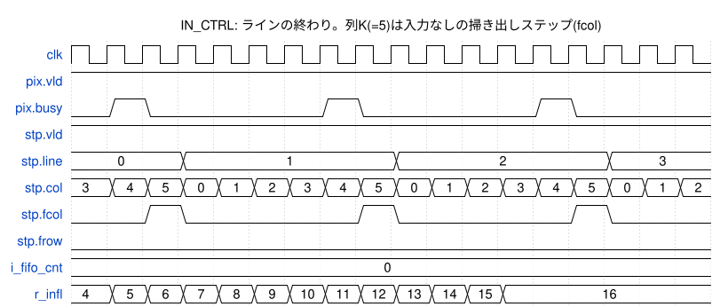

<details><summary>WaveDrom の記述(wave/in_ctrl_line.json)</summary>

```wavedrom
{"signal": [
  {"name": "clk", "wave": "p................."},
  {"name": "pix.vld", "wave": "1................."},
  {"name": "pix.busy", "wave": "010....10....10..."},
  {"name": "stp.vld", "wave": "1................."},
  {"name": "stp.line", "wave": "=..=.....=.....=..", "data": ["0", "1", "2", "3"]},
  {"name": "stp.col", "wave": "==================", "data": ["3", "4", "5", "0", "1", "2", "3", "4", "5", "0", "1", "2", "3", "4", "5", "0", "1", "2"]},
  {"name": "stp.fcol", "wave": "0.10....10....10.."},
  {"name": "stp.frow", "wave": "0................."},
  {"name": "i_fifo_cnt", "wave": "=.................", "data": ["0"]},
  {"name": "r_infl", "wave": "=============.....", "data": ["4", "5", "6", "7", "8", "9", "10", "11", "12", "13", "14", "15", "16"]}
],
 "head": {"text": "IN_CTRL: ラインの終わり。列K(=5)は入力なしの掃き出しステップ(fcol)"},
 "config": {"hscale": 1}
}
```

</details>

波形2(フレームの終わり): ライン 16(=H)は入力のない掃き出しライン(`frow`=1)です。出力側が詰まって出力 FIFO が埋まってくると、クレジットが足りないクロックはステップを出しません(`stp.vld` の切れ目)。最後のステップを出すと `r_act` が0になります。

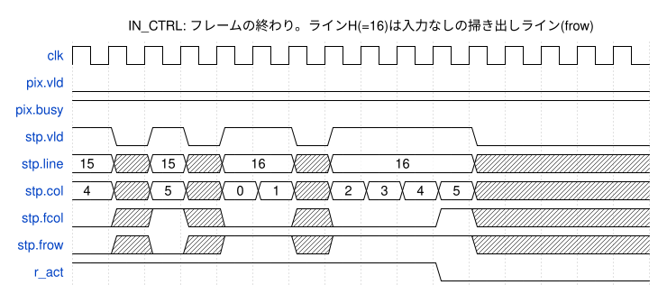

<details><summary>WaveDrom の記述(wave/in_ctrl_frame.json)</summary>

```wavedrom
{"signal": [
  {"name": "clk", "wave": "p..............."},
  {"name": "pix.vld", "wave": "0..............."},
  {"name": "pix.busy", "wave": "1..............."},
  {"name": "stp.vld", "wave": "10101.01...0...."},
  {"name": "stp.line", "wave": "=x=x=.x=...x....", "data": ["15", "15", "16", "16"]},
  {"name": "stp.col", "wave": "=x=x==x====x....", "data": ["4", "5", "0", "1", "2", "3", "4", "5"]},
  {"name": "stp.fcol", "wave": "0x1x0.x0..1x...."},
  {"name": "stp.frow", "wave": "0x0x1.x1...x...."},
  {"name": "r_act", "wave": "1.........0....."}
],
 "head": {"text": "IN_CTRL: フレームの終わり。ラインH(=16)は入力なしの掃き出しライン(frow)"},
 "config": {"hscale": 1}
}
```

</details>

### 9.9 BAYER2RGB_BLC

黒レベル補正です(6.3)。遅れ1クロック。色の位置は BAYER_PHASE とライン・画素の座標の偶奇で決めます(6.2)。

| 信号名 | 入出力 | 信号仕様 | ビット幅 | 極性 |
|---|---|---|---|---|
| clk | 入力 | 映像系クロック(AXI4マスタ・画像処理)。400MHz | 1 | 立ち上がり |
| rst_n | 入力 | 映像系リセット。非同期アサート・同期解除(同期化は外部) | 1 | Low |
| i_clr | 入力 | 同期クリア(ソフトリセット)。1クロックのパルスで有効ビットを消す | 1 | High |
| i_cfg | 入力 | フレームの設定(cfg_t)。フレームの開始時だけ変わる | 795 | - |
| i_stp | 入力 | ステップ(stp_t) | 136(PPC×14+24) | - |
| o_stp | 出力 | 黒レベルを引いたステップ(stp_t、レイテンシ1) | 136(PPC×14+24) | - |

波形: ライン2(RGGB の R/Gr の行)。画素0(R)は 7684 → 6884、840 → 40 のように 800 を引き、800 未満は0になります(333 → 0)。掃き出しのステップ(`fcol`)の画素は使わないので x で示しています。

![BLC: q = max(p − blc[site], 0)。1クロック(この例は blc=800、ライン2 = R/Gr の行)](wave/blc.svg)

<details><summary>WaveDrom の記述(wave/blc.json)</summary>

```wavedrom
{"signal": [
  {"name": "clk", "wave": "p..........."},
  {"name": "i.vld", "wave": "1..........."},
  {"name": "i.col", "wave": "============", "data": ["5", "0", "1", "2", "3", "4", "5", "0", "1", "2", "3", "4"]},
  {"name": "i.fcol", "wave": "10....10...."},
  {"name": "i.pix[0](R)", "wave": "x=====x=====", "data": ["7684", "840", "1763", "9080", "333", "84", "111", "4056", "15681", "6024"]},
  {"name": "i.pix[1](Gr)", "wave": "x=====x=====", "data": ["5635", "10394", "940", "1038", "6335", "6433", "4754", "6536", "7080", "14945"]},
  {"name": "o.vld", "wave": "1..........."},
  {"name": "o.pix[0](R)", "wave": "=x=====x====", "data": ["13639", "6884", "40", "963", "8280", "0", "0", "0", "3256", "14881"]},
  {"name": "o.pix[1](Gr)", "wave": "=x=====x====", "data": ["376", "4835", "9594", "140", "238", "5535", "5633", "3954", "5736", "6280"]}
],
 "head": {"text": "BLC: q = max(p − blc[site], 0)。1クロック(この例は blc=800、ライン2 = R/Gr の行)"},
 "config": {"hscale": 2}
}
```

</details>

### 9.10 BAYER2RGB_WB

ホワイトバランスです(6.4)。遅れ2クロック(1段目: 乗算、2段目: 丸めとクリップ)。

| 信号名 | 入出力 | 信号仕様 | ビット幅 | 極性 |
|---|---|---|---|---|
| clk | 入力 | 映像系クロック(AXI4マスタ・画像処理)。400MHz | 1 | 立ち上がり |
| rst_n | 入力 | 映像系リセット。非同期アサート・同期解除(同期化は外部) | 1 | Low |
| i_clr | 入力 | 同期クリア(ソフトリセット)。1クロックのパルスで有効ビットを消す | 1 | High |
| i_cfg | 入力 | フレームの設定(cfg_t)。フレームの開始時だけ変わる | 795 | - |
| i_stp | 入力 | ステップ(stp_t) | 136(PPC×14+24) | - |
| o_stp | 出力 | WBゲインを掛けたステップ(stp_t、レイテンシ2) | 136(PPC×14+24) | - |

波形: R のゲイン 1.75(0x1C00)で 6884 → 12047、40 → 70。Gr のゲインは 1.0 なので値は変わりません。

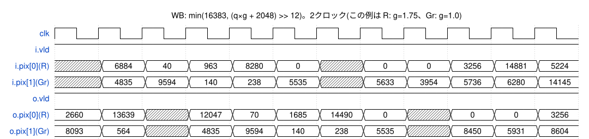

<details><summary>WaveDrom の記述(wave/wb.json)</summary>

```wavedrom
{"signal": [
  {"name": "clk", "wave": "p..........."},
  {"name": "i.vld", "wave": "1..........."},
  {"name": "i.pix[0](R)", "wave": "x=====x=====", "data": ["6884", "40", "963", "8280", "0", "0", "0", "3256", "14881", "5224"]},
  {"name": "i.pix[1](Gr)", "wave": "x=====x=====", "data": ["4835", "9594", "140", "238", "5535", "5633", "3954", "5736", "6280", "14145"]},
  {"name": "o.vld", "wave": "1..........."},
  {"name": "o.pix[0](R)", "wave": "==x=====x===", "data": ["2660", "13639", "12047", "70", "1685", "14490", "0", "0", "0", "3256"]},
  {"name": "o.pix[1](Gr)", "wave": "==x=====x===", "data": ["8093", "564", "4835", "9594", "140", "238", "5535", "8450", "5931", "8604"]}
],
 "head": {"text": "WB: min(16383, (q×g + 2048) >> 12)。2クロック(この例は R: g=1.75、Gr: g=1.0)"},
 "config": {"hscale": 2}
}
```

</details>

### 9.11 BAYER2RGB_LBUF

2ライン分のラインバッファと、3ライン × (PPC+2) 画素の窓を作ります。遅れ2クロック。

- SRAM0 は2ライン前、SRAM1 は1ライン前を持ちます(各 K_MAX = 3840/PPC ワード × PPC×14 bit。PPC=8 で 480 ワード × 112 bit)。
- 0段目: ステップの列 `col` のアドレスで SRAM0 / SRAM1 を読みます(掃き出しの列では読まない)。
- 1段目: 窓の3行を作り、同時に書き戻します。

  | 行 | 通常 | ライン1(上端) | 掃き出しライン(下端) |
  |---|---|---|---|
  | 上(y-1) | SRAM0(2ライン前) | 入力(y=-1 → y=1 のミラー) | SRAM0 |
  | 中(y) | SRAM1(1ライン前) | SRAM1 | SRAM1 |
  | 下(y+1) | 入力 | 入力 | SRAM0(y=H → y=H-2 のミラー) |

  書き戻し: SRAM1[col] ← 入力、SRAM0[col] ← SRAM1 の読み出し値(掃き出しのステップでは書かない)。読んだ次のクロックに書くので、同じアドレスを同じクロックに読み書きすることはありません。
- 窓は列 `col-2` の最後の1画素、列 `col-1` の PPC 画素、列 `col` の最初の1画素です。出力の列 oc = col-1 の画素 x = oc×PPC-1 〜 oc×PPC+PPC に当たります。左端(col=1)は x=-1 を x=1 の値に、右端(掃き出しの列)は x=W を x=W-2 の値に置き換えます。
- 2段目: 窓を出力します(y = line-1、oc = col-1)。sof はライン1・列1、eol は掃き出しの列、eof は掃き出しのラインの掃き出しの列で1です。

| 信号名 | 入出力 | 信号仕様 | ビット幅 | 極性 |
|---|---|---|---|---|
| clk | 入力 | 映像系クロック(AXI4マスタ・画像処理)。400MHz | 1 | 立ち上がり |
| rst_n | 入力 | 映像系リセット。非同期アサート・同期解除(同期化は外部) | 1 | Low |
| i_clr | 入力 | 同期クリア(ソフトリセット)。1クロックのパルスで有効ビットを消す | 1 | High |
| i_stp | 入力 | ステップ(stp_t) | 136(PPC×14+24) | - |
| o_win | 出力 | 3×(PPC+2)画素の窓 {vld, sof, eol, eof, y, oc, win}(win_t、レイテンシ2) | 445(3×(PPC+2)×14+25) | - |
| o_sram0_ren | 出力 | SRAM0(2ライン前)の読み出し | 1 | High |
| o_sram0_raddr | 出力 | SRAM0の読み出しアドレス(列番号) | 9(log2(3840/PPC)) | - |
| i_sram0_rdata | 入力 | SRAM0の読み出しデータ(レイテンシ1) | 112(PPC×14) | - |
| o_sram0_wen | 出力 | SRAM0の書き込み(読み出しの次のクロック) | 1 | High |
| o_sram0_waddr | 出力 | SRAM0の書き込みアドレス | 9(log2(3840/PPC)) | - |
| o_sram0_wdata | 出力 | SRAM0の書き込みデータ(SRAM1の読み出し値) | 112(PPC×14) | - |
| o_sram1_ren | 出力 | SRAM1(1ライン前)の読み出し | 1 | High |
| o_sram1_raddr | 出力 | SRAM1の読み出しアドレス(列番号) | 9(log2(3840/PPC)) | - |
| i_sram1_rdata | 入力 | SRAM1の読み出しデータ(レイテンシ1) | 112(PPC×14) | - |
| o_sram1_wen | 出力 | SRAM1の書き込み(読み出しの次のクロック) | 1 | High |
| o_sram1_waddr | 出力 | SRAM1の書き込みアドレス | 9(log2(3840/PPC)) | - |
| o_sram1_wdata | 出力 | SRAM1の書き込みデータ(入力のビート) | 112(PPC×14) | - |

波形: ライン1〜3。SRAM は列 0〜4 を読み(`sram0.ren`)、次のクロックで同じアドレスに書きます(`sram0.waddr` は1クロック遅れ)。列5(掃き出し)では読み書きしません。窓(`win`)は ライン1・列1 から出て、y = line-1、oc = col-1 です。

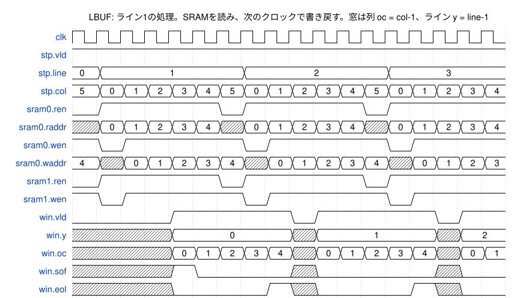

<details><summary>WaveDrom の記述(wave/lbuf.json)</summary>

```wavedrom
{"signal": [
  {"name": "clk", "wave": "p................."},
  {"name": "stp.vld", "wave": "1................."},
  {"name": "stp.line", "wave": "==.....=.....=....", "data": ["0", "1", "2", "3"]},
  {"name": "stp.col", "wave": "==================", "data": ["5", "0", "1", "2", "3", "4", "5", "0", "1", "2", "3", "4", "5", "0", "1", "2", "3", "4"]},
  {"name": "sram0.ren", "wave": "01....01....01...."},
  {"name": "sram0.raddr", "wave": "x=====x=====x=====", "data": ["0", "1", "2", "3", "4", "0", "1", "2", "3", "4", "0", "1", "2", "3", "4"]},
  {"name": "sram0.wen", "wave": "101....01....01..."},
  {"name": "sram0.waddr", "wave": "=x=====x=====x====", "data": ["4", "0", "1", "2", "3", "4", "0", "1", "2", "3", "4", "0", "1", "2", "3"]},
  {"name": "sram1.ren", "wave": "01....01....01...."},
  {"name": "sram1.wen", "wave": "101....01....01..."},
  {"name": "win.vld", "wave": "0...1....01....01."},
  {"name": "win.y", "wave": "x...=....x=....x=.", "data": ["0", "1", "2"]},
  {"name": "win.oc", "wave": "x...=====x=====x==", "data": ["0", "1", "2", "3", "4", "0", "1", "2", "3", "4", "0", "1"]},
  {"name": "win.sof", "wave": "x...10...x0....x0."},
  {"name": "win.eol", "wave": "x...0...1x0...1x0."}
],
 "head": {"text": "LBUF: ライン1の処理。SRAMを読み、次のクロックで書き戻す。窓は列 oc = col-1、ライン y = line-1"},
 "config": {"hscale": 1}
}
```

</details>

### 9.12 BAYER2RGB_DMSC

バイリニア補間でデモザイクし、エッジ量を求めます(6.6)。遅れ2クロック(1段目: 平均と差、2段目: 色の位置による選択)。バイパスのときは (c, c, c) とエッジ量0を出します。

| 信号名 | 入出力 | 信号仕様 | ビット幅 | 極性 |
|---|---|---|---|---|
| clk | 入力 | 映像系クロック(AXI4マスタ・画像処理)。400MHz | 1 | 立ち上がり |
| rst_n | 入力 | 映像系リセット。非同期アサート・同期解除(同期化は外部) | 1 | Low |
| i_clr | 入力 | 同期クリア(ソフトリセット)。1クロックのパルスで有効ビットを消す | 1 | High |
| i_cfg | 入力 | フレームの設定(cfg_t)。フレームの開始時だけ変わる | 795 | - |
| i_win | 入力 | 窓(win_t) | 445(3×(PPC+2)×14+25) | - |
| o_dm | 出力 | RGB(各14bit)とエッジ量(dm_t、レイテンシ2) | 473(PPC×56+25) | - |

波形: 出力ライン2の画素0(R の位置)。R は窓の中心の値(12047 → R=12047)、G と B は補間値です。

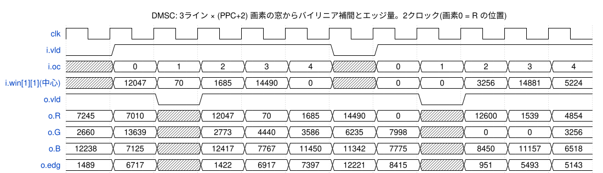

<details><summary>WaveDrom の記述(wave/dmsc.json)</summary>

```wavedrom
{"signal": [
  {"name": "clk", "wave": "p..........."},
  {"name": "i.vld", "wave": "01....01...."},
  {"name": "i.oc", "wave": "x=====x=====", "data": ["0", "1", "2", "3", "4", "0", "1", "2", "3", "4"]},
  {"name": "i.win[1][1](中心)", "wave": "x=====x=====", "data": ["12047", "70", "1685", "14490", "0", "0", "0", "3256", "14881", "5224"]},
  {"name": "o.vld", "wave": "1.01....01.."},
  {"name": "o.R", "wave": "==x=====x===", "data": ["7245", "7010", "12047", "70", "1685", "14490", "0", "12600", "1539", "4854"]},
  {"name": "o.G", "wave": "==x=====x===", "data": ["2660", "13639", "2773", "4440", "3586", "6235", "7998", "0", "0", "3256"]},
  {"name": "o.B", "wave": "==x=====x===", "data": ["12238", "7125", "12417", "7767", "11450", "11342", "7775", "8450", "11157", "6518"]},
  {"name": "o.edg", "wave": "==x=====x===", "data": ["1489", "6717", "1422", "6917", "7397", "12221", "8415", "951", "5493", "5143"]}
],
 "head": {"text": "DMSC: 3ライン × (PPC+2) 画素の窓からバイリニア補間とエッジ量。2クロック(画素0 = R の位置)"},
 "config": {"hscale": 2}
}
```

</details>

### 9.13 BAYER2RGB_FCS

エッジ部の彩度を抑えます(6.7)。遅れ3クロック(1段目: Y と ex、2段目: k と X−Y、3段目: 補間とクリップ)。

| 信号名 | 入出力 | 信号仕様 | ビット幅 | 極性 |
|---|---|---|---|---|
| clk | 入力 | 映像系クロック(AXI4マスタ・画像処理)。400MHz | 1 | 立ち上がり |
| rst_n | 入力 | 映像系リセット。非同期アサート・同期解除(同期化は外部) | 1 | Low |
| i_clr | 入力 | 同期クリア(ソフトリセット)。1クロックのパルスで有効ビットを消す | 1 | High |
| i_cfg | 入力 | フレームの設定(cfg_t)。フレームの開始時だけ変わる | 795 | - |
| i_dm | 入力 | RGBとエッジ量(dm_t) | 473(PPC×56+25) | - |
| o_fc | 出力 | 彩度を抑えたRGB(fc_t、レイテンシ3) | 361(PPC×42+25) | - |

波形(fcs_th=4000、fcs_gain=4): エッジ量 1422 は しきい値未満なので値はそのまま(12047, 2773, 12417)。6917 は一部を抑えて (70, 4440, 7767) → (2991, 4254, 5216)。12221 は k=0 となり R=G=B=Y(9576)になります。

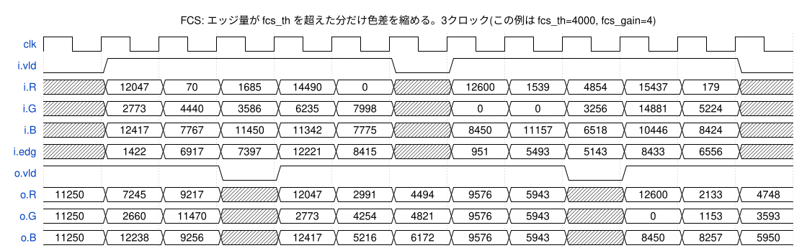

<details><summary>WaveDrom の記述(wave/fcs.json)</summary>

```wavedrom
{"signal": [
  {"name": "clk", "wave": "p............"},
  {"name": "i.vld", "wave": "01....01....0"},
  {"name": "i.R", "wave": "x=====x=====x", "data": ["12047", "70", "1685", "14490", "0", "12600", "1539", "4854", "15437", "179"]},
  {"name": "i.G", "wave": "x=====x=====x", "data": ["2773", "4440", "3586", "6235", "7998", "0", "0", "3256", "14881", "5224"]},
  {"name": "i.B", "wave": "x=====x=====x", "data": ["12417", "7767", "11450", "11342", "7775", "8450", "11157", "6518", "10446", "8424"]},
  {"name": "i.edg", "wave": "x=====x=====x", "data": ["1422", "6917", "7397", "12221", "8415", "951", "5493", "5143", "8433", "6556"]},
  {"name": "o.vld", "wave": "1..01....01.."},
  {"name": "o.R", "wave": "===x=====x===", "data": ["11250", "7245", "9217", "12047", "2991", "4494", "9576", "5943", "12600", "2133", "4748"]},
  {"name": "o.G", "wave": "===x=====x===", "data": ["11250", "2660", "11470", "2773", "4254", "4821", "9576", "5943", "0", "1153", "3593"]},
  {"name": "o.B", "wave": "===x=====x===", "data": ["11250", "12238", "9256", "12417", "5216", "6172", "9576", "5943", "8450", "8257", "5950"]}
],
 "head": {"text": "FCS: エッジ量が fcs_th を超えた分だけ色差を縮める。3クロック(この例は fcs_th=4000, fcs_gain=4)"},
 "config": {"hscale": 2}
}
```

</details>

### 9.14 BAYER2RGB_GAMMA

折れ線のガンマ(または線形)で 14bit を 8bit にします(6.8)。遅れ3クロック(1段目: 区間と位置、2段目: 折れ点の選択、3段目: 補間と丸め)。PPC×3 チャネルを並列に処理します。

| 信号名 | 入出力 | 信号仕様 | ビット幅 | 極性 |
|---|---|---|---|---|
| clk | 入力 | 映像系クロック(AXI4マスタ・画像処理)。400MHz | 1 | 立ち上がり |
| rst_n | 入力 | 映像系リセット。非同期アサート・同期解除(同期化は外部) | 1 | Low |
| i_clr | 入力 | 同期クリア(ソフトリセット)。1クロックのパルスで有効ビットを消す | 1 | High |
| i_cfg | 入力 | フレームの設定(cfg_t)。フレームの開始時だけ変わる | 795 | - |
| i_fc | 入力 | RGB(各14bit、fc_t) | 361(PPC×42+25) | - |
| o_gm | 出力 | RGB(各8bit、gm_t、レイテンシ3) | 217(PPC×24+25) | - |

波形(sRGB の既定値): 12047 → 223、2773 → 114、12417 → 226。

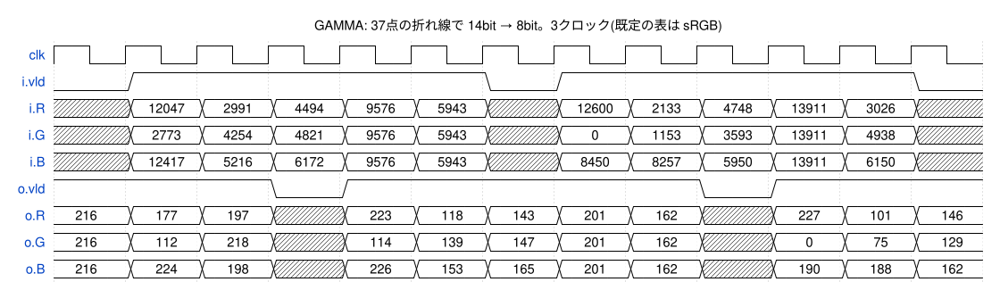

<details><summary>WaveDrom の記述(wave/gamma.json)</summary>

```wavedrom
{"signal": [
  {"name": "clk", "wave": "p............"},
  {"name": "i.vld", "wave": "01....01....0"},
  {"name": "i.R", "wave": "x=====x=====x", "data": ["12047", "2991", "4494", "9576", "5943", "12600", "2133", "4748", "13911", "3026"]},
  {"name": "i.G", "wave": "x=====x=====x", "data": ["2773", "4254", "4821", "9576", "5943", "0", "1153", "3593", "13911", "4938"]},
  {"name": "i.B", "wave": "x=====x=====x", "data": ["12417", "5216", "6172", "9576", "5943", "8450", "8257", "5950", "13911", "6150"]},
  {"name": "o.vld", "wave": "1..01....01.."},
  {"name": "o.R", "wave": "===x=====x===", "data": ["216", "177", "197", "223", "118", "143", "201", "162", "227", "101", "146"]},
  {"name": "o.G", "wave": "===x=====x===", "data": ["216", "112", "218", "114", "139", "147", "201", "162", "0", "75", "129"]},
  {"name": "o.B", "wave": "===x=====x===", "data": ["216", "224", "198", "226", "153", "165", "201", "162", "190", "188", "162"]}
],
 "head": {"text": "GAMMA: 37点の折れ線で 14bit → 8bit。3クロック(既定の表は sRGB)"},
 "config": {"hscale": 2}
}
```

</details>

### 9.15 BAYER2RGB_OUT_FMT

テストパターンへの差し替え(6.9)と出力ビートの整形を行います。遅れ1クロック。出力ビートは {eof, eol, sof, rgb} で、rgb のバイト 3i / 3i+1 / 3i+2 が画素 i の R / G / B です(メモリのバイト順と同じ)。

| 信号名 | 入出力 | 信号仕様 | ビット幅 | 極性 |
|---|---|---|---|---|
| clk | 入力 | 映像系クロック(AXI4マスタ・画像処理)。400MHz | 1 | 立ち上がり |
| rst_n | 入力 | 映像系リセット。非同期アサート・同期解除(同期化は外部) | 1 | Low |
| i_clr | 入力 | 同期クリア(ソフトリセット)。1クロックのパルスで有効ビットを消す | 1 | High |
| i_cfg | 入力 | フレームの設定(cfg_t)。フレームの開始時だけ変わる | 795 | - |
| i_gm | 入力 | RGB(各8bit、gm_t) | 217(PPC×24+25) | - |
| o_vld | 出力 | 出力ビートが有効(レイテンシ1) | 1 | High |
| o_data | 出力 | 出力ビート {eof, eol, sof, rgb}(obeat_t) | 195(PPC×24+3) | - |

波形: フレームの最初のビート(sof=1)。画素0 の (R, G, B) = (199, 188, 130) は rgb[23:0] = 0x82bcc7 になります(16進では上位から B, G, R)。

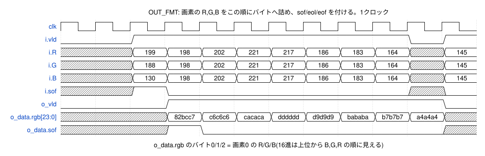

<details><summary>WaveDrom の記述(wave/out_fmt.json)</summary>

```wavedrom
{"signal": [
  {"name": "clk", "wave": "p..........."},
  {"name": "i.vld", "wave": "0.1.......01"},
  {"name": "i.R", "wave": "x.========x=", "data": ["199", "198", "202", "221", "217", "186", "183", "164", "145"]},
  {"name": "i.G", "wave": "x.========x=", "data": ["188", "198", "202", "221", "217", "186", "183", "164", "145"]},
  {"name": "i.B", "wave": "x.========x=", "data": ["130", "198", "202", "221", "217", "186", "183", "164", "145"]},
  {"name": "i.sof", "wave": "x.10......x0"},
  {"name": "o_vld", "wave": "0..1.......0"},
  {"name": "o_data.rgb[23:0]", "wave": "x..========x", "data": ["82bcc7", "c6c6c6", "cacaca", "dddddd", "d9d9d9", "bababa", "b7b7b7", "a4a4a4"]},
  {"name": "o_data.sof", "wave": "x..10......x"}
],
 "head": {"text": "OUT_FMT: 画素の R,G,B をこの順にバイトへ詰め、sof/eol/eof を付ける。1クロック"},
 "config": {"hscale": 2},
 "foot": {"text": "o_data.rgb のバイト0/1/2 = 画素0 の R/G/B(16進は上位から B,G,R の順に見える)"}
}
```

</details>

### 9.16 BAYER2RGB_OUT_FIFO

CORE の出力 FIFO です(SFIFO の SRAM 版、32段 + 先読み2段)。書き込み側(OUT_FMT)は止められないので、IN_CTRL のクレジットであふれないことを保証しています。`o_cnt` は先読みと読み出し中の分を含む格納数で、IN_CTRL のクレジットに使います。

| 信号名 | 入出力 | 信号仕様 | ビット幅 | 極性 |
|---|---|---|---|---|
| clk | 入力 | 映像系クロック(AXI4マスタ・画像処理)。400MHz | 1 | 立ち上がり |
| rst_n | 入力 | 映像系リセット。非同期アサート・同期解除(同期化は外部) | 1 | Low |
| i_clr | 入力 | 同期クリア(ソフトリセット)。1クロックのパルスで有効ビットを消す | 1 | High |
| i_vld | 入力 | 書き込み(止められない。あふれないことはクレジットで保証) | 1 | High |
| i_data | 入力 | 書き込むビート(obeat_t) | 195(PPC×24+3) | - |
| o_cnt | 出力 | 格納数(先読み2段と読み出し中を含む) | 6 | - |
| rgb.vld | 出力 | 出力ビートが有効(FIFOが空でない) | 1 | High |
| rgb.busy | 入力 | WR_DMAが受け取れない | 1 | High |
| rgb.data | 出力 | 出力ビート(obeat_t) | 195(PPC×24+3) | - |

波形: 書き込み(`i_vld`)から3クロックで `rgb.vld` が1になります。WR_DMA が受け取れないクロック(`rgb.busy`=1)はデータを保持し、格納数が増えます。

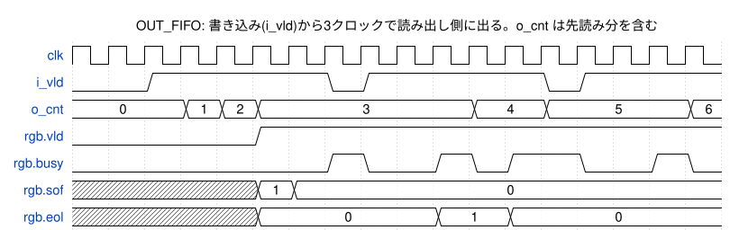

<details><summary>WaveDrom の記述(wave/out_fifo.json)</summary>

```wavedrom
{"signal": [
  {"name": "clk", "wave": "p................."},
  {"name": "i_vld", "wave": "0.1....01....01..."},
  {"name": "o_cnt", "wave": "=..===.....=.=...=", "data": ["0", "1", "2", "3", "4", "5", "6"]},
  {"name": "rgb.vld", "wave": "0....1............"},
  {"name": "rgb.busy", "wave": "0......10.101.0.10"},
  {"name": "rgb.sof", "wave": "x....==...........", "data": ["1", "0"]},
  {"name": "rgb.eol", "wave": "x....=....=.=.....", "data": ["0", "1", "0"]}
],
 "head": {"text": "OUT_FIFO: 書き込み(i_vld)から3クロックで読み出し側に出る。o_cnt は先読み分を含む"},
 "config": {"hscale": 1}
}
```

</details>

### 9.17 BAYER2RGB_WR_DMA

CORE の出力ビート(PPC 画素 × 3バイト)を16バイトのビートに詰め、ライン単位のバーストで書き込みます。

- 詰め替え: 入力のバイト数(PPC×3)と16の最大公約数を単位(PPC=8 なら8バイト)にして、詰め替えバッファ `r_acc` に詰めます。16バイトそろうと書き込みバッファに入れます。ラインの終わり(eol)で端数があれば、有効なバイトだけ WSTRB を立てたビートにします(残りの WDATA は0)。
- 書き込みバッファ: SFIFO(SRAM 64ビート、{WSTRB, WDATA} の144bit)。
- バースト: 長さ = min(16, ラインの残りのビート数, 4KB 境界までのビート数)。バースト分のデータがバッファにそろってから(`r_avail` ≥ 長さ)AW を出します。
- W: AW を出した順にバースト長のキュー(4段)に入れ、その長さで WLAST を付けて送ります。W は AW の受け付けを待ちません。
- 同時発行は4バーストまで(`r_ost`)。全部の AW を出し、全部の応答を受けたら `o_evt.frame_done` を1クロック出します。
- BRESP ≠ OKAY のとき `o_evt.wr_err` を1クロック出します。
- ソフトリセット: 新しい AW と入力の受け取りを止め、AW を出したバーストの W を送り切り、応答を受けます。残ったデータ(AW を出していないもの)は捨てます。

| 信号名 | 入出力 | 信号仕様 | ビット幅 | 極性 |
|---|---|---|---|---|
| clk | 入力 | 映像系クロック(AXI4マスタ・画像処理)。400MHz | 1 | 立ち上がり |
| rst_n | 入力 | 映像系リセット。非同期アサート・同期解除(同期化は外部) | 1 | Low |
| i_ctl | 入力 | フレームの設定 + start(開始パルス)+ sw_rst(ソフトリセットパルス)(ctl_t) | 797 | - |
| rgb.vld | 入力 | COREの出力ビートが有効 | 1 | High |
| rgb.busy | 出力 | 受け取れない(詰め替え中・バッファが満杯) | 1 | High |
| rgb.data | 入力 | 出力ビート(obeat_t) | 195(PPC×24+3) | - |
| aw.vld | 出力 | 書き込み要求が有効 | 1 | High |
| aw.busy | 入力 | BRIDGEが要求を受け取れない | 1 | High |
| aw.data | 出力 | 要求(axreq_t) | 59 | - |
| w.vld | 出力 | 書き込みデータが有効 | 1 | High |
| w.busy | 入力 | BRIDGEがデータを受け取れない | 1 | High |
| w.data | 出力 | データ {last, strb[15:0], data[127:0]}(wbeat_t) | 145 | - |
| b.vld | 入力 | 書き込み応答が有効 | 1 | High |
| b.busy | 出力 | 応答を受け取れない(常に0) | 1 | High |
| b.data | 入力 | BRESP | 2 | - |
| o_evt | 出力 | 状態 {busy, frame_done(全バーストの応答を受けた、パルス), wr_err(パルス)} | 3 | - |

波形1(最初のバースト): 24バイトのビートを8バイト単位(`r_cnt`)で詰め、16バイトになるたびに書き込みバッファに入れます(`s_push`、`r_avail` が増える)。1ライン(40画素 = 120バイト = 8ビート、最後は端数)がそろうと AW(len=7)を出し、W を送ります。ラインの最後のビートは WSTRB=0x00FF、WLAST=1 です。

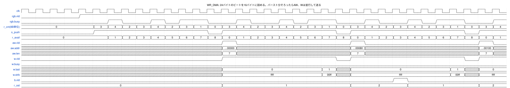

<details><summary>WaveDrom の記述(wave/wr_dma.json)</summary>

```wavedrom
{"signal": [
  {"name": "clk", "wave": "p................................."},
  {"name": "rgb.vld", "wave": "0...1............................."},
  {"name": "rgb.busy", "wave": "0.....10.101.0.10.101.0.10.101.0.1"},
  {"name": "r_cnt(8B単位)", "wave": "=....=============================", "data": ["0", "3", "4", "2", "3", "4", "2", "3", "1", "0", "3", "4", "2", "3", "4", "2", "3", "1", "0", "3", "4", "2", "3", "4", "2", "3", "1", "0", "3", "4"]},
  {"name": "s_push", "wave": "0....1.......01.......01.......01."},
  {"name": "r_avail", "wave": "=.....============================", "data": ["0", "1", "2", "3", "4", "5", "6", "7", "8", "0", "1", "2", "3", "4", "5", "6", "7", "8", "0", "1", "2", "3", "4", "5", "6", "7", "8", "0", "1"]},
  {"name": "aw.vld", "wave": "0.............10.......10.......10"},
  {"name": "aw.addr", "wave": "x.............=x.......=x.......=x", "data": ["…00000", "…00080", "…00100"]},
  {"name": "aw.len", "wave": "x.............=x.......=x.......=x", "data": ["7", "7", "7"]},
  {"name": "w.vld", "wave": "0.............1.......01.......01."},
  {"name": "w.busy", "wave": "0................................."},
  {"name": "w.last", "wave": "x.............=......=x=......=x=.", "data": ["0", "1", "0", "1", "0"]},
  {"name": "w.strb", "wave": "x.............=......=x=......=x=.", "data": ["ffff", "00ff", "ffff", "00ff", "ffff"]},
  {"name": "b.vld", "wave": "0.........................10......"},
  {"name": "r_ost", "wave": "=.............=........=...=....=.", "data": ["0", "1", "2", "1", "2"]}
],
 "head": {"text": "WR_DMA: 24バイトのビートを16バイトに詰める。バースト分そろったらAW、Wは並行して送る"},
 "config": {"hscale": 2}
}
```

</details>

波形2(フレームの終わり): 最後の AW を出すと `r_aw_go`=0。全バーストの応答(`b.vld`)を受けて `r_ost`=0 になると `o_evt.frame_done` を出し、`o_evt.busy` が0になります。

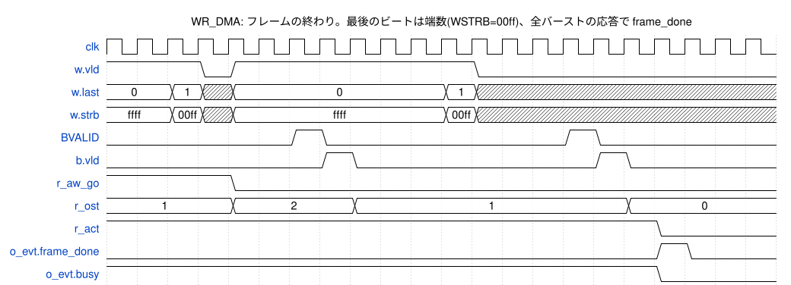

<details><summary>WaveDrom の記述(wave/wr_dma_end.json)</summary>

```wavedrom
{"signal": [
  {"name": "clk", "wave": "p....................."},
  {"name": "w.vld", "wave": "1..01.......0........."},
  {"name": "w.last", "wave": "=.=x=......=x.........", "data": ["0", "1", "0", "1"]},
  {"name": "w.strb", "wave": "=.=x=......=x.........", "data": ["ffff", "00ff", "ffff", "00ff"]},
  {"name": "BVALID", "wave": "0.....10.......10....."},
  {"name": "b.vld", "wave": "0......10.......10...."},
  {"name": "r_aw_go", "wave": "1...0................."},
  {"name": "r_ost", "wave": "=...=...=........=....", "data": ["1", "2", "1", "0"]},
  {"name": "r_act", "wave": "1.................0..."},
  {"name": "o_evt.frame_done", "wave": "0.................10.."},
  {"name": "o_evt.busy", "wave": "1.................0..."}
],
 "head": {"text": "WR_DMA: フレームの終わり。最後のビートは端数(WSTRB=00ff)、全バーストの応答で frame_done"},
 "config": {"hscale": 1}
}
```

</details>

### 9.18 BAYER2RGB_AXIM_WR_BRIDGE

書き込み要求(`aw`)、書き込みデータ(`w`)、書き込み応答(`b`)の vld/busy/data を AXI4 の AW / W / B に変換します。

- AW、W、B はそれぞれ2段スキッドバッファを通します。AXI 側の出力はすべて FF から出ます。
- AWID=0、AWSIZE=4(16バイト)、AWBURST=INCR、AWLOCK=0 に固定します。BID は見ません。
- AW と W は独立に流します(W は AW の受け付けを待たない)。
- 遅れ: `aw` → AWVALID、`w` → WVALID、BVALID → `b` がそれぞれ1クロック。

| 信号名 | 入出力 | 信号仕様 | ビット幅 | 極性 |
|---|---|---|---|---|
| clk | 入力 | 映像系クロック(AXI4マスタ・画像処理)。400MHz | 1 | 立ち上がり |
| rst_n | 入力 | 映像系リセット。非同期アサート・同期解除(同期化は外部) | 1 | Low |
| BAYER2RGB_MEM_AWID | 出力 | 書き込みID(常に0) | 4 | - |
| BAYER2RGB_MEM_AWADDR | 出力 | 書き込みアドレス(16バイト境界) | 40 | - |
| BAYER2RGB_MEM_AWLEN | 出力 | バーストのビート数-1(0〜15) | 8 | - |
| BAYER2RGB_MEM_AWSIZE | 出力 | 1ビートのバイト数(常に4 = 16バイト) | 3 | - |
| BAYER2RGB_MEM_AWBURST | 出力 | バーストの種類(常に1 = INCR) | 2 | - |
| BAYER2RGB_MEM_AWLOCK | 出力 | 排他アクセス(常に0) | 1 | High |
| BAYER2RGB_MEM_AWCACHE | 出力 | キャッシュ属性(AXI_ATTR.AWCACHE) | 4 | - |
| BAYER2RGB_MEM_AWPROT | 出力 | 保護属性(AXI_ATTR.AWPROT) | 3 | - |
| BAYER2RGB_MEM_AWQOS | 出力 | QoS(AXI_ATTR.AWQOS) | 4 | - |
| BAYER2RGB_MEM_AWVALID | 出力 | 書き込み要求が有効 | 1 | High |
| BAYER2RGB_MEM_AWREADY | 入力 | 書き込み要求を受け付けた | 1 | High |
| BAYER2RGB_MEM_WDATA | 出力 | 書き込みデータ(RGB888をR,G,B順に詰めたもの。バイト0が下位) | 128 | - |
| BAYER2RGB_MEM_WSTRB | 出力 | バイトイネーブル(ラインの最後の端数ビートだけ下位8バイト) | 16 | - |
| BAYER2RGB_MEM_WLAST | 出力 | バーストの最後のビート | 1 | High |
| BAYER2RGB_MEM_WVALID | 出力 | 書き込みデータが有効 | 1 | High |
| BAYER2RGB_MEM_WREADY | 入力 | 書き込みデータを受け付けた | 1 | High |
| BAYER2RGB_MEM_BID | 入力 | 応答ID(見ない) | 4 | - |
| BAYER2RGB_MEM_BRESP | 入力 | 書き込み応答(OKAY以外は IRQ_STATUS.WR_ERR) | 2 | - |
| BAYER2RGB_MEM_BVALID | 入力 | 書き込み応答が有効 | 1 | High |
| BAYER2RGB_MEM_BREADY | 出力 | 書き込み応答を受け取れる(常に受け取る) | 1 | High |
| aw.vld | 入力 | 書き込み要求が有効 | 1 | High |
| aw.busy | 出力 | 要求を受け取れない(スキッドが満杯) | 1 | High |
| aw.data | 入力 | 要求(axreq_t) | 59 | - |
| w.vld | 入力 | 書き込みデータが有効 | 1 | High |
| w.busy | 出力 | データを受け取れない(スキッドが満杯) | 1 | High |
| w.data | 入力 | データ(wbeat_t) | 145 | - |
| b.vld | 出力 | 書き込み応答が有効 | 1 | High |
| b.busy | 入力 | WR_DMAが応答を受け取れない | 1 | High |
| b.data | 出力 | BRESP | 2 | - |

波形: 1ライン(8ビート)ごとに AW を出し、W を続けて送ります。

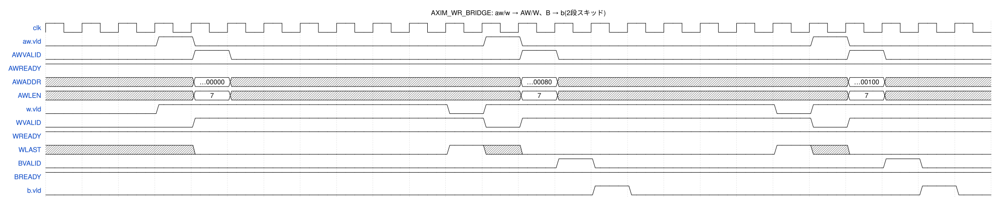

<details><summary>WaveDrom の記述(wave/axim_wr_bridge.json)</summary>

```wavedrom
{"signal": [
  {"name": "clk", "wave": "p........................."},
  {"name": "aw.vld", "wave": "0..10.......10.......10..."},
  {"name": "AWVALID", "wave": "0...10.......10.......10.."},
  {"name": "AWREADY", "wave": "1........................."},
  {"name": "AWADDR", "wave": "x...=x.......=x.......=x..", "data": ["…00000", "…00080", "…00100"]},
  {"name": "AWLEN", "wave": "x...=x.......=x.......=x..", "data": ["7", "7", "7"]},
  {"name": "w.vld", "wave": "0..1.......01.......01...."},
  {"name": "WVALID", "wave": "0...1.......01.......01..."},
  {"name": "WREADY", "wave": "1........................."},
  {"name": "WLAST", "wave": "x...0......1x0......1x0..."},
  {"name": "BVALID", "wave": "0.............10.......10."},
  {"name": "BREADY", "wave": "1........................."},
  {"name": "b.vld", "wave": "0..............10.......10"}
],
 "head": {"text": "AXIM_WR_BRIDGE: aw/w → AW/W、B → b(2段スキッド)"},
 "config": {"hscale": 2}
}
```

</details>

### 9.19 BAYER2RGB_SFIFO

同期 FIFO です。書き込み側・読み出し側とも vld/busy/data(ポートは個別の信号)です。

| パラメータ | 内容 |
|---|---|
| DEPTH | 段数 |
| DW | データ幅 |
| USE_SRAM | 0: FF で作る(浅い FIFO 用。容量 DEPTH)。1: 1R1W SRAM + 先読み2段(容量 DEPTH+2) |

- SRAM 版は書き込みから読み出し側に出るまで3クロックです。連続して毎クロック1ワードを読み書きできます。
- `o_cnt` は格納数です(SRAM 版は読み出し中と先読みの分を含む)。
- `i_clr` で中身を捨てます(同期クリア)。

| 使っているところ | DEPTH × DW | 実装 |
|---|---|---|
| RD_DMA 読み出しバッファ | 64 × 128 | SRAM |
| WR_DMA 書き込みバッファ | 64 × 144 | SRAM |
| WR_DMA バースト長のキュー | 4 × 5 | FF |
| CORE 出力 FIFO(OUT_FIFO) | 32 × 195(PPC=8) | SRAM |

| 信号名 | 入出力 | 信号仕様 | ビット幅 | 極性 |
|---|---|---|---|---|
| clk | 入力 | 映像系クロック(AXI4マスタ・画像処理)。400MHz | 1 | 立ち上がり |
| rst_n | 入力 | 映像系リセット。非同期アサート・同期解除(同期化は外部) | 1 | Low |
| i_clr | 入力 | 同期クリア(ソフトリセット)。1クロックのパルスで有効ビットを消す | 1 | High |
| i_wvld | 入力 | 書き込みが有効 | 1 | High |
| o_wbusy | 出力 | 満杯(書き込めない) | 1 | High |
| i_wdata | 入力 | 書き込みデータ | DW | - |
| o_rvld | 出力 | 読み出しデータが有効(空でない) | 1 | High |
| i_rbusy | 入力 | 読み出し側が受け取れない | 1 | High |
| o_rdata | 出力 | 読み出しデータ(先頭) | DW | - |
| o_cnt | 出力 | 格納数 | CW | - |

波形(RD_DMA の読み出しバッファ): `i_wvld` から SRAM に書き(`sram.wen`)、読み出し(`sram.ren`)を経て3クロックで `o_rvld` が1になります。`r_scnt` は SRAM の中の数、`r_pcnt` は先読みの数です。

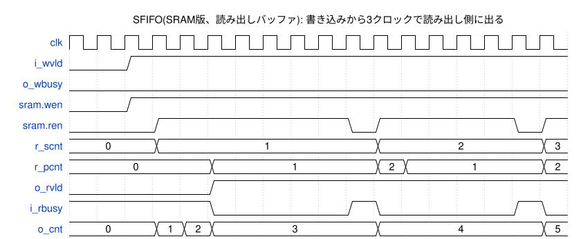

<details><summary>WaveDrom の記述(wave/sfifo.json)</summary>

```wavedrom
{"signal": [
  {"name": "clk", "wave": "p................."},
  {"name": "i_wvld", "wave": "0.1..............."},
  {"name": "o_wbusy", "wave": "0................."},
  {"name": "sram.wen", "wave": "0.1..............."},
  {"name": "sram.ren", "wave": "0..1......01....01"},
  {"name": "r_scnt", "wave": "=..=.......=.....=", "data": ["0", "1", "2", "3"]},
  {"name": "r_pcnt", "wave": "=....=.....==....=", "data": ["0", "1", "2", "1", "2"]},
  {"name": "o_rvld", "wave": "0....1............"},
  {"name": "i_rbusy", "wave": "1....0....10....10"},
  {"name": "o_cnt", "wave": "=..===.....=.....=", "data": ["0", "1", "2", "3", "4", "5"]}
],
 "head": {"text": "SFIFO(SRAM版、読み出しバッファ): 書き込みから3クロックで読み出し側に出る"},
 "config": {"hscale": 1}
}
```

</details>

### 9.20 BAYER2RGB_SKID

2段スキッドバッファです(vld/busy/data)。出力の `o_vld` / `o_data` と、入力側への `o_busy` をすべて FF から出します。出力が止まっていても1ビート受け取れるので、連続転送で毎クロック1ビートを流せます。BRIDGE で AXI の各チャネルに使っています。

| 信号名 | 入出力 | 信号仕様 | ビット幅 | 極性 |
|---|---|---|---|---|
| clk | 入力 | 映像系クロック(AXI4マスタ・画像処理)。400MHz | 1 | 立ち上がり |
| rst_n | 入力 | 映像系リセット。非同期アサート・同期解除(同期化は外部) | 1 | Low |
| i_vld | 入力 | 入力が有効 | 1 | High |
| o_busy | 出力 | 入力を受け取れない(FFから出す) | 1 | High |
| i_data | 入力 | 入力データ | DW | - |
| o_vld | 出力 | 出力が有効(FFから出す) | 1 | High |
| i_busy | 入力 | 出力先が受け取れない | 1 | High |
| o_data | 出力 | 出力データ(FFから出す) | DW | - |

波形(AXIM_WR_BRIDGE の W チャネル、WREADY 40%): 出力が止まる(`i_busy`=1)と、受け取ったビートをスキッド段に入れ、次のクロックで `o_busy`=1 になります。データの順番は変わりません(D0, D1, ...)。

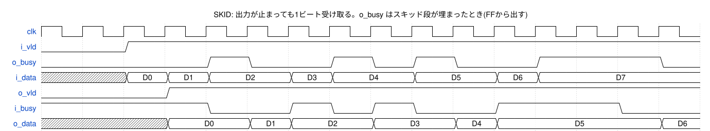

<details><summary>WaveDrom の記述(wave/skid.json)</summary>

```wavedrom
{"signal": [
  {"name": "clk", "wave": "p..............."},
  {"name": "i_vld", "wave": "0.1............."},
  {"name": "o_busy", "wave": "0...10.1010.1..0"},
  {"name": "i_data", "wave": "x.===.==.=.==...", "data": ["D0", "D1", "D2", "D3", "D4", "D5", "D6", "D7"]},
  {"name": "o_vld", "wave": "0..1............"},
  {"name": "i_busy", "wave": "1...0.1010.1..0."},
  {"name": "o_data", "wave": "x..=.==.=.==...=", "data": ["D0", "D1", "D2", "D3", "D4", "D5", "D6"]}
],
 "head": {"text": "SKID: 出力が止まっても1ビート受け取る。o_busy はスキッド段が埋まったとき(FFから出す)"},
 "config": {"hscale": 2}
}
```

</details>

### 9.21 BAYER2RGB_SRAM_1R1W

1R1W SRAM のラッパです。読み出しの遅れは1クロックで、`i_ren`=0 のクロックは `o_rdata` を保持します。同じアドレスを同じクロックに読み書きしないことは使う側で保証します。量産ではSRAMコンパイラのマクロに置き換えます(12章)。

| パラメータ | 内容 |
|---|---|
| DEPTH | ワード数 |
| DW | データ幅 |

| 信号名 | 入出力 | 信号仕様 | ビット幅 | 極性 |
|---|---|---|---|---|
| clk | 入力 | クロック | 1 | 立ち上がり |
| i_ren | 入力 | 読み出し | 1 | High |
| i_raddr | 入力 | 読み出しアドレス | AW | - |
| o_rdata | 出力 | 読み出しデータ(レイテンシ1。読まないときは保持) | DW | - |
| i_wen | 入力 | 書き込み | 1 | High |
| i_waddr | 入力 | 書き込みアドレス | AW | - |
| i_wdata | 入力 | 書き込みデータ | DW | - |

波形(LBUF の SRAM1): アドレスを読んだ次のクロックにデータが出ます。ライン n でアドレス a に書いた値(例: D6)は、ライン n+1 でアドレス a を読むと出てきます。

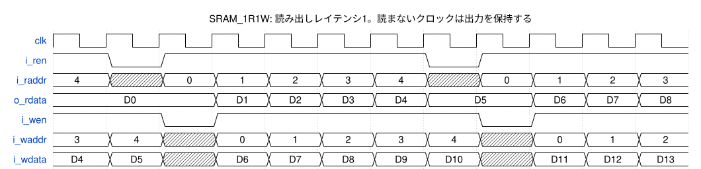

<details><summary>WaveDrom の記述(wave/sram.json)</summary>

```wavedrom
{"signal": [
  {"name": "clk", "wave": "p..........."},
  {"name": "i_ren", "wave": "101....01..."},
  {"name": "i_raddr", "wave": "=x=====x====", "data": ["4", "0", "1", "2", "3", "4", "0", "1", "2", "3"]},
  {"name": "o_rdata", "wave": "=..=====.===", "data": ["D0", "D1", "D2", "D3", "D4", "D5", "D6", "D7", "D8"]},
  {"name": "i_wen", "wave": "1.01....01.."},
  {"name": "i_waddr", "wave": "==x=====x===", "data": ["3", "4", "0", "1", "2", "3", "4", "0", "1", "2"]},
  {"name": "i_wdata", "wave": "==x=====x===", "data": ["D4", "D5", "D6", "D7", "D8", "D9", "D10", "D11", "D12", "D13"]}
],
 "head": {"text": "SRAM_1R1W: 読み出しレイテンシ1。読まないクロックは出力を保持する"},
 "config": {"hscale": 2}
}
```

</details>

### 9.22 BAYER2RGB_SYNC2

1ビットの2段同期化のラッパです。トグル信号・レベル信号の同期化だけに使い、多ビットのデータは通しません。量産では同期化専用のスタンダードセルに置き換えます(12章)。

| 信号名 | 入出力 | 信号仕様 | ビット幅 | 極性 |
|---|---|---|---|---|
| clk | 入力 | 同期化先のクロック | 1 | 立ち上がり |
| rst_n | 入力 | 同期化先のリセット(Lowで INIT にする) | 1 | Low |
| i_d | 入力 | 同期化する信号(別クロックのFFの出力) | DW | - |
| o_q | 出力 | 2段同期化した信号 | DW | - |

波形(CDC の要求トグル): 制御系の `r_req_c` が変わると、映像系の1段目(`r_m`)が次の clk で取り込み、その次の clk で `o_q` が変わります。

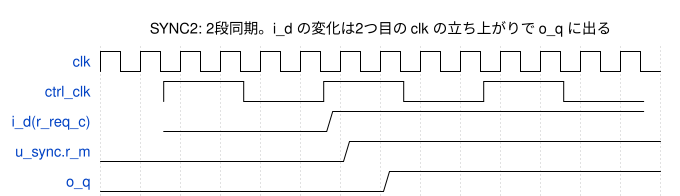

<details><summary>WaveDrom の記述(wave/sync2.json)</summary>

```wavedrom
{"signal": [
  {"name": "clk", "wave": "p............."},
  {"name": "ctrl_clk", "wave": "p..", "period": 4, "phase": -1.58},
  {"name": "i_d(r_req_c)", "wave": "01.", "period": 4, "phase": -1.58},
  {"name": "u_sync.r_m", "wave": "0.....1......."},
  {"name": "o_q", "wave": "0......1......"}
],
 "head": {"text": "SYNC2: 2段同期。i_d の変化は2つ目の clk の立ち上がりで o_q に出る"},
 "config": {"hscale": 1}
}
```

</details>

## 10. 性能

### 10.1 1フレームの処理時間

1フレームのクロック数は、次の3つのうち最も大きいものでほぼ決まります(メモリが毎クロック応答できる場合)。

| 要素 | クロック数 |
|---|---|
| 読み出し(R) | W × H × 2 / 16 |
| 書き込み(W) | ceil(W × 3 / 16) × H |
| CORE のステップ | (H + 1) × (W / PPC + 1) |

clk = 400 MHz のときの値です。

| 大きさ | PPC | R ビート | W ビート | CORE ステップ | 律速 | 処理時間 | 最大フレームレート |
|---|---:|---:|---:|---:|---|---:|---:|
| 3840×2160 | 8 | 1,036,800 | 1,555,200 | 1,039,441 | W | 3.89 ms | 257 fps |
| 3840×2160 | 4 | 1,036,800 | 1,555,200 | 2,076,721 | CORE | 5.19 ms | 192 fps |
| 3840×2160 | 2 | 1,036,800 | 1,555,200 | 4,151,281 | CORE | 10.38 ms | 96 fps |
| 3840×2160 | 1 | 1,036,800 | 1,555,200 | 8,300,401 | CORE | 20.75 ms | 48 fps |
| 1920×1080 | 8 | 259,200 | 388,800 | 260,521 | W | 0.97 ms | 1028 fps |
| 1920×1080 | 1 | 259,200 | 388,800 | 2,076,601 | CORE | 5.19 ms | 192 fps |

シミュレーション(`b2r_full_frame_test`、3840×2160、PPC=8、メモリは遅れ固定で毎クロック応答)では、レジスタ設定を含めて 3.898 ms(書き込みビート数 1,555,200 に対して約 0.25% の増え)でした。実際の処理時間はメモリの帯域と遅れで決まります。

### 10.2 メモリ帯域

| 条件 | 読み出し | 書き込み |
|---|---:|---:|
| 3840×2160 を 60 fps | 0.995 GB/s | 1.493 GB/s |
| AXI4 マスタの最大(128bit × 400 MHz、各方向) | 6.4 GB/s | 6.4 GB/s |

### 10.3 PPC の選び方

- PPC=8(既定): 4K で約 257 fps まで処理でき、書き込みの帯域で律速します。
- PPC を下げると CORE の演算器(DMSC、FCS、GAMMA)がほぼ PPC に比例して減ります。4K 60 fps なら PPC=2(96 fps)、4K 30 fps なら PPC=1(48 fps)で足ります。
- SRAM の容量は PPC によらずほぼ同じです(下の表)。

PPC ごとの論理合成の結果(ASAP7、WC コーナー、400 MHz。14.3。SRAM は仮マクロ):

| PPC | セル数 | 面積(合計) | 標準セル | SRAM | GAMMA | FCS | DMSC | セットアップ WNS(配線なし) |
|---:|---:|---:|---:|---:|---:|---:|---:|---:|
| 8 | 166,032 | 26,583 um² | 18,674 um² | 7,909 um² | 6,099 um² | 3,755 um² | 2,321 um² | +0.639 ns |
| 4 | 98,567 | 19,168 um² | 11,445 um² | 7,722 um² | 3,011 um² | 1,872 um² | 1,182 um² | +0.680 ns |
| 2 | 65,020 | 15,584 um² | 7,955 um² | 7,629 um² | 1,558 um² | 980 um² | 606 um² | +0.637 ns |
| 1 | 48,308 | 13,738 um² | 6,154 um² | 7,584 um² | 778 um² | 512 um² | 318 um² | +0.653 ns |

### 10.4 SRAM の一覧

| 用途 | インスタンス | ワード × ビット(PPC=8) | 容量 |
|---|---|---|---:|
| ラインバッファ(2ライン前) | u_core.u_sram0 | 480 × 112(3840/PPC × PPC×14) | 53,760 bit |
| ラインバッファ(1ライン前) | u_core.u_sram1 | 480 × 112 | 53,760 bit |
| 読み出しバッファ | u_rd_dma.u_rbuf | 64 × 128 | 8,192 bit |
| 書き込みバッファ | u_wr_dma.u_wbuf | 64 × 144 | 9,216 bit |
| 出力 FIFO | u_core.u_out_fifo | 32 × 195(32 × (PPC×24+3)) | 6,240 bit |
| 合計 | | | 131,168 bit |

PPC=1 では ラインバッファが 3840 × 14、出力 FIFO が 32 × 27 で、合計 125,792 bit です。

## 11. クロック乗せ換え(CDC)とタイミング制約

### 11.1 乗せ換えの一覧

`clk` と `ctrl_clk` の間の信号は BAYER2RGB_CDC の中だけで受け渡します(9.4)。同期化は BAYER2RGB_SYNC2(2段)で、1ビットのトグル信号だけを通します。

| No | 送り側(クロック) | 受け側(クロック) | 信号 | 種類 |
|---|---|---|---|---|
| 1 | u_cdc.r_req_c(ctrl_clk) | u_cdc.u_sync_req(clk) | 要求トグル | 2段同期 |
| 2 | u_cdc.r_req_d_v(clk) | u_cdc.u_sync_ack(ctrl_clk) | ACK トグル | 2段同期 |
| 3 | u_cdc.r_pl_cfg、r_pl_start、r_pl_srst(ctrl_clk) | u_cdc.r_cfg_v ほか(clk) | 設定と要求の種類 | MCP(要求中は変化しない) |
| 4 | u_cdc.r_ev_req_v(clk) | u_cdc.u_sync_ev_req(ctrl_clk) | イベントのトグル | 2段同期 |
| 5 | u_cdc.r_ev_req_d_c(ctrl_clk) | u_cdc.u_sync_ev_ack(clk) | イベントの ACK トグル | 2段同期 |
| 6 | u_cdc.r_ev_pl_v(clk) | u_cdc.r_evt_c(ctrl_clk) | イベントの中身 | MCP(送信中は変化しない) |

MCP のデータ(No.3、6)は、トグルが受け側で同期化されて検出されるまで(受け側クロックで2周期以上)変化しません [R8]。

### 11.2 制約の考え方

- `clk` と `ctrl_clk` は非同期として扱います。上の表以外に2つのクロックの間の経路はありません。
- No.1、2、4、5(同期化セルの1段目へのトグル): 通常のタイミング検査から外し、配線の遅れだけを受け側クロックの1周期以内に制限します。
- No.3、6(MCP のデータ): 通常のタイミング検査から外し、データの遅れ(クロックの遅れを含めない)を受け側クロックの1周期以内に制限します。データのビットどうしのばらつきも1周期以内にします。
- 同期化セルの1段目と2段目は近くに置きます(同期化専用セルを使う。12章)。

制約は `syn/constraints/bayer2rgb.sdc` にあります(論理合成・配置配線・STA で共通。14.2)。2つのクロックの間の経路は上の表の6種類だけなので、セル名を使わず、クロックどうしの指定で書いています。`set_clock_groups -asynchronous` は遅れの上限まで消してしまうので使いません。

```tcl
create_clock -name clk         -period 2.500  [get_ports clk]
create_clock -name ctrl_clk    -period 10.000 [get_ports ctrl_clk]
# 入出力の相手(IP の外の FF)のクロック。仮想クロック(14.2)
create_clock -name clk_io      -period 2.500
create_clock -name ctrl_clk_io -period 10.000

# No.1〜6: データの遅れ(クロックの遅れを含めない)を受け側の1周期以内にする
set b2r_dom_clk  [get_clocks {clk clk_io}]
set b2r_dom_ctrl [get_clocks {ctrl_clk ctrl_clk_io}]
set_max_delay 2.500  -ignore_clock_latency -from $b2r_dom_ctrl -to $b2r_dom_clk
set_max_delay 10.000 -ignore_clock_latency -from $b2r_dom_clk  -to $b2r_dom_ctrl
# ホールドは検査しない
set_false_path -hold -from $b2r_dom_ctrl -to $b2r_dom_clk
set_false_path -hold -from $b2r_dom_clk  -to $b2r_dom_ctrl
```

入出力の相手のクロック(`clk_io`、`ctrl_clk_io`)は、それぞれ `clk` 側、`ctrl_clk` 側に含めています。合成後の STA で、2つの側の間の経路の終点の数を数えています(`syn/yosys` の `reports/sta_cdc.txt`)。PPC=8/4/2/1 のすべてで、clk → ctrl_clk が 6、ctrl_clk → clk が 799(設定の受け渡しのデータとトグル)、仮想クロックと反対側のクロックの間が 0 でした。

`-ignore_clock_latency` は、経路の余裕の計算からクロックの遅れ(スキュー)を除く指定です [R25]。OpenSTA(OpenROAD)で使えることを確かめています。使えないツールでは、そのツールのクロックの遅れを除く指定(例 `-datapath_only`)に置き換えてください。

### 11.3 リセット

- `rst_n` と `ctrl_rst_n` は非同期アサート・同期解除で、それぞれのクロックに同期して解除してください(同期化はIPの外)。
- 2つのリセットは同時にアサートしてください。片方だけをリセットすると CDC のトグルの状態が食い違い、余分なイベントが出ることがあります。動作中に止めたいときはソフトリセット(7.4)を使ってください。
- リセットするのは制御の FF(有効ビット、状態、カウンタ)だけです。データの FF と SRAM は初期化しないので、リセット直後の値は不定です(不定値が出力に出ないことは検証で確かめています。13.1)。

## 12. 製品IP(SRAM・同期化セル)の扱い

製品IP(SRAM マクロ、同期化セル)はラッパで包んでいます。RTL はラッパだけを使い、シミュレーションではラッパの中で振る舞いモデルを使います。

| ラッパ(rtl/) | 振る舞いモデル(model/) | 量産での置き換え |
|---|---|---|
| BAYER2RGB_SRAM_1R1W | BAYER2RGB_SRAM_1R1W_BHV | Foundry の SRAM コンパイラで作った 1R1W(2ポート)マクロ |
| BAYER2RGB_SYNC2 | BAYER2RGB_SYNC2_BHV | スタンダードセルライブラリの2段同期化セル |

### 12.1 SRAM の置き換え

1. 10.4 の5種類の大きさ(ワード数 × ビット幅)のマクロを SRAM コンパイラで作ります。ビット幅が合わないときは、幅の広いマクロを使うか、複数個を並べます。
2. 論理合成用のラッパ `syn/rtl/foundry/BAYER2RGB_SRAM_1R1W.sv`(雛形。DEPTH / DW でマクロを選ぶ generate)のマクロ名と端子名を、コンパイラの出力に合わせて書き換えます。論理合成では `rtl/` の同じ名前のファイルの代わりにこれを読みます(14章)。`rtl/` のラッパはシミュレーション用(振る舞いモデルを呼ぶ)のまま残します。
3. マクロの性質がラッパの約束と違う場合は、ラッパの中で合わせます。
   - 読み出しの遅れが1クロックでない → ラッパでは対応できないので、使う側の段数の変更が必要です(相談してください)。
   - `i_ren`=0 のときに出力を保持しない → ラッパに保持用のレジスタを追加します(使う側の LBUF と SFIFO は読み出しの次のクロックでだけ値を使うので、保持しなくても動作上は問題ありませんが、ラッパの約束どおりにしておきます)。
   - 同じアドレスの同時読み書きは起きないので、衝突時の動作は問いません。
4. テスト用の端子(BIST、スキャン、電源制御など)はラッパの外に出すか、ラッパの中でつなぎます。

### 12.2 同期化セルの置き換え

論理合成用のラッパ `syn/rtl/foundry/BAYER2RGB_SYNC2.sv`(雛形)のセル名と端子名を、同期化専用セル(非同期リセット付き、リセット値 0)に合わせて書き換えます。DW は1だけを使っています。合成と配置配線でこのセルを最適化しないように、同じ名前を `pd/commercial/setup/foundry_setup.tcl` の `B2R_SYNC2_CELLS` に書きます。

### 12.3 振る舞いモデル

| モデル | 動作 | 検査 |
|---|---|---|
| BAYER2RGB_SRAM_1R1W_BHV | 書き込み・読み出しとも1クロック。`i_ren`=0 では出力を保持。中身の初期値は不定 | 同じアドレスの同時読み書き、範囲外のアドレスで `$error`(出力は X) |
| BAYER2RGB_SYNC2_BHV | 2段の FF。`+define+BAYER2RGB_CDC_RANDOM_DELAY` を付けると、入力が変わったときに1段目の取り込みを乱数で1クロック遅らせる(メタステーブルの後に旧値に落ち着く場合をまねる) | - |

## 13. 検証

### 13.1 方針

- UVM(IEEE 1800.2-2017-1.0)の環境で、ランダムな設定・画像・メモリの応答タイミングを与え、出力をリファレンスモデルとビット単位で比べます。
- 同じ環境を Verilator と Xcelium で動かせるようにしています(`sim/Makefile`)。
- リファレンスモデルは SystemVerilog(`tb/uvm/b2r_ref_model.svh`、スコアボードで使用)と Python(`tools/b2r_model.py`)の2つで、互いに照合します。
- AXI のプロトコルと本IPの約束(16バイト・INCR・4KB 境界・同時発行数など)はインタフェースの検査で毎クロック確かめます。
- リセットしない FF と SRAM の初期値は乱数にして(Verilator の `--x-assign unique --x-initial unique` と `+verilator+rand+reset+2`)、初期値に依存しないことを確かめます。

### 13.2 検証環境の構成

| 部品 | ファイル | 内容 |
|---|---|---|
| tb_top | `tb/tb_top.sv` | クロック(`+CLK_PS`、`+CTRL_CLK_PS` で周期を変更)、リセット、DUT、インタフェース、波形の出力(`+WAVES`) |
| AXI4-Lite インタフェース | `tb/b2r_axil_if.sv` | BVALID/RVALID と応答の保持、要求していない応答がないことを検査 |
| AXI4 インタフェース | `tb/b2r_axi4_if.sv` | VALID と値の保持、ID=0、SIZE=16バイト、INCR、LEN≦15、16バイト境界、4KB 境界、LOCK=0、同時発行≦4、VALID/READY の不定値を検査 |
| b2r_axil_agent | `tb/uvm/b2r_axil_agent.svh` | AXI4-Lite マスタ。AW と W を別々の乱数の遅れで出す。BREADY/RREADY を乱数で遅らせる |
| b2r_axi_slave | `tb/uvm/b2r_axi_slave.svh` | AXI4 スレーブ(メモリ)。READY の割合、応答の遅れ、ビートの間隔、エラー応答の割合を設定できる。W が AW より先に来る場合も受ける。WLAST の位置と W/AW の対応を検査 |
| b2r_mem | `tb/uvm/b2r_mem.svh` | 4KB ページ単位の疎なメモリ |
| b2r_image | `tb/uvm/b2r_image.svh` | 合成画像 7種類(一様乱数、グラデーション、色付きの矩形、縞・市松、0/最大値の混在、暗部、明部)。上位2bitに乱数を入れる |
| b2r_frame_cfg | `tb/uvm/b2r_frame_cfg.svh` | 1フレームの設定と乱数化 |
| b2r_ref_model | `tb/uvm/b2r_ref_model.svh` | SystemVerilog のリファレンスモデル(6章の式) |
| b2r_scoreboard | `tb/uvm/b2r_scoreboard.svh` | AR/AW の並び(アドレス・長さ・属性)を設定から予測して比較。W はバイトごとに、出力領域の内側か、2回書いていないか、リファレンスモデルと一致するかを検査。`+B2R_DUMP` でフレームの入出力をファイルに出す |
| b2r_coverage | `tb/uvm/b2r_coverage.svh` | 機能カバレッジ(フレームの設定、バースト、制御のイベント) |
| b2r_base_test / b2r_tests | `tb/uvm/b2r_base_test.svh`、`b2r_tests.svh` | テストの共通部分(レジスタアクセス、フレームの設定・開始・完了待ち)とテスト |

RTL の中にもシミュレーション専用の検査があります(`ifndef SYNTHESIS`): CDC の使い方の誤り、IN_CTRL の動作中の開始、SRAM モデルの同じアドレスの同時読み書きと範囲外アドレス。どれも `$error` を出し、回帰試験では失敗になります。

### 13.3 テスト

| テスト | 内容 |
|---|---|
| b2r_reg_test | レジスタのリセット値、読み書き、バイトイネーブル、読み出し専用、未定義アドレス |
| b2r_smoke_test | 既定の設定で1フレーム + 乱数の設定 |
| b2r_phase_test | Bayer の並び4種類 |
| b2r_func_test | BLC / WB / FCS / ガンマの有効・無効とパラメータの乱数 |
| b2r_bypass_test | バイパス(R=G=B=Bayer 値) |
| b2r_tpg_test | テストパターン4種類(入力メモリを読まないこと) |
| b2r_size_test | 幅・高さの境界、クランプ、切り捨て |
| b2r_stress_test | メモリの遅れと READY の詰まりが多い条件 |
| b2r_4kb_test | 4KB 境界をまたぐラインとバーストの分割 |
| b2r_auto_restart_test | 自動再開と REG_UPDATE(設定の保持) |
| b2r_error_test | 読み出し・書き込みのエラー応答と割り込み |
| b2r_sw_reset_test | ソフトリセット(停止中、処理中、START と同時) |
| b2r_ctrl_test | 処理中の START(保留)、BUSY、割り込み出力 |
| b2r_full_frame_test | 3840×2160 の1フレーム |
| b2r_random_test | すべてを乱数で組み合わせる(12フレーム) |
| b2r_wave_test | 仕様書の波形図を作るためのテスト(9章) |

テスト共通のプラスアーグ: `+B2R_FRAMES=n`(フレーム数)、`+B2R_TIMING=0/1/2`(メモリの応答: 速い / 乱数 / 遅い・詰まりが多い)、`+B2R_WMAX`、`+B2R_HMAX`(乱数で決める幅・高さの上限、既定 256 / 48)、`+B2R_DUMP=接頭辞`(フレームの入出力をファイルに出す)。

### 13.4 回帰試験

`sim/tests.list` に、ビルド(PPC=8/4/2/1、同期化セルの乱数遅延あり)、テスト、シードの数、プラスアーグを書いています。クロックの周期の組み合わせ(clk と ctrl_clk のどちらが速い場合も)を含みます。

| ビルド | 内容 | 実行数 |
|---|---|---:|
| ppc8 | PPC=8 | 56 |
| ppc4 | PPC=4 | 7 |
| ppc2 | PPC=2 | 5 |
| ppc1 | PPC=1 | 5 |
| cdc | PPC=8、`BAYER2RGB_CDC_RANDOM_DELAY`(同期化の取り込みを乱数で1クロック遅らせる) | 16 |
| 合計 | | 89 |

結果(2026-10-25、Verilator 5.053、2コアのマシン。14.3.3 の RTL の修正の後に実行):

| 回帰試験 | 実行数 | 結果 | 時間(ビルドを含む) | 結果のファイル |
|---|---:|---|---:|---|
| `make regress` | 89 | PASS 89 / FAIL 0 | 16分56秒 | `sim/results/regress.txt` |
| `make cov`(カバレッジ付き、`JOBS=1`) | 89 | PASS 89 / FAIL 0 | 25分59秒 | `sim/results/regress_cov.txt` |

時間は、論理合成・配置配線と同時に実行したときのものです(修正の前に単独で実行したときは、それぞれ 13分27秒、16分23秒)。

合否は、ログに `TEST PASSED` があり、`%Error`(インタフェースの検査、RTL の検査、SRAM モデルの検査)がないことで判定しています。`make lint`(Verilator `-Wall`)の警告は PPC=8/4/2/1 のいずれも0件です(除外の設定は `rtl/bayer2rgb_lint.vlt`)。3840×2160 の1フレーム(`b2r_full_frame_test`)も一致しました。

### 13.5 Python モデルとの照合

`+B2R_DUMP` で出したフレーム(設定、入力、DUT の出力、SV モデルの出力)を `tools/check_dumps.py` で Python モデルと照合しました。

| 実行したテスト | フレーム数 | 結果 |
|---|---:|---|
| PPC=8: b2r_random_test ×2、b2r_func_test、b2r_phase_test、b2r_bypass_test、b2r_tpg_test、b2r_size_test。PPC=4/2/1: b2r_random_test | 122 | DUT = SV モデル = Python モデル(全フレーム一致) |

### 13.6 カバレッジ

カバレッジ付きの回帰試験(`make cov`、89本、PPC=8/4/2/1 と同期化の乱数遅延の5ビルド)をまとめた結果です。

#### 機能カバレッジ

covergroup 3つ(cg_frame: フレームの設定、cg_burst: AXI のバースト、cg_event: 制御のイベント)のビン 93個は、すべて当たりました。Verilator の covergroup の集計(`verilator_coverage`: covergroup 100.0% (93/93))と、ログからの集計(`tools/merge_cov.py`)の両方で 100% です。

| covergroup.coverpoint | ビン数 | 当たったビン | カバレッジ | 当たっていないビン |
|---|---:|---:|---:|---|
| cg_frame.cp_phase | 4 | 4 | 100.0% | - |
| cg_frame.cp_blc | 2 | 2 | 100.0% | - |
| cg_frame.cp_wb | 2 | 2 | 100.0% | - |
| cg_frame.cp_fcs | 2 | 2 | 100.0% | - |
| cg_frame.cp_gamma | 2 | 2 | 100.0% | - |
| cg_frame.cp_bypass | 2 | 2 | 100.0% | - |
| cg_frame.cp_tpg | 5 | 5 | 100.0% | - |
| cg_frame.cp_w | 7 | 7 | 100.0% | - |
| cg_frame.cp_h | 6 | 6 | 100.0% | - |
| cg_frame.x_phase_func | 16 | 16 | 100.0% | - |
| cg_frame.x_func | 16 | 16 | 100.0% | - |
| cg_burst.cp_dir | 2 | 2 | 100.0% | - |
| cg_burst.cp_len | 3 | 3 | 100.0% | - |
| cg_burst.cp_reason | 3 | 3 | 100.0% | - |
| cg_burst.x_dir_reason | 6 | 6 | 100.0% | - |
| cg_burst.x_dir_len | 6 | 6 | 100.0% | - |
| cg_event.cp_ev | 9 | 9 | 100.0% | - |
| 合計 | 93 | 93 | 100.0% | |

#### コードカバレッジ(RTL)

Verilator の行カバレッジ(`--coverage-line`)を `tools/cov_summary.py` で RTL のファイルごとにまとめたものです。「分岐」は if / case の各枝です。インスタンスと配線だけのファイル(BAYER2RGB、CORE、AXIM_RD_BRIDGE、AXIM_WR_BRIDGE、SRAM と同期化セルのラッパ)とパッケージは、数える行がないので表にありません。

| ファイル | 行 | 実行した行 | 行カバレッジ | 分岐 | 通った分岐 | 分岐カバレッジ |
|---|---:|---:|---:|---:|---:|---:|
| BAYER2RGB_AXIL_BRIDGE.sv | 66 | 66 | 100.0% | 26 | 26 | 100.0% |
| BAYER2RGB_BLC.sv | 30 | 30 | 100.0% | 7 | 7 | 100.0% |
| BAYER2RGB_CDC.sv | 76 | 76 | 100.0% | 20 | 20 | 100.0% |
| BAYER2RGB_DMSC.sv | 98 | 98 | 100.0% | 16 | 16 | 100.0% |
| BAYER2RGB_FCS.sv | 70 | 70 | 100.0% | 22 | 22 | 100.0% |
| BAYER2RGB_GAMMA.sv | 77 | 77 | 100.0% | 25 | 25 | 100.0% |
| BAYER2RGB_IN_CTRL.sv | 53 | 53 | 100.0% | 60 | 60 | 100.0% |
| BAYER2RGB_LBUF.sv | 46 | 46 | 100.0% | 21 | 21 | 100.0% |
| BAYER2RGB_OUT_FIFO.sv | 2 | 2 | 100.0% | 2 | 2 | 100.0% |
| BAYER2RGB_OUT_FMT.sv | 41 | 41 | 100.0% | 11 | 11 | 100.0% |
| BAYER2RGB_RD_DMA.sv | 82 | 82 | 100.0% | 95 | 95 | 100.0% |
| BAYER2RGB_REG.sv | 255 | 255 | 100.0% | 54 | 54 | 100.0% |
| BAYER2RGB_SFIFO.sv | 52 | 49 | 94.2% | 48 | 47 | 97.9% |
| BAYER2RGB_SKID.sv | 18 | 18 | 100.0% | 22 | 22 | 100.0% |
| BAYER2RGB_WB.sv | 40 | 40 | 100.0% | 12 | 12 | 100.0% |
| BAYER2RGB_WR_DMA.sv | 113 | 101 | 89.4% | 129 | 117 | 90.7% |
| 合計 | 1119 | 1104 | 98.7% | 570 | 557 | 97.7% |

実行していない行は、どちらも動作中には到達しないものです。

| ファイル | 行 | 理由 |
|---|---|---|
| BAYER2RGB_SFIFO.sv | 67〜69 | FF 版の `i_clr` の処理。FF 版は WR_DMA のバースト長のキューだけで使い、`i_clr` は0に固定している |
| BAYER2RGB_WR_DMA.sv | 26〜38 | 定数関数 `f_gcd`(パラメータの計算でエラボレーションのときだけ評価する) |

トグルカバレッジは取っていません。

### 13.7 実行方法

必要なもの: Verilator 5.053 以降(`--timing` と UVM が使える版)、UVM 1800.2-2017-1.0(Verilator で使える版。Verilator 向けの修正を入れたものが CHIPS Alliance から出ている [R12][R13])、FST 出力用の zlib と lz4、Python 3(numpy、Pillow)。

下の表のコマンドは、全部を続けて実行するものではありません。準備のあと、目的の行を選んで実行します。

準備:

```sh
export UVM_HOME=/path/to/uvm-2017-1.0     # src/uvm_pkg.sv があるディレクトリ
cd sim
```

| 目的 | コマンド |
|---|---|
| RTL の lint(Verilator -Wall) | `make lint` |
| ビルドだけ行う(`obj_ppc8/`) | `make build` |
| テストを1つ実行する(`logs/` にログ) | `make run TEST=b2r_smoke_test SEED=1` |
| 波形を出して見る | `make run TEST=b2r_random_test SEED=5 WAVES=1` のあと `gtkwave waves.fst` |
| PPC を変えて実行する(`obj_ppc4/`) | `make run TEST=b2r_smoke_test PPC=4` |
| 回帰試験(結果は `logs/regress.txt`) | `make regress` |
| カバレッジ付きの回帰試験(`cov/`) | `make cov` |

`make run` は、ビルドがまだなら先にビルドします。ふつうは `make regress`(または `make cov`)を実行し、失敗したテストがあれば、そのテスト名とシードで `make run ... WAVES=1` を実行して波形を見ます。

Xcelium(このリポジトリの環境では実行していません。15章)も、目的の行を選んで実行します:

| 目的 | コマンド |
|---|---|
| 実行する(Xcelium に付属の UVM。-uvmhome CDNS-1.2)[R16] | `make xrun TEST=b2r_smoke_test` |
| VCD の波形を出す | `make xrun TEST=b2r_smoke_test XWAVES=vcd` のあと `gtkwave waves.vcd` |
| SHM の波形を出す(`xrun_waves.tcl`)[R15] | `make xrun TEST=b2r_smoke_test XWAVES=shm` |
| Verilator と同じ UVM のソースを使う | `make xrun TEST=b2r_smoke_test XUVM=$UVM_HOME` |

波形: Verilator は FST(`TRACE=vcd` を付けると VCD)、Xcelium は VCD(`XWAVES=vcd`)を出し、どちらも GTKWave で見られます [R17]。

Python のリファレンスモデル:

画像を作ってモデルで変換する(上から順に実行する):

```sh
python3 tools/gen_image.py --size 640x480 --kind blocks --out in.raw        # 合成画像(16bit LE)
python3 tools/b2r_model.py --in in.raw --raw-size 640x480 --crop 640x480 --out out.rgb --png out.png
```

設定を JSON で与えるときは、2行目の代わりに次を実行します:

```sh
python3 tools/b2r_model.py --in in.raw --raw-size 640x480 --cfg cfg.json --out out.rgb
```

シミュレーションの入出力(`+B2R_DUMP`)をモデルと照合する(上とは別の使い方):

```sh
python3 tools/check_dumps.py 'sim/dump/*.cfg.json'
```

### 13.8 ドキュメントの作り直し

上から順に実行します(ブロック図・端子表・波形図を作ってから、最後に仕様書を組み立てる)。本文(`doc/spec/src/`)だけを直したときは、最後の `gen_spec.py` だけで足ります。

```sh
python3 doc/tools/gen_arch.py doc/arch               # ブロック図(draw.io、SVG)
python3 doc/tools/gen_pins.py rtl doc/spec/pins      # 端子表
cd sim && make build TRACE=vcd && ./obj_ppc8_vcd/Vtb_top +UVM_TESTNAME=b2r_wave_test +verilator+seed+1 +WAVES
python3 ../doc/tools/gen_waves.py waves.vcd ../doc/spec/wave      # 波形図(WaveDrom の JSON)
cd ../doc/spec/wave && for j in *.json; do node ../../tools/render_wavedrom.js $j ${j%.json}.svg; done
cd ../../.. && python3 doc/tools/gen_spec.py         # この仕様書
```

SVG にするには node と wavedrom パッケージ(`npm install wavedrom`)が必要です。

#### GitHub での波形図の表示

GitHub の Markdown は WaveDrom を描画しないので、この仕様書では SVG の画像を表示し、WaveDrom の記述(JSON)を `<details>` の中の ```wavedrom ブロックに入れています。記述は [WaveDrom エディタ](https://wavedrom.com/editor.html) に貼ると編集できます。リポジトリを公開している場合は、WaveDrom のサーバで JSON を直接描画することもできます [R14]:

```md

```

## 14. 論理合成と物理設計

論理合成と配置配線の環境は2つあります。

| 環境 | ツール | PDK | 状態 |
|---|---|---|---|
| 公開ツールの環境 | Yosys(合成)、OpenROAD-flow-scripts(配置配線)、OpenSTA | ASAP7(7nm 相当の予測 PDK)[R18][R21] | 合成と、配置配線の概略配線までをこの環境で実行した。詳細配線から後はメモリが足りず未実行(14.4.3) |
| 商用ツールの雛形 | Cadence Genus / Innovus / Tempus / Conformal / Pegasus | Foundry の PDK | PDK とツールがないので未実行 |

ASAP7 での結果は、RTL・制約・流れが通ることと、面積・タイミングのおおよその傾向を確かめるためのものです。ASAP7 は研究用の予測 PDK で、Foundry のプロセスの面積・速度・電力とは一致しません。SRAM も仮のマクロです(14.3)。

### 14.1 ファイルの構成

| パス | 内容 |
|---|---|
| `syn/constraints/bayer2rgb.sdc` | タイミング制約(合成・配置配線・STA で共通。14.2) |
| `syn/rtl/asap7/`、`syn/rtl/foundry/` | 合成用の SRAM・同期化のラッパ(`rtl/` の同じ名前のファイルの代わりに読む。12章) |
| `syn/yosys/` | Yosys の合成と合成後の STA(`make`)。説明は `syn/README.md` |
| `pd/openroad/` | ORFS + ASAP7 の配置配線(`make`)。説明は `pd/README.md` |
| `pd/commercial/` | Cadence + Foundry の PDK の雛形(`make syn pnr sta ...`) |
| `tools/gen_sram_macro.py` | SRAM の仮マクロ(LEF、Liberty、ブラックボックス)を作る |

```
RTL(rtl/) + 合成用のラッパ(syn/rtl/<PDK>/)
  │                          制約: syn/constraints/bayer2rgb.sdc
  ▼
論理合成    Yosys + ABC(syn/yosys)          │ Genus(pd/commercial/genus)
  ▼                                          │
配置配線    ORFS: RePlAce / TritonCTS /      │ Innovus
            FastRoute / TritonRoute          │
  ▼                                          │
解析        OpenRCX + OpenSTA、IR ドロップ    │ Quantus + Tempus、Conformal、Pegasus
```

### 14.2 タイミング制約

`syn/constraints/bayer2rgb.sdc` は、ポート名とクロック名だけを使う Tcl の SDC です。セル名・インスタンス名を使わないので、合成の前後やツールによらず同じファイルを読めます。値は ns / pF で書き、ライブラリの単位(`B2R_TIME_UNIT`、`B2R_CAP_UNIT`)に合わせて換算します。

| 項目 | 既定値 | 変数 |
|---|---|---|
| clk(映像系) | 周期 2.5 ns(400 MHz) | `B2R_CLK_PERIOD` |
| ctrl_clk(制御系) | 周期 10.0 ns(100 MHz) | `B2R_CTRL_PERIOD` |
| クロックの不確かさ | セットアップ 0.10 ns、ホールド 0.03 ns | `B2R_UNC_SETUP`、`B2R_UNC_HOLD` |
| クロックの遷移時間(CTS 前) | 0.05 ns | `B2R_CLK_TRAN` |
| 入出力の相手のクロック | `clk_io`(clk と同じ周期)、`ctrl_clk_io`(ctrl_clk と同じ周期)。仮想クロック | - |
| クロックツリーの遅れの見込み | 0 ns。clk と clk_io、ctrl_clk と ctrl_clk_io の両方に与える | `B2R_CLK_LATENCY`、`B2R_CTRL_LATENCY` |
| AXI4 マスタ・AXI4-Lite・irq の入出力遅延 | clk_io / ctrl_clk_io から測る。最大: 周期の 50%、最小: 0 | `B2R_IO_PCT` |
| リセット(rst_n、ctrl_rst_n) | 入力遅延(最大: 周期の 50%、最小: 0)。解除のタイミング(リカバリ・リムーバル)を検査する | `B2R_RST_PCT` |
| 入力の遷移時間 / 出力の負荷 | 0.05 ns / 0.005 pF | `B2R_IN_TRAN`、`B2R_OUT_LOAD` |
| clk 側 ⇔ ctrl_clk 側 | 受け側の1周期(クロックの遅れを含めない)。ホールドは検査しない(11.2) | - |

変数は Tcl のグローバル変数、環境変数、既定値の順に探します。ASAP7 のライブラリは ps / fF なので、ORFS の設定(`pd/openroad/asap7/config.mk`)と `syn/yosys` で `B2R_TIME_UNIT=ps`、`B2R_CAP_UNIT=fF` を渡しています。

入出力の遅延は、IP の外の FF のクロック(仮想クロック `clk_io`、`ctrl_clk_io`)から測ります。IP の外の FF も SoC の同じクロックツリーにつながっているので、クロックツリーの遅れの見込みを、IP のクロックと仮想クロックの両方に与えます。

- クロックツリーを作る前(理想クロック): 両方の遅れが同じなので、見込みの値によらず同じ結果になります。
- クロックツリーを作った後: IP の中の FF は実際の遅れ、仮想クロックは見込みの遅れのままで計算されます(仮想クロックは伝搬しない)。見込みが実際より小さいと、入力ポートから FF への経路のホールドがその差だけ厳しくなり、不要なホールド用バッファが入ります。大きすぎると、出力ポートへの経路のホールドが厳しくなります(14.4.3)。

Innovus の CCOpt には、仮想クロックの遅れをクロックツリーに合わせて更新する機能(update_io_latency)があります [R27]。OpenROAD にはないので、ASAP7 の環境では、クロックツリーの後に `make io_latency` で測った値を `pd/openroad/asap7/config.mk` に書いています。

### 14.3 論理合成(Yosys + ASAP7)

#### 14.3.1 流れ

| 段階 | 内容 |
|---|---|
| SRAM の仮マクロ | `tools/gen_sram_macro.py` で、使う大きさ(10.4)の 1R1W マクロの LEF・Liberty・ブラックボックスを作る(1ビット 0.06 um²、端子は左辺の M4、読み出し 0.10 + 0.012 × log2(ビット数) ns) |
| 読み込み | sv2v で SystemVerilog を Verilog に変換して読む(`FRONTEND=slang` で yosys-slang を使うこともできる)[R19][R20] |
| 合成 | Yosys [R22] で階層を残して合成する(`SYNTH_FLATTEN=0`)。ABC がモジュールごとに動くので、必要なメモリが少ない |
| 割り当て | 加算器 → 全加算器・半加算器のセル、FF → ASAP7 の FF、組み合わせ回路 → ABC(面積優先のスクリプト、目標 2.5 ns) |
| 後始末 | 定数を TIEHI / TIELO に、素通しの配線にバッファを入れる |
| STA | OpenSTA [R26] で SDC を読み、セットアップ・ホールド・遷移時間を調べる(配線の遅れなし) |

ライブラリは ASAP7 の RVT、WC コーナー(SS、0.63 V、100°C)です。ORFS の ASAP7 と同じく、駆動力の小さいセル(`*x1p*`、`*xp*`)、スキャン FF、クロックゲーティングのセルは使いません。

#### 14.3.2 結果(PPC=8、400 MHz、WC)

| 項目 | 値 |
|---|---|
| セル数 | 166,032(FF 12,485、全加算器 8,470、半加算器 7,829) |
| 面積 | 26,583 um²(標準セル 18,674 um²、SRAM の仮マクロ 5個 7,909 um²) |
| セットアップ(clk、配線の遅れなし) | WNS +0.639 ns(最も遅い経路は FCS の 1.747 ns、約40段) |
| ホールド(CTS 前) | 入力ポートから・リセットの解除の検査で最大 -0.081 ns(配置配線のホールドの修正で直す) |
| 遷移時間の違反 | 2本(ファンアウトの大きいネット。配置のバッファ挿入で直す) |
| 合成の時間 | 約4分(CPU 1個) |

モジュールごとの面積(下の階層を含めない値):

| モジュール | 個数 | セル数 | 面積 [um²] | 割合 |
|---|---:|---:|---:|---:|
| BAYER2RGB_SRAM_1R1W(仮マクロ) | 5 | 5 | 7908.7 | 29.8% |
| BAYER2RGB_GAMMA | 1 | 56,750 | 6099.0 | 22.9% |
| BAYER2RGB_FCS | 1 | 37,084 | 3754.5 | 14.1% |
| BAYER2RGB_DMSC | 1 | 21,164 | 2321.3 | 8.7% |
| BAYER2RGB(トップ。REG、DMA、BRIDGE、IN_CTRL を含む) | 1 | 13,226 | 1842.8 | 6.9% |
| BAYER2RGB_CDC | 1 | 7,771 | 1186.8 | 4.5% |
| BAYER2RGB_WB | 1 | 11,408 | 1105.4 | 4.2% |
| BAYER2RGB_SFIFO | 4 | 4,861 | 669.2 | 2.5% |
| BAYER2RGB_LBUF | 1 | 4,714 | 613.0 | 2.3% |
| BAYER2RGB_SKID | 5 | 4,778 | 587.3 | 2.2% |
| BAYER2RGB_OUT_FMT | 1 | 2,397 | 277.2 | 1.0% |
| BAYER2RGB_BLC | 1 | 1,876 | 213.3 | 0.8% |
| BAYER2RGB_SYNC2 | 4 | 24 | 4.1 | 0.0% |
| 合計 | | 166,032 | 26582.5 | 100.0% |

sv2v はインタフェースを使うモジュール(CORE、DMA、BRIDGE など)をトップに展開するので、それらはトップの行に入っています。

yosys-slang で SystemVerilog を直接読んだ場合(`make FRONTEND=slang`。元の階層のまま合成)も、セル数 167,371、面積 26,760 um²、セットアップ WNS +0.660 ns と、ほぼ同じ規模・タイミングになりました(論理の等価性までは確かめていません)。PPC=4/2/1 の合成結果は 10.3 にあります。

#### 14.3.3 合成で見つけた問題と対策

最初の合成では GAMMA が 26,800 um²(全体の 56%)になりました。原因は、折れ点の選択 `i_cfg.gm_knot[r_seg1[n]]` のような添字が変数の配列の読み出しです。sv2v は構造体の cfg を1本のビット列にするので、この読み出しは cfg 全体(約 800 ビット)のシフタになり、24チャネル × 2か所に入っていました。BLC・WB の色位置による選択(`i_cfg.blc[s_site[i]]`、`i_cfg.wbg[s_site[i]]`)と REG の折れ点のレジスタの読み書きも同じ形でした。

これらを、添字との比較で選ぶ書き方(GAMMA は比較と AND-OR、BLC・WB は case、REG は折れ点ごとの比較)に直しました。動作は同じです(GAMMA の区間番号は 0〜35 なので、範囲外の場合は起きない)。直したあとの回帰試験は 89本すべて合格です(13.4)。

| 項目 | 直す前 | 直した後 |
|---|---:|---:|
| セル数 | 384,911 | 166,032 |
| 面積 | 48,057 um² | 26,583 um² |
| GAMMA の面積 | 26,800 um² | 6,099 um² |
| BLC の面積 | 729 um² | 213 um² |
| 合成の時間 | 8.5 分 | 3.9 分 |

Genus などの商用の合成ツールは配列の読み出しを選択回路として扱うので、ここまでの差は出ないと考えられますが、どのツールでも同じ回路になる書き方にしています。

### 14.4 配置配線(OpenROAD-flow-scripts + ASAP7)

#### 14.4.1 流れと設定

OpenROAD-flow-scripts(ORFS)[R18][R24] の流れに、14.3 のネットリストと共通の SDC をそのまま渡します(ORFS の中では合成しない)。ツールは OpenROAD [R23] です。

| 段階 | 内容 | 主な設定 |
|---|---|---|
| フロアプラン | コアの大きさ、端子の配置、SRAM マクロの配置、タップセル、電源配線 | 使用率 30%、正方形。端子は上辺と下辺。電源は M1/M2 のレールと M5/M6 のストライプ(マクロは M4–M5 で接続) |
| 配置 | タイミングと配線の混み具合を見た配置、バッファ挿入・サイズ変更、詳細配置 | 配置の密度 0.42 |
| CTS | clk と ctrl_clk のクロックツリー、ホールドの修正 | 違反した終点をすべて直す(`TNS_END_PERCENT=100`) |
| 入出力の遅れの確認 | CTS の後に、入出力につながる FF のクロックの遅れを測る(`make io_latency`) | 測った値を `asap7/config.mk` の表に書く(14.2) |
| 概略配線 | 概略配線(FastRoute)と、配線の見積もりを使ったタイミング・遷移時間の修正 | 配線層 M2〜M7。概略配線の容量の差し引き 0.3 |
| 詳細配線 | 詳細配線(TritonRoute)、フィラー | (この環境では未実行。14.4.3) |
| 最終 | 寄生抽出(OpenRCX)、STA、電力、IR ドロップ | WC コーナー(SS、0.63 V、100°C)(この環境では未実行) |

SRAM マクロは、面積の大きい順にコアの左端の列へ下から積み、入らなくなったら右端の列へ積みます(`pd/openroad/asap7/macro_place.tcl`)。マクロの端子は左辺にあるので、左の列は左右を反転して端子をコアの内側へ向けます。

#### 14.4.2 結果(400 MHz、WC コーナー、概略配線の後)

PPC=8 と PPC=2 を概略配線まで実行しました。タイミングは、概略配線の結果から見積もった配線の遅れを含みます。詳細配線から後は、この環境のメモリでは実行できませんでした(14.4.3)。各段階の値は `pd/openroad/results/asap7_ppc<PPC>/summary.md` にあります。

| 項目 | PPC=8 | PPC=2 |
|---|---:|---:|
| ダイの大きさ | 301.7 × 301.7 um | 231.9 × 231.9 um |
| セル数(概略配線の後) | 182,326 | 77,087 |
| セルの面積(標準セル + SRAM) | 30,310 um²(22,401 + 7,909) | 17,006 um²(9,377 + 7,629) |
| コアの使用率 | 34.3% | 32.8% |
| セットアップ WNS / TNS | +2.0 ps / 0 | +3.9 ps / 0 |
| ホールド違反 | 0 | 0 |
| CTS で入れたホールド用バッファ | 1 | 125 |
| clk のクロックの遅れ(入出力につながる FF の中央値) | 0.499 ns | 0.396 ns |
| clk のスキュー(セットアップ / ホールド) | 193.2 / 116.1 ps | 177.3 / 117.6 ps |
| 遷移時間の違反 | 5 | 0 |
| 配線長(概略配線) | 1,857,903 um | 486,830 um |
| 電力(見積もり) | 365.0 mW | 148.1 mW |
| 実行時間(フロアプラン〜概略配線、CPU 2個) | 37.9 分 | 12.0 分 |

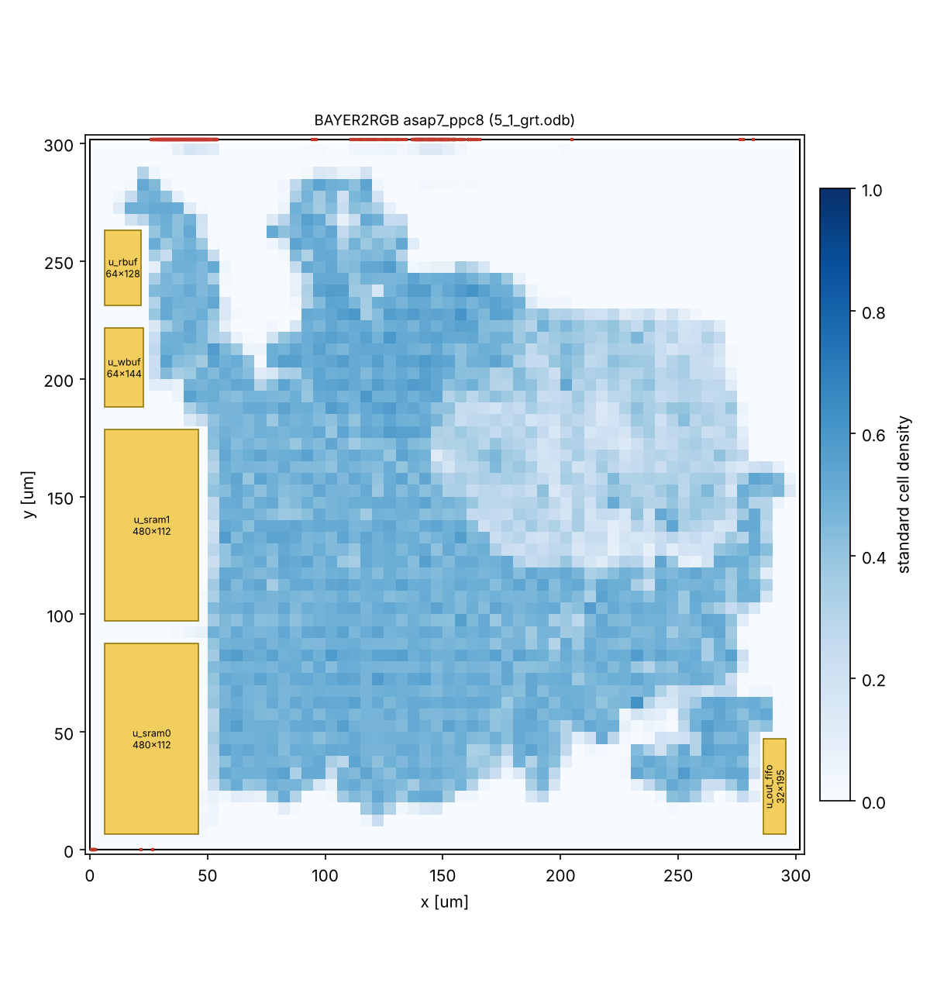

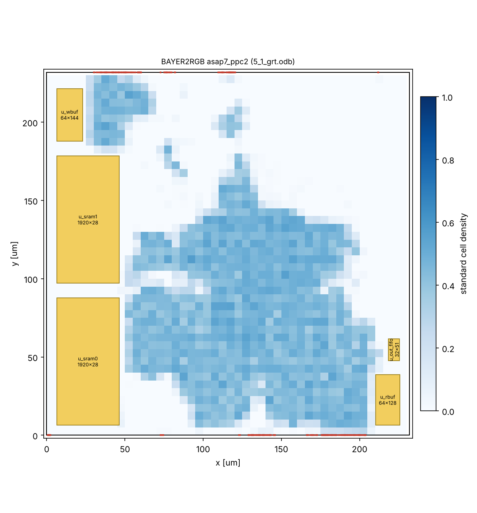

黄色が SRAM の仮マクロ、青が標準セルの密度、赤が端子です。マクロはコアの左右の端に積んでいます(14.4.1)。

#### 14.4.3 わかったこと

**入出力のクロックの遅れ(14.2)**

最初は入出力の遅延を IP のクロック(clk、ctrl_clk)から測っていました。この場合、入力ポートのデータとリセットは遅れのないクロックで出たことになり、CTS の後は IP の中の FF のクロックだけが、クロックツリーの遅れ(PPC=8 で約 0.5 ns)の分だけ遅れます。その結果、

- 入力ポートから FF への経路と、リセットの解除のリムーバル(ホールドと同じ向きの検査)が約 0.5 ns 足りなくなり、CTS のホールドの修正で 3,995 個のバッファが入りました(修正の前に違反していた終点 1,934、最大 -504 ps)。リセットの根元にも、約 0.5 ns 分のバッファの列が入りました。
- 逆に、入力ポートからの経路のセットアップと、リセットのリカバリは約 0.5 ns 甘く計算されていました。

SoC に組み込むと IP の外の FF も同じクロックツリーから来るので、これらのバッファは要りません。入出力の遅延を仮想クロックから測るように SDC を直し、仮想クロックの遅れを `make io_latency` で測った値にしました。

| 項目 | PPC=8 直す前(遅れ 0) | PPC=8 直した後 | PPC=2 見込みの値 | PPC=2 実測の値 |
|---|---:|---:|---:|---:|
| 仮想クロックの遅れ(clk / ctrl_clk) | 0 / 0 ns | 0.50 / 0.23 ns | 0.45 / 0.23 ns | 0.40 / 0.20 ns |
| CTS のホールドの修正の前に違反していた終点 | 1,934 | 1 | 0 | 237 |
| CTS で入れたホールド用バッファ | 3,995 | 1 | 0 | 125 |
| 概略配線の後のセル数 | 186,315 | 182,326 | 76,966 | 77,087 |
| 概略配線の後のセットアップ WNS(リセットのリカバリを含む) | +39.8 ps | +2.0 ps | -19.9 ps | +3.9 ps |

PPC=8 の直した後の WNS(+2.0 ps)は、直す前(+39.8 ps)より小さくなっていますが、直す前はリセットのリカバリが甘く計算されていたためで、直した後の方が実際に近い値です。PPC=2 は、はじめに見込みの値(0.45 / 0.23 ns)で流し、CTS の後に測った値(入出力につながる FF の中央値 0.395 / 0.200 ns)で流し直しました。見込みの値が実際より約 55 ps 大きかったので、ホールドの修正は 0 でしたが、リセットのリカバリが約 55 ps 厳しくなり、概略配線の後に 12 個の終点で違反しました。

**リセットの解除の検査**

概略配線の後で最も余裕が小さいのは、rst_n から FF の非同期リセット端子へのリカバリの検査です。リセットは IP の全体の制御の FF に広がるので、リセットの配線に 10段ほどのバッファが入り、遅れが 1 ns 程度になります。SDC はリセットの入力遅延を周期の 50% にしているので(`B2R_RST_PCT`)、IP の中に残るのは 1.25 ns です。IP の外の同期化の FF を IP の近くに置けるなら `B2R_RST_PCT` を小さくできます。商用の流れでも、ファンアウトの大きいリセットの配線へのバッファの入れ方を確認してください。

**配線の混み具合(GAMMA)**

最初の設定(使用率 40%、配置の密度 0.60)では、PPC=8 の概略配線が収束しませんでした(混んだ格子が 2万か所以上。ほとんどが GAMMA のまわり)。GAMMA は 24チャネル(8画素 × 3色)のそれぞれが 37個の折れ点(12 bit)から2つを選ぶので、折れ点のレジスタから多くの選択回路へ配線が広がります。使用率 30%、配置の密度 0.42、概略配線の容量の差し引き 0.3 にして、あふれが 0 になりました。

**詳細配線のメモリ**

詳細配線(TritonRoute)は、この環境(作業用のメモリの上限 約 6 GB、スワップ 8 GB、CPU 2個)では、どちらの PPC も途中でメモリ不足になり、OS に止められました(上の表の「直す前」と「見込みの値」のデータで試した。メモリの量は制約によらない)。

| | PPC=8 | PPC=2 |
|---|---|---|
| 止まった所 | 1回目の繰り返しの 10〜20%(開始から 31.5 分。端子の取り付けに 24 分) | 1回目の繰り返しの 70〜80%(開始から 34 分。端子の取り付けに 11 分) |
| そのときのメモリ + スワップ | 約 14 GB | 約 12 GB(2回試した) |

glibc の割り当ての設定(`MALLOC_ARENA_MAX=2`)を変えても同じでした。詳細配線から後(`make route final`)は、32 GB 以上のメモリの計算機で実行してください。

**遷移時間の違反**

概略配線の後の遷移時間の違反は、PPC=8 で 5本(GAMMA の中。324 ps、制限 320 ps)、PPC=2 で 0本でした。直す前の PPC=8 では 46本(GAMMA の中。最大 386 ps)、見込みの値の PPC=2 では 24本(リセットの配線。最大 367 ps)ありました。

### 14.5 商用ツールの雛形(Cadence + Foundry の PDK)

`pd/commercial/` に、Foundry の PDK と Cadence のツールで流すためのスクリプトを置いています。PDK の中身(ファイル名、セル名、層の名前、電源の作り方)は公開されていないので、`<...>` の項目を記入して使います。コマンドは Stylus Common UI を想定していますが、この環境では実行していません。

| ファイル | 内容 |
|---|---|
| `setup/foundry_setup.tcl` | PDK のパス、ライブラリ(コーナーごと)、qrcTechFile、解析ビュー、セル名、配線層(記入する) |
| `setup/design_setup.tcl`、`setup/mmmc.tcl` | 設計の設定、MMMC(Genus / Innovus / Tempus で共通) |
| `genus/syn.tcl` | 合成。ネットリスト、数値に展開した SDC、LEC の dofile を出す |
| `innovus/*.tcl` | init → floorplan → place → cts → route → signoff(段階ごとに db を保存) |
| `tempus/sta.tcl` | サインオフの STA(全ビュー、SI、CDC の経路、SDF) |
| `lec/gate2gate.do` | 合成後と配置配線後の等価性検証 |
| `syn/rtl/foundry/` | SRAM・同期化のラッパ(マクロ名・セル名を記入する) |

電源配線の作り方はプロセスによって違うので、雛形では PDK のリファレンスフローの電源配線のスクリプトを読むだけにしています(`B2R_PDN_TCL`)。

ラッパの雛形は、仮のモデル(`syn/rtl/foundry/B2R_FOUNDRY_STUB.sv`)と合わせて Verilator の lint(-Wall)を通しています(PPC=8/4/2/1、警告 0)。

### 14.6 注意

- ASAP7 の SRAM は仮マクロです。外形・端子・遅れは見積もりで、GDS もありません。Foundry のプロセスでは、メモリコンパイラのマクロの大きさ・端子の位置・遅れでやり直してください。
- ASAP7 の合成では同期化を FF 2段(`keep` 属性)で作っています。量産では同期化専用セルを使います(12.2)。
- この環境の OpenROAD は GUI の部品(Qt Charts)がないので、ORFS の最後の画像保存を止める設定にしています(`final_report.tcl` の `save_image`)。配置の図は DEF から描いています(`pd/openroad/scripts/plot_layout.py`)。
- 詳細配線から後(`make route final`)は、この環境のメモリでは実行できませんでした(14.4.3)。ORFS の手順の名前(`do-5_2_route` など)は、使った版の ORFS の Makefile と同じであることを確かめています。
- この版の OpenROAD の自動マクロ配置(RTL-MP)は、階層つきのネットリストで異常終了しました。マクロは `pd/openroad/asap7/macro_place.tcl` の規則で置いています。
- DFT(スキャン、メモリ BIST)は入れていません。商用の流れでは Genus / Modus で入れます。

## 15. 既知の制約と注意事項

### 15.1 機能・性能

- 幅は8の倍数、高さは偶数です(それ以外の設定値は切り捨て)。最小は 16×16 です。
- 入力と出力の領域を重ねた変換(同じバッファでの変換)はできません。
- バイリニア補間は、エッジでの偽色やジッパー状のノイズが出やすい方式です。FCS はエッジ量に応じて色差を縮めますが、エッジ量は中心をはさむ同じ色どうしの差なので、中心を通る1画素幅の細い線では小さくなり、細い線の偽色は抑えられません。
- AXI の ID は1種類だけで、同時発行は読み出し・書き込みとも4バースト(64ビート)です。メモリの応答の遅れ(読み出しは AR から R、書き込みは最後の W から B まで)がおおよそ 64 クロック(400 MHz で 160 ns)を超えると、帯域が下がります。
- エラー応答を受けても処理は続けます。エラーの起きたアドレスは記録しません。
- 割り込みはレベル出力です。エッジで受けるシステムでは、IRQ_STATUS をクリアしてから次の要因で再び立ちます。

### 15.2 実装

- Foundry のプロセスでの論理合成・配置配線・STA はまだ行っていません(PDK と商用ツールがないため。雛形は 14.5)。ASAP7 では 400 MHz(WC コーナー)で、合成(PPC=8/4/2/1)と、配置配線の概略配線まで(PPC=8/2)を通しました(14.3、14.4)。詳細配線・寄生抽出・配線後の STA・IR ドロップは、この環境のメモリが足りず実行していません。ASAP7 の結果は傾向を見るためのもので、Foundry のプロセスの値ではありません。
- SRAM マクロと同期化セルは、シミュレーションでは振る舞いモデル、ASAP7 の合成では仮マクロと FF 2段です。量産の前に 12章の手順で Foundry の製品IPに置き換えてください。
- CDC の制約(11.2)を必ず入れてください。CDC 検証ツールでの確認はしていません。
- PPC=8 では、GAMMA の折れ点の選択(24チャネル × 2か所 × 37個の中から選ぶ)に配線が集中します。ASAP7 では使用率 40%・配置の密度 0.60 で概略配線が収束せず、30% / 0.42 に下げました(14.4)。量産の配置配線でも GAMMA のまわりの配置の密度を下げてください(Innovus の部分的な配置ブロッケージなど)。
- 配置配線の後で最も余裕が小さいのは、リセットの解除(rst_n のリカバリ)です(ASAP7 の概略配線の後で PPC=8 が +2.0 ps、PPC=2 が +3.9 ps)。リセットは IP の全体の制御の FF に広がるので、配線のバッファで 1 ns 程度遅れます。SoC に組み込むときは、リセットの同期化の FF を IP の近くに置く(SDC の `B2R_RST_PCT` を小さくできる)か、リセットの配線へのバッファの入れ方を見直してください(14.4.3)。
- 入出力の遅延は仮想クロック(`clk_io`、`ctrl_clk_io`)から測ります。CTS の後は、仮想クロックの遅れを実際のクロックツリーの遅れに合わせてください(Innovus の update_io_latency、ASAP7 の環境の `make io_latency`。14.2)。
- DFT(スキャン、メモリ BIST)と低消費電力の機能(クロックゲーティング、電源遮断)は入れていません(ツールで挿入する前提)。
- RTL と検証環境のコメントは UTF-8 の日本語です。

### 15.3 検証

- 回帰試験とカバレッジは Verilator で行いました。Xcelium 用の Makefile と波形の設定は用意していますが、この環境では Xcelium を実行していません(ライセンスがない)。
- Verilator では UVM を `UVM_NO_DPI` で使っています(正規表現を使う機能は使っていません)。
- 機能カバレッジは、Verilator の covergroup の集計とは別に、同じビンを名前で数えてログに出し、`tools/merge_cov.py` でまとめています。Xcelium では covergroup の結果を IMC でまとめられます。

## 16. 参考文献

| No | 文献 | 使ったところ |
|---|---|---|
| R1 | [MathWorks: demosaic](https://www.mathworks.com/help/images/ref/demosaic.html) | Bayer の並びの名前(左上 2×2 の読み順) |
| R2 | [libcamera: ColorFilterArrangement の定義](https://git.libcamera.org/libcamera/pinchartl/libcamera.git/tree/src/libcamera/property_ids_draft.yaml) | Bayer の並びの名前 |
| R3 | [OpenCV Q&A: BORDER_REFLECT vs BORDER_REFLECT_101](https://answers.opencv.org/question/50706/border_reflect-vs-border_reflect_101) | 端の処理(reflect-101: gfedcb\|abcdefgh\|gfedcba) |
| R4 | [Google Patents: US7502505B2](https://patents.google.com/patent/US7502505) | MHC 方式の特許 |
| R5 | [Malvar, He, Cutler, "High-quality linear interpolation for demosaicing of Bayer-patterned color images", ICASSP 2004](https://ieeexplore.ieee.org/document/1326587) | MHC 方式 |
| R6 | [Arm: AMBA AXI Protocol Specification (IHI 0022)](https://developer.arm.com/documentation/ihi0022/latest/) | AXI4 / AXI4-Lite の規則(VALID/READY、W と AW の順序、4KB 境界、WID の廃止) |
| R7 | [Wikipedia: sRGB](https://en.wikipedia.org/wiki/SRGB) | ガンマの既定値(sRGB の変換曲線) |
| R8 | [Cummings, "Clock Domain Crossing (CDC) Design & Verification Techniques Using SystemVerilog", SNUG Boston 2008](https://pdfcoffee.com/cummings-paper-cdc-pdf-pdf-free.html) | MCP 方式(トグル + 同期化 + ACK)によるデータの受け渡し |
| R9 | [AMD UG934: AXI4-Lite Interface](https://docs.amd.com/r/en-US/ug934_axi_videoIP/AXI4-Lite-Interface) | ビデオIPの標準レジスタ(レジスタ更新、バイパス、テストパターン) |
| R10 | [AMD PG286 Sensor Demosaic: Register Space](https://docs.amd.com/r/en-US/pg286-v-demosaic/Register-Space) | Bayer の並び・幅・高さのレジスタ |
| R11 | [Verilator: verilator_coverage](https://verilator.org/guide/latest/exe_verilator_coverage.html) | コードカバレッジの集計 |
| R12 | [Antmicro: Support for upstream UVM 2017 in Verilator](https://antmicro.com/blog/2025/10/support-for-upstream-uvm-2017-in-verilator) | Verilator での UVM 2017-1.0 |
| R13 | [CHIPS Alliance: Support for upstream UVM 2017 in Verilator](https://chipsalliance.org/news/uvm-verilator/) | Verilator での UVM 2017-1.0 |
| R14 | [WaveDrom README(svg.wavedrom.com)](https://cdn.jsdelivr.net/npm/wavedrom@3.6.1/README.md) | GitHub での WaveDrom の表示 |
| R15 | [Cadence Community: xrun dump all internal signals](https://community.cadence.com/cadence_technology_forums/f/functional-verification/57941/xrun-dump-all-internal-signals) | Xcelium の波形(database / probe) |
| R16 | [OpenTitan: xcelium.hjson](https://opensecura.googlesource.com/3p/lowrisc/opentitan/+/4a6b06b28416dbb335099ead987c909e31403d78/hw/dv/data/xcelium/xcelium.hjson) | Xcelium の UVM 指定(-uvmhome CDNS-1.2) |
| R17 | [cocotb: Simulator Support](https://docs.cocotb.org/en/latest/simulator_support.html) / [GTKWave(Flathub)](https://flathub.org/apps/io.github.gtkwave.GTKWave) | Verilator の FST 出力と GTKWave |
| R18 | [OpenROAD-flow-scripts(GitHub)](https://github.com/The-OpenROAD-Project/OpenROAD-flow-scripts) | 配置配線の流れ、ASAP7 のプラットフォーム(14章) |
| R19 | [sv2v(GitHub)](https://github.com/zachjs/sv2v) | SystemVerilog → Verilog の変換(14.3) |
| R20 | [yosys-slang(GitHub)](https://github.com/povik/yosys-slang) | Yosys で SystemVerilog を直接読む(14.3) |
| R21 | [ASAP7 PDK(GitHub)](https://github.com/The-OpenROAD-Project/asap7) | 7nm 相当の予測 PDK とセルライブラリ(14章) |
| R22 | [Yosys(GitHub)](https://github.com/YosysHQ/yosys) | 論理合成(14.3) |
| R23 | [OpenROAD(GitHub)](https://github.com/The-OpenROAD-Project/OpenROAD) | 配置配線のツール(14.4) |
| R24 | [OpenROAD-flow-scripts: Flow Variables](https://openroad-flow-scripts.readthedocs.io/en/latest/user/FlowVariables.html) | ORFS の変数(14.4) |
| R25 | [Microchip: set_max_delay(SDC)](https://onlinedocs.microchip.com/oxy/GUID-AFCB5DCC-964F-4BE7-AA46-C756FA87ED7B-en-US-21/GUID-CDCFAAE7-BB67-4F0A-9E54-88F759325E05.html) | `-ignore_clock_latency` の意味(11.2) |
| R26 | [OpenSTA(GitHub)](https://github.com/parallaxsw/OpenSTA) | 静的タイミング解析(14.3、14.4) |
| R27 | [Cadence Community: Propagated clock for reg2out](https://community.cadence.com/cadence_technology_forums/f/digital-implementation/27219/propagated-clock-for-reg2out) | 入出力の遅延を仮想クロックから測る方法と、CTS の後の update_io_latency(14.2) |
