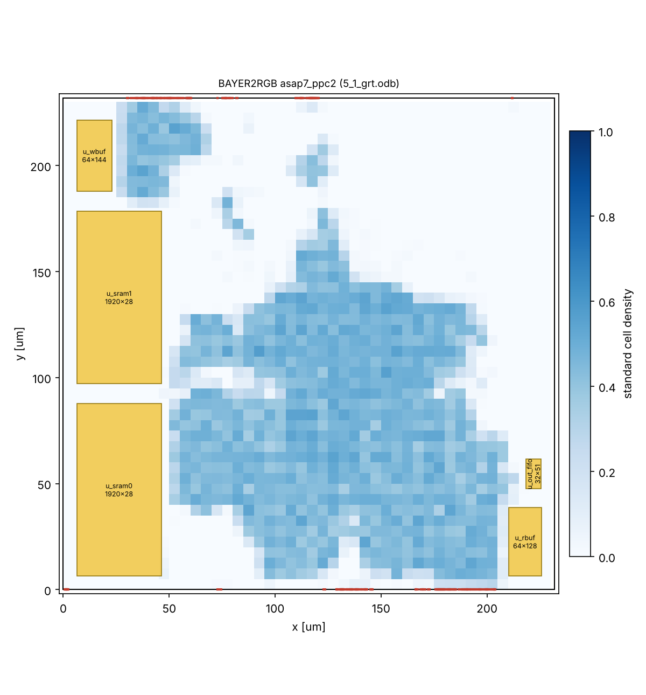

# 配置配線の結果(asap7_ppc2)

OpenROAD-flow-scripts(ASAP7)の各段階の値です。`pd/openroad/scripts/pd_summary.py` で作りました。
時間の単位は ps(ASAP7 のライブラリの単位)です。

| 項目 | フロアプラン | 配置 | CTS | 概略配線 |
|---|---:|---:|---:|---:|
| セル数 | 65199 | 76071 | 77084 | 77087 |
| セルの面積 [um²] | 15602.1 | 16710.5 | 17005.1 | 17006.2 |
| 使用率 [%] | 30.1 | 32.2 | 32.8 | 32.8 |
| セットアップ WNS [ps] | 637.4 | 188.7 | 162.1 | 3.9 |
| セットアップ TNS [ps] | 0.0 | 0.0 | 0.0 | 0.0 |
| セットアップ違反 [本] | - | 0 | 0 | 0 |
| ホールド違反 [本] | - | 10 | 0 | 0 |
| ホールド用バッファ [個] | 179 | - | 125 | 0 |
| クロックスキュー(セットアップ)[ps] | - | - | 172.4 | 177.3 |
| クロックスキュー(ホールド)[ps] | - | - | 110.8 | 117.6 |
| 遷移時間の違反 [本] | - | 0 | 0 | 0 |
| 容量の違反 [本] | - | 0 | 0 | 0 |
| 配線長 [um](配置・CTS は見積もり) | - | 330640 | 331302 | 486830 |
| アンテナ違反 [本] | - | - | - | 0 |
| 電力 [mW] | 118.41 | 139.97 | 142.65 | 148.13 |

- ダイの面積: 53785 um²、コアの面積: 51856 um²
- 実行時間(CPU 2個): フロアプラン 1.5 分、配置 7.1 分、CTS 1.2 分、概略配線 2.2 分(合計 12.0 分)

## レポート

- [2_floorplan_final.rpt](2_floorplan_final.rpt)
- [3_detailed_place.rpt](3_detailed_place.rpt)
- [4_cts_final.rpt](4_cts_final.rpt)
- [5_global_route.rpt](5_global_route.rpt)
- [io_latency.rpt](io_latency.rpt)

## 配置

黄色: SRAM マクロ、青: 標準セルの密度、赤: 端子

## 補足(手で追記)

- 入出力の仮想クロックの遅れは clk 0.40 ns、ctrl_clk 0.20 ns です(`asap7/config.mk`)。見込みの値(0.45 ns / 0.23 ns)で1回流し、CTS の後に測った値(0.395 ns / 0.200 ns)にしました。この結果の CTS の後に測った値は [io_latency.rpt](io_latency.rpt) にあります(0.396 ns / 0.201 ns)。
- 概略配線の後のセットアップ WNS(+3.9 ps)は、rst_n から FF の非同期リセット端子へのリカバリの検査です(`5_global_route.rpt`)。
- 詳細配線は、この環境のメモリでは途中で止まりました(2回試し、どちらも1回目の繰り返しの 70〜80%。仕様書 14.4.3)。
