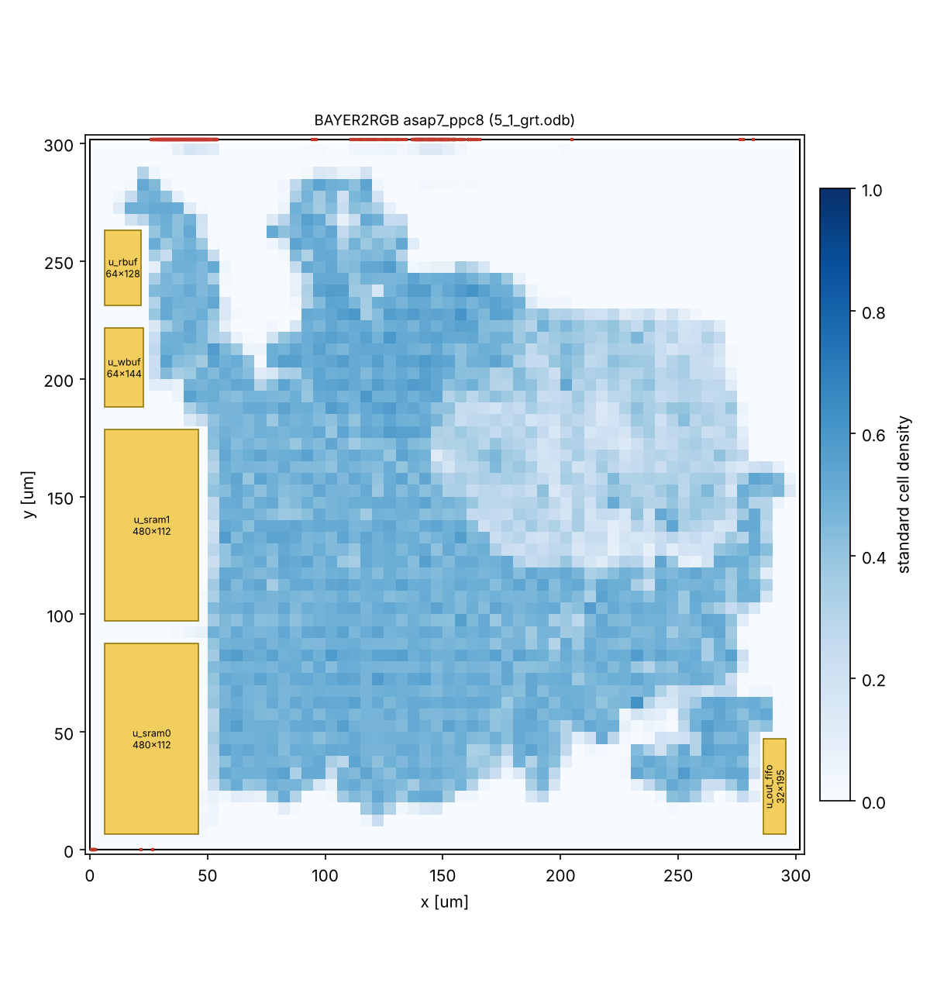

# 配置配線の結果(asap7_ppc8)

OpenROAD-flow-scripts(ASAP7)の各段階の値です。`pd/openroad/scripts/pd_summary.py` で作りました。
時間の単位は ps(ASAP7 のライブラリの単位)です。

| 項目 | フロアプラン | 配置 | CTS | 概略配線 |
|---|---:|---:|---:|---:|
| セル数 | 166214 | 180791 | 182315 | 182326 |
| セルの面積 [um²] | 26601.1 | 29809.2 | 30307.8 | 30310.0 |
| 使用率 [%] | 30.1 | 33.7 | 34.3 | 34.3 |
| セットアップ WNS [ps] | 638.7 | 160.0 | 114.7 | 2.0 |
| セットアップ TNS [ps] | 0.0 | 0.0 | 0.0 | 0.0 |
| セットアップ違反 [本] | - | 0 | 0 | 0 |
| ホールド違反 [本] | - | 0 | 0 | 0 |
| ホールド用バッファ [個] | 182 | - | 1 | 2 |
| クロックスキュー(セットアップ)[ps] | - | - | 181.3 | 193.2 |
| クロックスキュー(ホールド)[ps] | - | - | 110.2 | 116.1 |
| 遷移時間の違反 [本] | - | 0 | 0 | 5 |
| 容量の違反 [本] | - | 0 | 0 | 0 |
| 配線長 [um](配置・CTS は見積もり) | - | 1239770 | 1239660 | 1857903 |
| アンテナ違反 [本] | - | - | - | 0 |
| 電力 [mW] | 290.62 | 346.48 | 351.65 | 364.98 |

- ダイの面積: 91005 um²、コアの面積: 88466 um²
- 実行時間(CPU 2個): フロアプラン 2.7 分、配置 23.4 分、CTS 3.5 分、概略配線 8.3 分(合計 37.9 分)

## レポート

- [2_floorplan_final.rpt](2_floorplan_final.rpt)
- [3_detailed_place.rpt](3_detailed_place.rpt)
- [4_cts_final.rpt](4_cts_final.rpt)
- [5_global_route.rpt](5_global_route.rpt)
- [io_latency.rpt](io_latency.rpt)

## 配置

黄色: SRAM マクロ、青: 標準セルの密度、赤: 端子

## 補足(手で追記)

- 入出力の仮想クロックの遅れは clk 0.50 ns、ctrl_clk 0.23 ns です(`asap7/config.mk`)。CTS の後に測った値は [io_latency.rpt](io_latency.rpt) にあります(入出力につながる FF の中央値 0.499 ns / 0.229 ns)。
- 概略配線の後のセットアップ WNS(+2.0 ps)は、rst_n から FF の非同期リセット端子へのリカバリの検査です(`5_global_route.rpt`)。
- 遷移時間の違反 5本は GAMMA の中です(324 ps、制限 320 ps)。
- 詳細配線から後は、この環境のメモリでは実行できませんでした(仕様書 14.4.3)。
