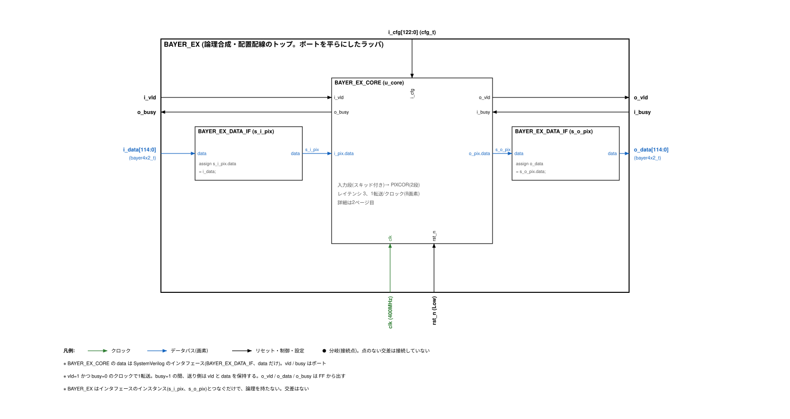

# BAYER_EX(演習用のコア)

Bayer 画像の水平4画素 × 垂直2ラインを1転送で受け取り、画素ごとに黒レベル補正とゲインをかけて、同じ形の Bayer で出すコアです(SystemVerilog)。BAYER2RGB を、RTL → UVM 検証 → 論理合成 → 物理設計を一通り練習できる大きさに小さくしたものです。

- インタフェース: vld / busy のポートと、data だけの SystemVerilog インタフェース `BAYER_EX_DATA_IF`(data は構造体 `bayer4x2_t`)
- 演算: 1モジュール(`BAYER_EX_PIXCOR`)。黒レベル補正 → ゲイン。bypass あり
- 1クロック 1転送(8画素)、レイテンシ 3、400 MHz

仕様の詳細は [doc/spec/BAYER_EX_spec.md](doc/spec/BAYER_EX_spec.md) を見てください。



## BAYER2RGB との違い

| 項目 | BAYER2RGB | BAYER_EX |
|---|---|---|
| 入出力 | AXI4 マスタ(メモリ)+ AXI4-Lite(レジスタ) | vld / busy + data(`BAYER_EX_DATA_IF`)のストリーム。設定は `i_cfg` のポート |
| 1転送 | PPC 画素(1 / 2 / 4 / 8) | 水平4 × 垂直2 = 8画素(`bayer4x2_t`) |
| 処理 | 黒レベル、WB、デモザイク、彩度抑制、ガンマ → RGB888 | 黒レベル、ゲイン(WB と同じ式)→ Bayer のまま |
| bypass | R=G=B=Bayer 値 | 入力の画素をそのまま |
| クロック | clk + ctrl_clk(CDC あり) | clk だけ |
| 製品IP | SRAM、同期化セル | なし |
| 同じところ | - | vld / busy の規則、画素 14bit、Bayer の並び4種類、黒レベル・ゲインの式、SDC の考え方、ツールと流れ |

## ディレクトリ

| パス | 内容 |
|---|---|
| `rtl/` | RTL(`rtl.f`)。`BAYER_EX_CORE.sv` がコア、`BAYER_EX.sv` が論理合成・配置配線のトップ(ラッパ) |
| `tb/` | UVM 検証環境(`tb.f`、`tb/uvm/`) |
| `sim/` | Makefile、回帰試験(`run_regress.sh`、`tests.list`)、Xcelium の波形設定(`xrun_waves.tcl`) |
| `tools/` | Python のリファレンスモデル(`bex_model.py`)、変異テスト(`bex_mutate.py`)、カバレッジの集計、コーディング規約の検査、Liberty の準備 |
| `doc/arch/` | ブロック図(`bayer_ex_arch.drawio`、SVG。トップ・CORE・PIXCOR・検証環境) |
| `doc/spec/` | 仕様書、端子表(`pins/`)、波形図(`wave/`: WaveDrom の JSON と SVG) |
| `doc/tools/` | ブロック図・端子表・波形図・仕様書を作るスクリプト |
| `syn/` | タイミング制約(`constraints/bayer_ex.sdc`。設定値と意味は `constraints/README.md`)、Yosys の論理合成(`yosys/`)。説明は [syn/README.md](syn/README.md) |
| `pd/` | 物理設計。OpenROAD-flow-scripts + ASAP7(`openroad/`)、Cadence + Foundry の PDK の雛形(`commercial/`)。説明は [pd/README.md](pd/README.md) |

## 使い方

下の表のコマンドは、全部を続けて実行するものではありません。準備のあと、目的の行を選んで実行します。

### シミュレーション(`sim/`)

必要なもの: Verilator 5.053 以降、UVM 1800.2-2017-1.0(Verilator で使える版)、zlib と lz4(FST 出力)、Python 3。Xcelium でも動かせるようにしています(未実行。仕様書 8.6)。

準備:

```sh
export UVM_HOME=/path/to/uvm-2017-1.0   # src/uvm_pkg.sv があるディレクトリ
cd sim
```

| 目的 | コマンド |
|---|---|
| RTL の lint | `make lint` |
| テストを1つ実行する | `make run TEST=bex_smoke_test` |
| 波形を出して見る | `make run TEST=bex_random_test SEED=3 WAVES=1` のあと `gtkwave waves.fst` |
| DUT を合成のトップ(BAYER_EX)にして実行する | `make run DUT=top TEST=bex_random_test` |
| 回帰試験(全テスト) | `make regress`(結果は `logs/regress.txt`) |
| カバレッジ付きの回帰試験 | `make cov`(結果は `cov/`) |
| Xcelium で実行する | `make xrun TEST=bex_smoke_test XWAVES=vcd` のあと `gtkwave waves.vcd` |

ふつうは `make regress`(または `make cov`)を実行し、失敗したテストがあれば、そのテスト名とシードで `make run ... WAVES=1` を実行して波形を見ます。`DUT` を変えるとビルドの出力先(`obj_core` / `obj_top`)が分かれるので、`make clean` は要りません。

FST の出力に必要な lz4 / zlib を標準以外の場所に入れた場合は `VL_CFLAGS=-I<dir>/include VL_LDFLAGS=-L<dir>/lib` を付けてください。

### 論理合成と配置配線(`syn/`、`pd/`)

必要なもの: Yosys、sv2v、OpenROAD(`openroad`、`sta`)、OpenROAD-flow-scripts(ASAP7)。

準備:

```sh
export ORFS_FLOW=$HOME/OpenROAD-flow-scripts/flow
```

| 目的 | コマンド | 詳しい説明 |
|---|---|---|
| 論理合成と合成後の STA だけ | `make -C syn/yosys` | `syn/README.md` の 2.2 |
| 配置配線を最後まで(論理合成を含む) | `make -C pd/openroad` | `pd/README.md` の 1.2 |

配置配線のコマンドは論理合成も自動で行うので、`make -C syn/yosys` を先に実行する必要はありません。最後まで CPU 2個で約 15 分、メモリは最大 3.3 GB(詳細配線)でした。

## 検証の状況

Verilator 5.053 での結果です(詳細は仕様書 8章)。

| 項目 | 結果 |
|---|---|
| 回帰試験(49本: DUT=BAYER_EX_CORE 41、DUT=BAYER_EX 8) | PASS 49 / FAIL 0 |
| リファレンスモデルとの照合 | 回帰試験の 24,773 転送ですべて一致(SV のモデル)。Python のモデルとも 1,754 転送で一致 |
| 機能カバレッジ | 53 / 53 ビン(100%) |
| RTL のコードカバレッジ | 行 100%(71 / 71)、分岐 100%(80 / 80) |
| 変異テスト(RTL にわざと入れた誤り 6 種類) | 6 / 6 を検出(`tools/bex_mutate.py`) |
| lint(Verilator -Wall) | 警告 0 |

## 論理合成・配置配線の状況

公開ツールと ASAP7(7nm 相当の予測 PDK)での結果です(詳細は仕様書 9章、`syn/results/`、`pd/openroad/results/`)。Foundry のプロセスの値ではありません。

| 項目 | 値 |
|---|---:|
| 論理合成: セル数 / 面積 | 14,169 / 1,427.6 um² |
| 論理合成: セットアップ WNS(配線の遅れなし) | +755.3 ps |
| 配置配線: ダイの大きさ | 63.7 × 63.7 um |
| 最終(寄生抽出の後): セル数 | 15,381 |
| 最終: セットアップ WNS / ホールド違反 | +678.2 ps / 0 |
| 最終: DRC 違反 / アンテナ違反 | 0 / 0 |
| 最終: 電力(見積もり)/ IR ドロップ(VDD) | 18.3 mW / 16.4 mV |

## 残っている作業

- Xcelium での回帰試験とカバレッジ
- Foundry のプロセスでの論理合成・配置配線・サインオフ(雛形は `pd/commercial/`)
- ASAP7 の GDS(KLayout のある環境で `make -C pd/openroad gds`)

## コーディング規約

- `if( 条件 )`、`for( 初期化; 条件; 処理 )`、`while( 条件 )`。条件の中にはスペースを入れない
- begin / end は省略しない。`end else begin` は1行に書く。インデントは2スペース
- ポート・パラメータ・インスタンスの接続は先頭にカンマを置く(`,.rst_n (rst_n)`)
- FF は `r_`、組み合わせの信号とインタフェースのインスタンスは `s_`、インスタンスは `u_` で始める。有効ビットの FF だけリセットする

`python3 tools/style_check.py rtl tb tools doc/tools syn/yosys/scripts pd/openroad/scripts` で規約の一部(if / for / while の書き方、begin の位置、インデント、1行1文)を検査できます。
