# BAYER_EX 仕様書(演習用のコア)

| 項目 | 内容 |
|---|---|
| IP名 | BAYER_EX(Bayer の画素ごとの補正。演習用) |
| 版 | 1.0 |
| 日付 | 2026-10-31 |
| もとにした IP | BAYER2RGB(Bayer → RGB888 変換)。ハンドシェイク(vld/busy)、画素のビット幅、Bayer の並び、黒レベル・ゲインの式、タイミング制約の考え方を同じにした |
| 対象 | 演習(RTL → UVM 検証 → 論理合成 → 配置配線を一通り行う)。映像系クロック 400 MHz |
| RTL | `rtl/`(SystemVerilog IEEE 1800-2017) |

> この文書は `doc/tools/gen_spec.py` で `doc/spec/src/*.md` から作っています。端子表(`doc/spec/pins/`)と波形図(`doc/spec/wave/`)は RTL とシミュレーションの波形から自動で作ったものです。編集は `doc/spec/src/` に対して行ってください。

## 目次

1. [概要](#1-概要)
2. [主な仕様](#2-主な仕様)
3. [設計で決めた事項](#3-設計で決めた事項)
4. [外部インタフェース](#4-外部インタフェース)
5. [画素の補正(ビット精度の定義)](#5-画素の補正ビット精度の定義)
6. [各ブロックの詳細](#6-各ブロックの詳細)
7. [性能とタイミング制約](#7-性能とタイミング制約)
8. [検証](#8-検証)
9. [論理合成と物理設計](#9-論理合成と物理設計)
10. [既知の制約と注意事項](#10-既知の制約と注意事項)
11. [参考文献](#11-参考文献)

---

## 1. 概要

BAYER_EX は、Bayer 画像の水平4画素 × 垂直2ラインを1回の転送で受け取り、画素ごとに黒レベル補正とゲインをかけて、同じ形の Bayer で出すコアです。BAYER2RGB を、RTL・検証・論理合成・物理設計の流れを一通り練習できる大きさに小さくしたものです。RGB への変換(デモザイク)は行いません。

```
            i_cfg(設定: bypass、Bayer の並び、黒レベル ×4、ゲイン ×4)
                │
                ▼
i_vld ──▶ ┌──────────────────────────────────────────────┐ ──▶ o_vld
o_busy ◀─ │ BAYER_EX_CORE                                │ ◀── i_busy
i_pix ──▶ │ 入力段(スキッド付き)→ 黒レベル補正 → ゲイン  │ ──▶ o_pix
(data)    └──────────────────────────────────────────────┘     (data)
  bayer4x2_t: {sof, eol, eof, pix[2][4](各14bit)}
```

- 入力と出力は、それぞれ vld / busy の2本のポートと、data だけを持つ SystemVerilog のインタフェース(`BAYER_EX_DATA_IF`)です。data は Bayer の水平4画素 × 垂直2ラインと、フレームの区切り(sof / eol / eof)をまとめた構造体(`bayer4x2_t`)です。
- 演算は1つのモジュール(`BAYER_EX_PIXCOR`)で行います。1段目で黒レベルを引き、2段目でゲインをかけます。色(R / Gr / Gb / B)は Bayer の並びと転送の中の位置で決まります。
- bypass=1 のときは補正せず、入力の画素をそのまま出します(レイテンシは同じ)。
- 1クロックに1転送(8画素)を処理します。400 MHz で 3.2 G画素/秒です。

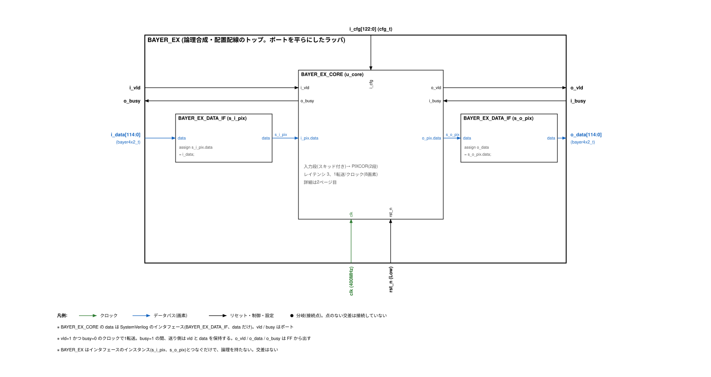

ブロック図の draw.io ファイルは `doc/arch/bayer_ex_arch.drawio` です(1ページ目: トップ、2ページ目: CORE、3ページ目: PIXCOR、4ページ目: 検証環境)。SVG には draw.io のデータを埋め込んでいるので、SVG も draw.io で開けます。

## 2. 主な仕様

| 項目 | 仕様 |
|---|---|
| 入力・出力のデータ | `bayer4x2_t`: Bayer の水平4画素 × 垂直2ライン(各14bit)+ sof / eol / eof。115bit |
| インタフェース | vld / busy のポートと、data だけの SystemVerilog インタフェース `BAYER_EX_DATA_IF`(modport src / dst / mon) |
| 転送の規則 | vld=1 かつ busy=0 のクロックで1転送。busy=1 の間、送り側は vld と data を保持する。vld は busy に組み合わせで依存しない(BAYER2RGB と同じ) |
| 画像の大きさ | 幅は4の倍数、高さは2の倍数(コアは大きさを見ない。フレームの区切りは sof / eol / eof で示し、そのまま出力へ渡す) |
| Bayer の並び | RGGB / GRBG / GBRG / BGGR(`i_cfg.phase`) |
| 補正 | 黒レベル補正 q1 = max(p − blc[色], 0)、ゲイン q2 = min(16383, (q1 × gain[色] + 2048) >> 12)。gain は U4.12(0x1000 = 1.0倍) |
| bypass | `i_cfg.bypass=1` で補正しない(入力の画素をそのまま出す) |
| 設定 | `i_cfg`(cfg_t、123bit)。準静的。コアの中にデータがないときだけ変える(4.7) |
| レイテンシ | 3クロック(入力の転送から o_vld=1 まで。止められていないとき) |
| スループット | 1転送/クロック(8画素/クロック)。出力側が busy を出さなければ止まらない |
| 出力の作り方 | o_vld、o_pix.data、o_busy はすべて FF から出す。入力ポートから出力ポートへの組み合わせの経路はない |
| クロック・リセット | clk 1本(400 MHz)。rst_n は非同期アサート・同期解除(同期化は外部) |
| 製品IP | 使わない(SRAM・同期化セルなし。標準セルだけでできる) |
| 論理合成・配置配線 | トップは `BAYER_EX`(インタフェースのポートを平らにしたラッパ)。ASAP7 で 400 MHz を満たし、詳細配線・最終の解析まで流した(9章) |

## 3. 設計で決めた事項

| 項目 | 決めたこと | 理由 |
|---|---|---|
| インタフェースの形 | vld / busy はモジュールのポート、data だけを SystemVerilog のインタフェースにする | ご指定による。data の中身(構造体)を1か所で定義し、送り側と受け側で同じ型を使える |
| data の構造体 | `bayer4x2_t` = {sof, eol, eof, pix[2][4]}。pix[y][x] は y=0 が上のライン | Bayer の 2×2 の繰り返しが転送の中に2組そろうので、色の位置が転送の中の位置だけで決まる(5.1) |
| 演算 | 黒レベル補正とゲイン(画素ごとの補正)を1モジュール(PIXCOR)で行う。RGB への変換はしない | ご指定による(「画素ごとの補正だけ」)。式とビット幅は BAYER2RGB の BLC・WB と同じ |
| bypass | 残す。補正だけを止め、レイテンシは変えない | ご指定による。bypass の切り替えでデータの順番やタイミングが変わらないようにする |
| 止め方 | 出力が止められたらパイプラインの全段を止める(全体停止)。o_busy は入力段の後ろのスキッドが埋まったときに FF から出す | 段ごとの ready の連鎖より簡単で、o_busy が i_busy に組み合わせで依存しない |
| 設定 | 毎クロック FF(r_cfg)で受け直す。フレームの切り替えでの取り込み(シャドウ)はしない | 簡単にするため。設定はコアが空のときだけ変える規則にした(4.7) |
| 合成のトップ | `BAYER_EX` で `BAYER_EX_CORE` を包み、data のポートを `bayer4x2_t` の普通のポートにする | 合成の流れで使う sv2v は、インタフェースのポートを持つモジュールをトップにできないため(9.1) |
| 名前 | BAYER_EX(Bayer + exercise) | RGB に変換しないので BAYER2RGB の名前は使わない |

## 4. 外部インタフェース

### 4.1 端子表(BAYER_EX_CORE)

コアの端子です。data は `BAYER_EX_DATA_IF` のインタフェースのポート(i_pix は modport dst、o_pix は modport src)です。

| 信号名 | 入出力 | 信号仕様 | ビット幅 | 極性 |
|---|---|---|---|---|
| clk | 入力 | クロック。400MHz(すべての FF) | 1 | 立ち上がり |
| rst_n | 入力 | リセット。非同期アサート・同期解除(同期化は外部) | 1 | Low |
| i_cfg | 入力 | 設定 {bypass, phase, blc[3:0], gain[3:0]}(cfg_t)。コアの中にデータがないときだけ変える | 123(cfg_t) | - |
| i_vld | 入力 | 入力の data(i_pix.data)が有効 | 1 | High |
| o_busy | 出力 | 入力を受け取れない(FF から出す。スキッドが埋まったとき 1) | 1 | High |
| i_pix.data | 入力 | 入力の転送(bayer4x2_t。Bayer の水平4画素 × 垂直2ラインと sof / eol / eof) | 115(bayer4x2_t) | - |
| o_vld | 出力 | 出力の data(o_pix.data)が有効(FF から出す) | 1 | High |
| i_busy | 入力 | 出力先が受け取れない | 1 | High |
| o_pix.data | 出力 | 出力の転送(bayer4x2_t。画素は補正後、sof / eol / eof は入力のまま。FF から出す) | 115(bayer4x2_t) | - |

### 4.2 端子表(BAYER_EX。論理合成・配置配線のトップ)

`BAYER_EX_CORE` のインタフェースのポートを、`bayer4x2_t` のポート(i_data / o_data)にしたラッパです。論理は持ちません。SystemVerilog で使うときは、どちらをインスタンスにしてもかまいません(機能は同じ。検証は両方で行った。8.5)。

| 信号名 | 入出力 | 信号仕様 | ビット幅 | 極性 |
|---|---|---|---|---|
| clk | 入力 | クロック。400MHz(すべての FF) | 1 | 立ち上がり |
| rst_n | 入力 | リセット。非同期アサート・同期解除(同期化は外部) | 1 | Low |
| i_cfg | 入力 | 設定 {bypass, phase, blc[3:0], gain[3:0]}(cfg_t)。コアの中にデータがないときだけ変える | 123(cfg_t) | - |
| i_vld | 入力 | 入力の data が有効 | 1 | High |
| o_busy | 出力 | 入力を受け取れない(FF から出す。スキッドが埋まったとき 1) | 1 | High |
| i_data | 入力 | 入力の転送(bayer4x2_t。Bayer の水平4画素 × 垂直2ラインと sof / eol / eof) | 115(bayer4x2_t) | - |
| o_vld | 出力 | 出力の data が有効(FF から出す) | 1 | High |
| i_busy | 入力 | 出力先が受け取れない | 1 | High |
| o_data | 出力 | 出力の転送(bayer4x2_t。画素は補正後、sof / eol / eof は入力のまま。FF から出す) | 115(bayer4x2_t) | - |

### 4.3 BAYER_EX_DATA_IF(data だけのインタフェース)

SystemVerilog のインタフェースと modport [R10] で、data だけをまとめています。

```systemverilog
interface BAYER_EX_DATA_IF;
  import BAYER_EX_PKG::*;
  bayer4x2_t data;
  modport src (
    output data
  );
  modport dst (
    input  data
  );
  modport mon (
    input  data
  );
endinterface
```

| メンバ | 型 | ビット幅 | modport src(送り側) | modport dst(受け側) | modport mon(監視) |
|---|---|---:|---|---|---|
| data | bayer4x2_t | 115 | output | input | input |

vld と busy はインタフェースに入れず、モジュールのポートにしています。つなぎ方の例(`tb/tb_top.sv` と同じ):

```systemverilog
BAYER_EX_DATA_IF s_i_pix ();
BAYER_EX_DATA_IF s_o_pix ();

assign s_i_pix.data = up_data;     // 送り側の data
assign dn_data      = s_o_pix.data;

BAYER_EX_CORE u_core (
  .clk    (clk)
 ,.rst_n  (rst_n)
 ,.i_cfg  (cfg)
 ,.i_vld  (up_vld)
 ,.o_busy (up_busy)
 ,.i_pix  (s_i_pix)
 ,.o_vld  (dn_vld)
 ,.i_busy (dn_busy)
 ,.o_pix  (s_o_pix)
);
```

### 4.4 data の構造体(bayer4x2_t)

```systemverilog
typedef struct packed {
  logic                                   sof;  // フレームの最初の転送
  logic                                   eol;  // 2ラインの最後(右端)の転送
  logic                                   eof;  // フレームの最後の転送
  logic [BLK_Y-1:0][BLK_X-1:0][PIX_W-1:0] pix;  // 画素 pix[y][x](BLK_Y=2、BLK_X=4、PIX_W=14)
} bayer4x2_t;
```

ビットの並び(packed struct なので、最初に書いたフィールドが上位):

| フィールド | ビットの位置 | ビット幅 | 内容 |
|---|---|---:|---|
| sof | [114] | 1 | フレームの最初の転送 |
| eol | [113] | 1 | 2ラインの最後(右端)の転送 |
| eof | [112] | 1 | フレームの最後の転送 |
| pix[1][3] | [111:98] | 14 | 下のライン(y=1)の x=3 の画素 |
| pix[1][2] | [97:84] | 14 | 下のライン(y=1)の x=2 の画素 |
| pix[1][1] | [83:70] | 14 | 下のライン(y=1)の x=1 の画素 |
| pix[1][0] | [69:56] | 14 | 下のライン(y=1)の x=0 の画素 |
| pix[0][3] | [55:42] | 14 | 上のライン(y=0)の x=3 の画素 |
| pix[0][2] | [41:28] | 14 | 上のライン(y=0)の x=2 の画素 |
| pix[0][1] | [27:14] | 14 | 上のライン(y=0)の x=1 の画素 |
| pix[0][0] | [13:0] | 14 | 上のライン(y=0)の x=0 の画素 |

### 4.5 転送の規則(vld / busy)

| 信号 | 向き | 内容 |
|---|---|---|
| vld | 送り側 → 受け側 | data が有効 |
| busy | 受け側 → 送り側 | 受け取れない |
| data | 送り側 → 受け側 | 転送(`BAYER_EX_DATA_IF` の data、`bayer4x2_t`) |

- vld=1 かつ busy=0 のクロックで1つ転送します。
- busy=1 の間、送り側は vld と data を保持します。
- vld は busy に組み合わせで依存してはいけません(busy は vld に依存してよい)。
- BAYER_EX の o_vld、o_pix.data、o_busy はすべて FF から出しています。o_busy=1 になるのは、出力が止められている間に入力の転送を受けて、スキッドが埋まったときだけです(6.2)。

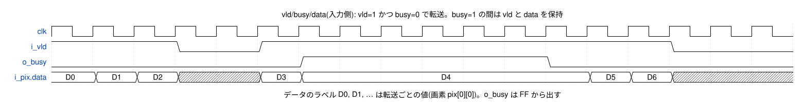

<details><summary>WaveDrom の記述(wave/vbd_if.json)</summary>

```wavedrom
{"signal": [
  {"name": "clk", "wave": "p................."},
  {"name": "i_vld", "wave": "1..0.1.........0.."},
  {"name": "o_busy", "wave": "0.....1.....0....."},
  {"name": "i_pix.data", "wave": "===x.==......==x..", "data": ["D0", "D1", "D2", "D3", "D4", "D5", "D6"]}
],
 "head": {"text": "vld/busy/data(入力側): vld=1 かつ busy=0 で転送。busy=1 の間は vld と data を保持"},
 "config": {"hscale": 2},
 "foot": {"text": "データのラベル D0, D1, … は転送ごとの値(画素 pix[0][0])。o_busy は FF から出す"}
}
```

</details>

検証環境は、この規則を入力側(検証環境の送り方)と出力側(DUT の出し方)の両方でアサーションで確かめています(8.1)。

### 4.6 フレームと転送の並び

画像の幅 W は4の倍数、高さ H は2の倍数です。1転送は、偶数ライン y0 と次のライン y0+1 の、4の倍数の列 x0 から x0+3 までの8画素です。転送は、2ラインずつ、左から右へ並べます。

```
     x: 0  1  2  3 | 4  5  6  7 | …  W-4 … W-1
y=0     ┌─ 転送0 ──┐┌─ 転送1 ──┐      ┌─ 転送 W/4-1 ──┐   ← 1組目の2ライン(最後の転送で eol=1)
y=1     └──────────┘└──────────┘      └───────────────┘
y=2     ┌─ 転送W/4 ┐ …                                    ← 2組目の2ライン
y=3     └──────────┘
 …
y=H-2   … 最後の転送(eol=1、eof=1)
y=H-1
```

| フラグ | 1になる転送 |
|---|---|
| sof | フレームの最初の転送(転送0) |
| eol | 2ラインの最後(右端)の転送 |
| eof | フレームの最後の転送(eol も 1) |

- 1フレームの転送の数は (W/4) × (H/2) です。W=4、H=2 のときは1転送で、sof=eol=eof=1 です。
- コアはフラグを処理に使いません。入力のフラグを、画素と同じ転送の出力にそのまま付けて出します。フラグの並びが規則どおりかは確かめません。
- 色の位置は転送の中の位置(y、x の偶奇)だけで決まるので、コアはフレームの中の位置を数えません(5.1)。

### 4.7 設定(i_cfg)

```systemverilog
typedef struct packed {
  logic                   bypass;  // 1: 補正しない(入力の画素をそのまま出す)
  logic [1:0]             phase;   // Bayer の並び 0:RGGB 1:GRBG 2:GBRG 3:BGGR
  logic [3:0][PIX_W-1:0]  blc;     // 黒レベル [0]R [1]Gr [2]Gb [3]B
  logic [3:0][GAIN_W-1:0] gain;    // ゲイン(U4.12) [0]R [1]Gr [2]Gb [3]B
} cfg_t;
```

| フィールド | ビットの位置 | ビット幅 | 内容 |
|---|---|---:|---|
| bypass | [122] | 1 | 1: 補正しない(入力の画素をそのまま出す) |
| phase | [121:120] | 2 | Bayer の並び 0:RGGB 1:GRBG 2:GBRG 3:BGGR |
| blc[3] | [119:106] | 14 | B の黒レベル(0〜16383) |
| blc[2] | [105:92] | 14 | Gb の黒レベル(0〜16383) |
| blc[1] | [91:78] | 14 | Gr の黒レベル(0〜16383) |
| blc[0] | [77:64] | 14 | R の黒レベル(0〜16383) |
| gain[3] | [63:48] | 16 | B のゲイン(U4.12。0x1000 = 1.0倍、0〜15.9998倍) |
| gain[2] | [47:32] | 16 | Gb のゲイン(U4.12。0x1000 = 1.0倍、0〜15.9998倍) |
| gain[1] | [31:16] | 16 | Gr のゲイン(U4.12。0x1000 = 1.0倍、0〜15.9998倍) |
| gain[0] | [15:0] | 16 | R のゲイン(U4.12。0x1000 = 1.0倍、0〜15.9998倍) |

設定を変えるときの規則:

- コアは i_cfg を毎クロック FF(r_cfg)で受け直します。フレームの最初に取り込む仕組み(シャドウ)はありません。
- i_cfg は、コアの中にデータがないとき、つまり入力したすべての転送が出力されたあとに変えてください。前のフレームの最後の転送(eof=1)が出力側で転送されれば、そのあと入力していない限りコアは空です。
- 変えたクロックに、次のフレームの最初の転送を入力してもかまいません(入力の転送と i_cfg を同じクロックの立ち上がりで取り込むため)。検証は、この最も厳しい時刻で行いました(8.3 の bex_cfg_change_test)。
- コアの中にデータがある間に変えると、その転送の1段目と2段目で違う設定を使うことがあります(結果は保証しません)。

### 4.8 リセット

- rst_n は非同期アサート・同期解除です(clk への同期化は IP の外で行う)。
- リセットするのは有効ビット(入力段・スキッド・PIXCOR の2段)だけです。データの FF と r_cfg はリセットしません。
- リセット中は o_vld=0、o_busy=0 です。リセットの前にコアの中にあったデータは捨てます(出力しない)。
- リセット中の入力の転送は受け取りません(送り側も同じリセットで止めてください)。

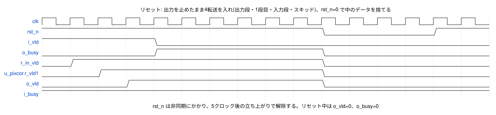

<details><summary>WaveDrom の記述(wave/reset.json)</summary>

```wavedrom
{"signal": [
  {"name": "clk", "wave": "p..............."},
  {"name": "rst_n", "wave": "1.........0...1."},
  {"name": "i_vld", "wave": "1...0..........."},
  {"name": "o_busy", "wave": "0...1.....0....."},
  {"name": "r_in_vld", "wave": "01........0....."},
  {"name": "u_pixcor.r_vld1", "wave": "0.1.......0....."},
  {"name": "o_vld", "wave": "0..1......0....."},
  {"name": "i_busy", "wave": "1..............."}
],
 "head": {"text": "リセット: 出力を止めたまま4転送を入れ(出力段・1段目・入力段・スキッド)、rst_n=0 で中のデータを捨てる"},
 "config": {"hscale": 2},
 "foot": {"text": "rst_n は非同期にかかり、5クロック後の立ち上がりで解除する。リセット中は o_vld=0、o_busy=0"}
}
```

</details>

## 5. 画素の補正(ビット精度の定義)

8画素のそれぞれに、同じ式で補正をかけます。色(黒レベルとゲインの選び方)だけが、画素の位置で変わります。式とビット幅は、BAYER2RGB の黒レベル補正(BLC)とホワイトバランス(WB)と同じです。黒レベル補正と色ごとのゲインは、デモザイクの前に Bayer のまま行う、ISP の最初のほうの処理です [R1]。

### 5.1 色の位置

転送の左上の画素は、フレームの偶数ライン・偶数列にあります。したがって、画素 pix[y][x] の色は、Bayer の並び(phase)と、転送の中の y と x の偶奇だけで決まります。

```
色 = 2 × (y xor phase[1]) + (x[0] xor phase[0])      0:R 1:Gr 2:Gb 3:B
```

Gr は R と同じラインの G、Gb は B と同じラインの G です。phase の値と、転送の中の色の並び:

| phase | 並び | y=0(上のライン)の x=0〜3 | y=1(下のライン)の x=0〜3 |
|---:|---|---|---|
| 0 | RGGB | R Gr R Gr | Gb B Gb B |
| 1 | GRBG | Gr R Gr R | B Gb B Gb |
| 2 | GBRG | Gb B Gb B | R Gr R Gr |
| 3 | BGGR | B Gb B Gb | Gr R Gr R |

並びの名前は、フレームの左上の 2×2 を左上・右上・左下・右下の順に読んだものです(BAYER2RGB と同じ)。

### 5.2 黒レベル補正(1段目)

```
q1 = p − blc[色]   (p > blc[色] のとき)
q1 = 0             (p ≤ blc[色] のとき)
```

- p: 入力の画素(0〜16383)、blc: 黒レベル(0〜16383)、q1: 0〜16383

### 5.3 ゲイン(2段目)

```
m  = q1 × gain[色]                 (30bit。最大 16383 × 65535)
t  = (m + 2048) >> 12              (小数部12bit を四捨五入。.5 は切り上げ)
q2 = min(t, 16383)                 (14bit に飽和)
```

- gain は U4.12 の固定小数点です(0x1000 = 1.0倍、0x0800 = 0.5倍、0xFFFF ≒ 15.9998倍)。
- 1.0倍(0x1000)では q2 = q1 です。0倍(0x0000)では q2 = 0 です。

### 5.4 bypass

bypass=1 のときは、1段目も2段目も入力の値をそのまま渡します(q1 = p、q2 = q1)。黒レベルとゲインの設定は使いません。レイテンシとスループットは bypass=0 と同じです。

### 5.5 計算例

RGGB、黒レベル R/Gr/Gb/B = 100/200/300/400、ゲイン 1.5/1.0/1.0/2.0 倍(波形図 6.3 と同じ設定):

| 位置 pix[y][x] | 色 | 入力 p | 黒レベル | p − 黒レベル | ゲイン | 出力 q |
|---|---|---:|---:|---:|---|---:|
| [0][0] | R | 1000 | 100 | 900 | 0x1800(1.500倍) | 1350 |
| [0][1] | Gr | 1100 | 200 | 900 | 0x1000(1.000倍) | 900 |
| [1][0] | Gb | 3000 | 300 | 2700 | 0x1000(1.000倍) | 2700 |
| [1][1] | B | 3100 | 400 | 2700 | 0x2000(2.000倍) | 5400 |
| [0][0] | R | 50 | 100 | 0 | 0x1800(1.500倍) | 0 |
| [1][1] | B | 12000 | 400 | 11600 | 0x2000(2.000倍) | 16383 |

この表は `python3 tools/bex_model.py table` で作りました。Python のモデル(`tools/bex_model.py`)と検証環境のリファレンスモデル(`tb/uvm/bex_ref_model.svh`)は、この章の式を別々に書いたもので、検証で DUT の出力と突き合わせています(8.5)。

## 6. 各ブロックの詳細

| モジュール | ファイル | 内容 |
|---|---|---|
| BAYER_EX_PKG | `rtl/BAYER_EX_PKG.sv` | 構成定数、`bayer4x2_t`、`cfg_t`、色の位置の関数 `f_site` |
| BAYER_EX_DATA_IF | `rtl/BAYER_EX_DATA_IF.sv` | data だけのインタフェース(4.3) |
| BAYER_EX_PIXCOR | `rtl/BAYER_EX_PIXCOR.sv` | 画素ごとの補正(黒レベル・ゲイン)。2段のパイプライン |
| BAYER_EX_CORE | `rtl/BAYER_EX_CORE.sv` | コア。入力段とスキッド、全体停止の判定、設定の FF、PIXCOR |
| BAYER_EX | `rtl/BAYER_EX.sv` | 論理合成・配置配線のトップ(ポートを平らにしたラッパ) |

コーディングの決まり: 有効ビット(制御)の FF はリセットあり、データの FF はリセットなし(有効な転送のときだけ取り込む)。FF は `r_`、組み合わせの信号とインタフェースのインスタンスは `s_`、インスタンスは `u_` で始めます。

### 6.1 BAYER_EX(トップ)

`BAYER_EX_DATA_IF` を2つ(s_i_pix、s_o_pix)作り、i_data / o_data と assign でつないで `BAYER_EX_CORE` に渡します。端子表は 4.2 です。


1フレームの入出力の例(16×4画素 = 8転送)です。入力は5転送目の前に2クロックあけ、出力側は2転送目から8クロック busy を出しています。止めている間に入力段とスキッドが埋まり、o_busy=1 の間、送り側は6転送目の vld と data を保持します。

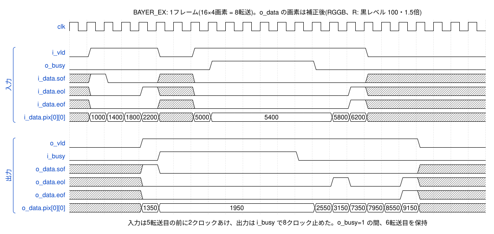

<details><summary>WaveDrom の記述(wave/top_frame.json)</summary>

```wavedrom
{"signal": [
  {"name": "clk", "wave": "p......................."},
  {},
  ["入力",
    {"name": "i_vld", "wave": "01...0.1.........0......"},
    {"name": "o_busy", "wave": "0.......1.....0........."},
    {"name": "i_data.sof", "wave": "x10..x.0.........x......"},
    {"name": "i_data.eol", "wave": "x0..1x.0........1x......"},
    {"name": "i_data.eof", "wave": "x0...x.0........1x......"},
    {"name": "i_data.pix[0][0]", "wave": "x====x.==......==x......", "data": ["1000", "1400", "1800", "2200", "5000", "5400", "5800", "6200"]}
  ],
  {},
  ["出力",
    {"name": "o_vld", "wave": "0...1...............0..."},
    {"name": "i_busy", "wave": "0....1.......0.........."},
    {"name": "o_data.sof", "wave": "x...10..............x..."},
    {"name": "o_data.eol", "wave": "x...0..........10..1x..."},
    {"name": "o_data.eof", "wave": "x...0..............1x..."},
    {"name": "o_data.pix[0][0]", "wave": "x...==........======x...", "data": ["1350", "1950", "2550", "3150", "7350", "7950", "8550", "9150"]}
  ]
],
 "head": {"text": "BAYER_EX: 1フレーム(16×4画素 = 8転送)。o_data の画素は補正後(RGGB、R: 黒レベル 100・1.5倍)"},
 "config": {"hscale": 1},
 "foot": {"text": "入力は5転送目の前に2クロックあけ、出力は i_busy で8クロック止めた。o_busy=1 の間、6転送目を保持"}
}
```

</details>

### 6.2 BAYER_EX_CORE

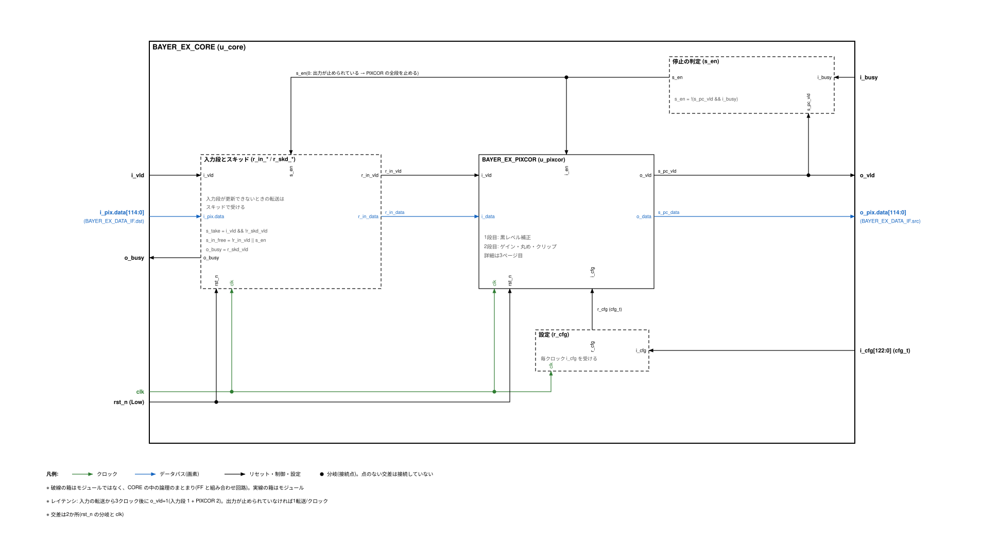

| 信号名 | 入出力 | 信号仕様 | ビット幅 | 極性 |
|---|---|---|---|---|
| clk | 入力 | クロック。400MHz(すべての FF) | 1 | 立ち上がり |
| rst_n | 入力 | リセット。非同期アサート・同期解除(同期化は外部) | 1 | Low |
| i_cfg | 入力 | 設定 {bypass, phase, blc[3:0], gain[3:0]}(cfg_t)。コアの中にデータがないときだけ変える | 123(cfg_t) | - |
| i_vld | 入力 | 入力の data(i_pix.data)が有効 | 1 | High |
| o_busy | 出力 | 入力を受け取れない(FF から出す。スキッドが埋まったとき 1) | 1 | High |
| i_pix.data | 入力 | 入力の転送(bayer4x2_t。Bayer の水平4画素 × 垂直2ラインと sof / eol / eof) | 115(bayer4x2_t) | - |
| o_vld | 出力 | 出力の data(o_pix.data)が有効(FF から出す) | 1 | High |
| i_busy | 入力 | 出力先が受け取れない | 1 | High |
| o_pix.data | 出力 | 出力の転送(bayer4x2_t。画素は補正後、sof / eol / eof は入力のまま。FF から出す) | 115(bayer4x2_t) | - |

**入力段とスキッド**

入力の転送は、まず入力段(r_in_vld / r_in_data)で受けます。入力段は「空いている」か「PIXCOR が進む(s_en=1)」ときに更新できます(s_in_free)。更新できないクロックに来た転送は、スキッド(r_skd_vld / r_skd_data)で受けます。o_busy はスキッドの有効ビットそのもの(FF)です。

| スキッド | s_in_free | このクロックの入力の転送(i_vld=1 かつ o_busy=0) | 次のクロック |
|---|---|---|---|
| 空 | 1 | 入力段に入れる | 入力段 = 転送 |
| 空 | 0 | スキッドに入れる | スキッドが埋まる(o_busy=1) |
| 埋まっている(o_busy=1) | 1 | 受け取らない | スキッドの転送を入力段へ移す(o_busy=0) |
| 埋まっている(o_busy=1) | 0 | 受け取らない | そのまま |

**全体停止**

出力が止められている(o_vld=1 かつ i_busy=1)ときは s_en=0 にして、PIXCOR の2段を止めます(有効ビットもデータも保持)。o_vld=0 のときは i_busy=1 でも進めます(空いた段を詰める)。

- コアが持てる転送は最大4つです(PIXCOR の2段、入力段、スキッド)。
- o_busy が i_busy に組み合わせで依存しないように、o_busy は1クロック遅れて上がります。その1クロックに来た転送をスキッドが受けます [R2]。
- 止められた後に動き出すと、スキッドの転送を入力段へ移すクロックだけ、入力の転送を受けません(o_busy=1 が1クロック残る)。

1転送が進む様子(レイテンシ3):

![BAYER_EX_CORE: 入力の転送から3クロック後に o_vld=1(入力段 → 1段目 → 2段目)。値は R の画素 pix[0][0]](wave/core_pipe.svg)

<details><summary>WaveDrom の記述(wave/core_pipe.json)</summary>

```wavedrom
{"signal": [
  {"name": "clk", "wave": "p........."},
  {"name": "i_vld", "wave": "01...0.1.."},
  {"name": "i_pix.data", "wave": "x====x.==.", "data": ["1000", "1400", "1800", "2200", "5000", "5400"]},
  {"name": "r_in_vld", "wave": "0.1......."},
  {"name": "r_in_data", "wave": "x.====....", "data": ["1000", "1400", "1800", "2200"]},
  {"name": "u_pixcor.r_vld1", "wave": "0..1......"},
  {"name": "u_pixcor.r_data1", "wave": "x..===....", "data": ["900", "1300", "1700"]},
  {"name": "o_vld", "wave": "0...1....."},
  {"name": "o_pix.data", "wave": "x...==....", "data": ["1350", "1950"]},
  {"name": "i_busy", "wave": "0....1...."},
  {"name": "s_en", "wave": "1....0...."}
],
 "head": {"text": "BAYER_EX_CORE: 入力の転送から3クロック後に o_vld=1(入力段 → 1段目 → 2段目)。値は R の画素 pix[0][0]"},
 "config": {"hscale": 2},
 "foot": {"text": "r_data1 は 1000 − 100 = 900、o_pix.data は 900 × 1.5 = 1350。i_busy=1 で s_en=0 になり全段を保持"}
}
```

</details>

出力を止めたときの様子:

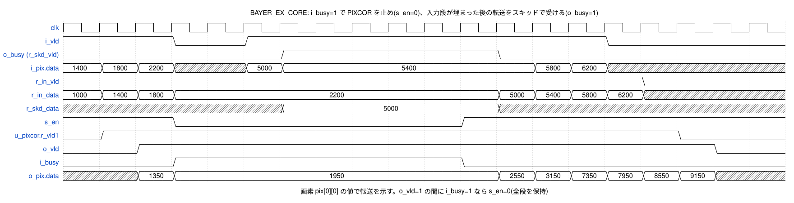

<details><summary>WaveDrom の記述(wave/core_stall.json)</summary>

```wavedrom
{"signal": [
  {"name": "clk", "wave": "p..................."},
  {"name": "i_vld", "wave": "1..0.1.........0...."},
  {"name": "o_busy (r_skd_vld)", "wave": "0.....1.....0......."},
  {"name": "i_pix.data", "wave": "===x.==......==x....", "data": ["1400", "1800", "2200", "5000", "5400", "5800", "6200"]},
  {"name": "r_in_vld", "wave": "1...............0..."},
  {"name": "r_in_data", "wave": "====........====x...", "data": ["1000", "1400", "1800", "2200", "5000", "5400", "5800", "6200"]},
  {"name": "r_skd_data", "wave": "x.....=.....x.......", "data": ["5000"]},
  {"name": "s_en", "wave": "1..0.......1........"},
  {"name": "u_pixcor.r_vld1", "wave": "01...............0.."},
  {"name": "o_vld", "wave": "0.1...............0."},
  {"name": "i_busy", "wave": "0..1.......0........"},
  {"name": "o_pix.data", "wave": "x.==........======x.", "data": ["1350", "1950", "2550", "3150", "7350", "7950", "8550", "9150"]}
],
 "head": {"text": "BAYER_EX_CORE: i_busy=1 で PIXCOR を止め(s_en=0)、入力段が埋まった後の転送をスキッドで受ける(o_busy=1)"},
 "config": {"hscale": 2},
 "foot": {"text": "画素 pix[0][0] の値で転送を示す。o_vld=1 の間に i_busy=1 なら s_en=0(全段を保持)"}
}
```

</details>

**設定の FF**

i_cfg を毎クロック r_cfg で受け直してから PIXCOR に渡します。入力ポートから乗算器への長い経路を FF で切るためです(7.2)。

### 6.3 BAYER_EX_PIXCOR

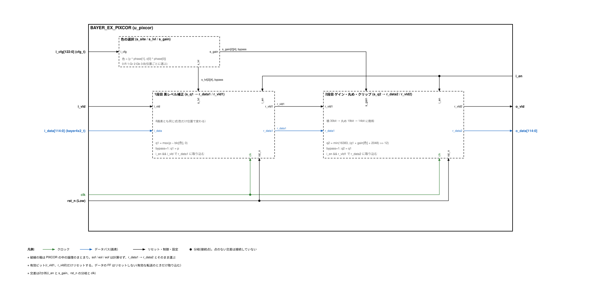

| 信号名 | 入出力 | 信号仕様 | ビット幅 | 極性 |
|---|---|---|---|---|
| clk | 入力 | クロック。400MHz(すべての FF) | 1 | 立ち上がり |
| rst_n | 入力 | リセット。非同期アサート・同期解除(同期化は外部) | 1 | Low |
| i_en | 入力 | 1: パイプラインを進める / 0: 全段を保持する(出力が止められているとき) | 1 | High |
| i_cfg | 入力 | 設定(cfg_t。CORE が FF で受け直したもの) | 123(cfg_t) | - |
| i_vld | 入力 | i_data が有効(CORE の入力段) | 1 | High |
| i_data | 入力 | 入力の転送(bayer4x2_t) | 115(bayer4x2_t) | - |
| o_vld | 出力 | o_data が有効(レイテンシ2。FF から出す) | 1 | High |
| o_data | 出力 | 補正した転送(bayer4x2_t。FF から出す) | 115(bayer4x2_t) | - |

- 色の選択: 8画素のそれぞれについて、`f_site(phase, y, x[0])` で色を決め、黒レベル(s_lvl)とゲイン(s_gain)を選びます。設定は準静的なので、この選択は設定を変えたときだけ変わります。
- 1段目: 5.2 の黒レベル補正。i_en=1 かつ i_vld=1 のとき r_data1 に取り込みます。
- 2段目: 5.3 のゲイン(乗算 30bit、四捨五入、14bit に飽和)。i_en=1 かつ r_vld1=1 のとき r_data2 に取り込みます。
- bypass=1 のときは、どちらの段も入力の値をそのまま渡します。
- sof / eol / eof は計算せず、r_data1 → r_data2 とそのまま運びます。
- 有効ビット r_vld1 / r_vld2 は、i_en=1 のクロックだけ進みます。

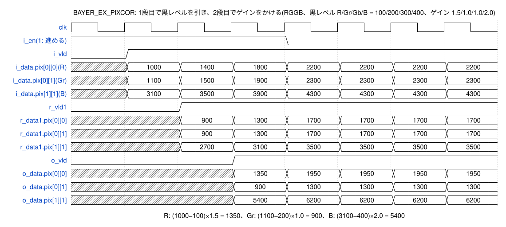

<details><summary>WaveDrom の記述(wave/pixcor.json)</summary>

```wavedrom
{"signal": [
  {"name": "clk", "wave": "p......."},
  {"name": "i_en(1: 進める)", "wave": "1...0..."},
  {"name": "i_vld", "wave": "01......"},
  {"name": "i_data.pix[0][0](R)", "wave": "x=======", "data": ["1000", "1400", "1800", "2200", "2200", "2200", "2200"]},
  {"name": "i_data.pix[0][1](Gr)", "wave": "x=======", "data": ["1100", "1500", "1900", "2300", "2300", "2300", "2300"]},
  {"name": "i_data.pix[1][1](B)", "wave": "x=======", "data": ["3100", "3500", "3900", "4300", "4300", "4300", "4300"]},
  {"name": "r_vld1", "wave": "0.1....."},
  {"name": "r_data1.pix[0][0]", "wave": "x.======", "data": ["900", "1300", "1700", "1700", "1700", "1700"]},
  {"name": "r_data1.pix[0][1]", "wave": "x.======", "data": ["900", "1300", "1700", "1700", "1700", "1700"]},
  {"name": "r_data1.pix[1][1]", "wave": "x.======", "data": ["2700", "3100", "3500", "3500", "3500", "3500"]},
  {"name": "o_vld", "wave": "0..1...."},
  {"name": "o_data.pix[0][0]", "wave": "x..=====", "data": ["1350", "1950", "1950", "1950", "1950"]},
  {"name": "o_data.pix[0][1]", "wave": "x..=====", "data": ["900", "1300", "1300", "1300", "1300"]},
  {"name": "o_data.pix[1][1]", "wave": "x..=====", "data": ["5400", "6200", "6200", "6200", "6200"]}
],
 "head": {"text": "BAYER_EX_PIXCOR: 1段目で黒レベルを引き、2段目でゲインをかける(RGGB、黒レベル R/Gr/Gb/B = 100/200/300/400、ゲイン 1.5/1.0/1.0/2.0)"},
 "config": {"hscale": 3},
 "foot": {"text": "R: (1000−100)×1.5 = 1350、Gr: (1100−200)×1.0 = 900、B: (3100−400)×2.0 = 5400"}
}
```

</details>

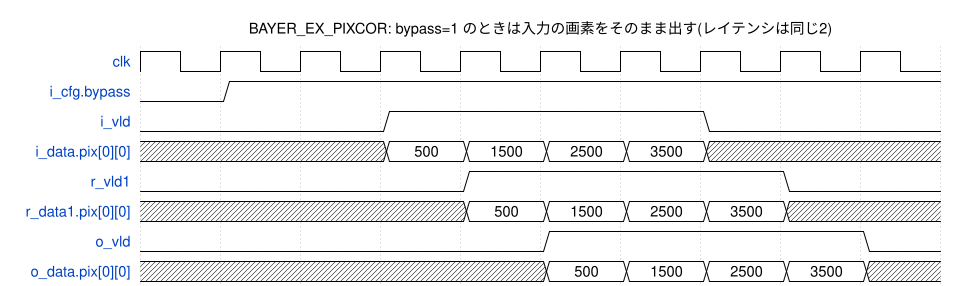

<details><summary>WaveDrom の記述(wave/pixcor_bypass.json)</summary>

```wavedrom
{"signal": [
  {"name": "clk", "wave": "p........."},
  {"name": "i_cfg.bypass", "wave": "01........"},
  {"name": "i_vld", "wave": "0..1...0.."},
  {"name": "i_data.pix[0][0]", "wave": "x..====x..", "data": ["500", "1500", "2500", "3500"]},
  {"name": "r_vld1", "wave": "0...1...0."},
  {"name": "r_data1.pix[0][0]", "wave": "x...====x.", "data": ["500", "1500", "2500", "3500"]},
  {"name": "o_vld", "wave": "0....1...0"},
  {"name": "o_data.pix[0][0]", "wave": "x....====x", "data": ["500", "1500", "2500", "3500"]}
],
 "head": {"text": "BAYER_EX_PIXCOR: bypass=1 のときは入力の画素をそのまま出す(レイテンシは同じ2)"},
 "config": {"hscale": 2}
}
```

</details>

### 6.4 BAYER_EX_DATA_IF

4.3 を見てください。modport mon は検証環境用です(DUT では使わない)。

## 7. 性能とタイミング制約

### 7.1 性能

| 項目 | 値 |
|---|---|
| レイテンシ | 3クロック(7.5 ns @ 400 MHz)。入力の転送から o_vld=1 まで(入力段 1 + PIXCOR 2) |
| スループット | 1転送/クロック = 8画素/クロック(3.2 G画素/秒 @ 400 MHz) |
| 3840×2160 の1フレーム | 960 × 1080 = 1,036,800 転送 → 2.59 ms(止められないとき) |
| 1920×1080 の1フレーム | 480 × 540 = 259,200 転送 → 0.65 ms |
| 出力が止められたとき | 入力側が o_busy=1 を見るまでに、さらに最大 2転送(入力段とスキッド)を受け取る |

止められないときに、レイテンシがいつも3で、入力・出力とも間をあけずに1転送/クロックで流れることを、bex_throughput_test で確かめました(8.3)。

### 7.2 タイミング制約(`syn/constraints/bayer_ex.sdc`)

論理合成・配置配線・STA で共通の SDC です。設定値と意味は [syn/constraints/README.md](../../syn/constraints/README.md) にまとめています。考え方は BAYER2RGB と同じです(クロックが1本なので、クロックの乗せ換えの制約はない)。

| 項目 | 値(既定) | 変数 |
|---|---|---|
| clk | 2.5 ns(400 MHz) | `BEX_CLK_PERIOD` |
| 入出力の相手のクロック | `clk_io`(clk と同じ周期の仮想クロック)。入出力の遅延はここから測る | - |
| クロックツリーの遅れの見込み | 0 ns(IP のクロックと clk_io の両方に与える)。配置配線では測った値 0.135 ns | `BEX_CLK_LATENCY` |
| クロックの不確かさ | セットアップ 0.10 ns、ホールド 0.03 ns | `BEX_UNC_SETUP`、`BEX_UNC_HOLD` |
| 入出力の遅延 | 周期の 50%(IP の外が使う割合)。最小は 0 | `BEX_IO_PCT` |
| リセットの解除 | 周期の 50%(リカバリ・リムーバルを検査する) | `BEX_RST_PCT` |
| 入力の遷移時間 / 出力の負荷 | 0.05 ns / 0.005 pF | `BEX_IN_TRAN`、`BEX_OUT_LOAD` |

IP の中の経路と、入出力の扱い:

| 経路 | 内容 |
|---|---|
| 入力 → FF | i_data / i_cfg / i_vld は、入力段・スキッド・r_cfg の FF で受ける。i_busy は全体停止の判定(s_en)を通って、PIXCOR と入力段の FF の取り込みの条件になる(この経路が入力 → FF で最も長い) |
| FF → FF | 最も長いのは 2段目(r_cfg のゲイン → 乗算 → 丸め → 飽和 → r_data2) |
| FF → 出力 | o_vld、o_pix.data、o_busy は FF から直接出る |
| 入力 → 出力 | なし(組み合わせの経路はない) |

## 8. 検証

UVM で検証環境を作りました。Verilator(5.053、UVM 1800.2-2017-1.0)と Xcelium(UVM は付属の CDNS-1.2、または同じ 1800.2-2017-1.0)の両方で動くように書いています [R3][R4]。波形は GTKWave で見られる形式(Verilator: FST、Xcelium: VCD)で出します [R5]。

### 8.1 構成

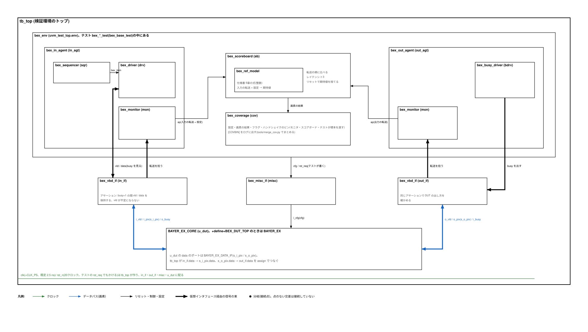

| 部品 | ファイル | 内容 |
|---|---|---|
| tb_top | `tb/tb_top.sv` | クロック(+CLK_PS、既定 2.5 ns)とリセットを作り、DUT と仮想インタフェースをつなぐ。DUT は `BAYER_EX_CORE`(既定)、`+define+BEX_DUT_TOP` で `BAYER_EX` |
| bex_vbd_if | `tb/bex_vbd_if.sv` | vld / busy / data の束(入力側と出力側で1つずつ)。転送の規則のアサーション |
| bex_misc_if | `tb/bex_misc_if.sv` | DUT の i_cfg と、テストからのリセットの要求(rst_req) |
| bex_in_agent | `tb/uvm/bex_agent.svh` | シーケンサ + ドライバ(vld / data を出し、busy=1 の間は保持)+ モニタ |
| bex_out_agent | 同上 | busy のドライバ(止めない / 乱数 / 長く止める / 止めたまま / 決めた並び)+ モニタ |
| bex_frame_seq | `tb/uvm/bex_item.svh` | 1フレームを転送に分けて送る。転送の間のあけ方(なし / 乱数 / ときどき長く / 指定) |
| bex_image | `tb/uvm/bex_image.svh` | 入力画像(乱数、ランプ、黒レベルの近く、最大値の近く、0 と 16383 の市松、一定値) |
| bex_cfg | `tb/uvm/bex_cfg.svh` | 設定。乱数は端の値(0、最大値、1.0倍)を一定の割合で選ぶ |
| bex_ref_model | `tb/uvm/bex_ref_model.svh` | 5章の式をそのまま整数で書いたリファレンスモデル |
| bex_scoreboard | `tb/uvm/bex_scoreboard.svh` | 入力の転送(そのときの設定つき)から期待値を作り、出力の転送と順に比べる。レイテンシ ≥ 3 を確かめる。リセットで期待値を捨てる |
| bex_coverage | `tb/uvm/bex_coverage.svh` | 機能カバレッジ(8.4) |
| テスト | `tb/uvm/bex_base_test.svh`、`bex_tests.svh` | 8.3 |

DUT の data のポートは `BAYER_EX_DATA_IF` です。tb_top は、検証環境側の束(bex_vbd_if)の data と、DUT につなぐインタフェースのインスタンス(s_i_pix / s_o_pix)の data を assign でつないでいます。

アサーション(bex_vbd_if。入力側と出力側の両方):

| 名前 | 内容 |
|---|---|
| a_hold | vld=1 かつ busy=1 のクロックの次も vld=1 で、data が変わらない |
| a_vld_known | vld が不定にならない |
| a_data_known | vld=1 のとき data が不定にならない |

違反は UVM のエラーとして数えます(テストは FAILED になる)。Verilator は2値なので、不定の検査は Xcelium で働きます。

### 8.2 チェックのしかた

- スコアボードが、入力の転送ごとに期待値を作り、出力の転送と1つずつ比べます(sof / eol / eof と8画素)。出力の順番が入力と同じであること、余分な出力・足りない出力がないことも確かめます。
- 期待値の計算に使う設定は、入力側のモニタが転送のクロックに i_cfg から取ります。
- `+BEX_DUMP=<ファイル>` を付けると、比べた組(設定・入力・出力)を書き出します。Python のモデル(`tools/bex_model.py check`)で、リファレンスモデルとは別に照合できます。

### 8.3 テスト

| テスト | 内容 |
|---|---|
| bex_smoke_test | 値が変わらない設定(黒レベル 0、ゲイン 1.0倍)と、ふつうの設定で1フレームずつ |
| bex_bypass_test | bypass=1(黒レベル・ゲインを乱数にしても入力のまま出る) |
| bex_phase_test | Bayer の並び4種類。色ごとに違う黒レベル・ゲインにして、色の選び方を確かめる |
| bex_edge_test | 端の値: 黒レベル最大、ゲイン 0 / 最大、黒レベルちょうど・±1、丸めの境目(0.5倍)、飽和の境目、1転送だけのフレーム、1列だけ、2ラインだけ |
| bex_random_test | 設定・大きさ・画像・入力の間・出力の busy を乱数で組み合わせる。同じ設定でフレームを続けて送る場合もある |
| bex_stall_test | 入力は続けて送り、出力を長く止める(スキッドが埋まって o_busy=1 になることを確かめる) |
| bex_throughput_test | 止めないとき、入力・出力とも間なく流れ(1転送/クロック)、o_busy=0 のままで、レイテンシがすべて 3 であること |
| bex_reset_test | 転送の途中でリセットを3回、出力を止めてコアが満杯のときに1回かける。リセット中の o_vld=0 / o_busy=0、中のデータを捨てること、その後も正しく動くこと |
| bex_cfg_change_test | 前のフレームの出力が終わった後、設定と次のフレームの最初の転送を同じクロックで変える(4.7 の最も厳しい時刻) |
| bex_wave_test | 仕様書の波形図用(決まった並び) |

回帰試験(`sim/tests.list`)は、DUT を `BAYER_EX_CORE` にしたビルド(core)で 41 本、`BAYER_EX` にしたビルド(top)で 8 本、合わせて 49 本を、シードを変えて実行します。

### 8.4 機能カバレッジ

| covergroup.coverpoint | ビン |
|---|---|
| cg_cfg.cp_phase / cp_bypass / x_phase_bypass | Bayer の並び4種類 × bypass |
| cg_ch.cp_blc | チャネルごとの黒レベル: 0 / 途中 / 最大(16383) |
| cg_ch.cp_gain | チャネルごとのゲイン: 0 / 1.0倍未満 / 1.0倍 / 1.0倍超 / 最大(0xFFFF) |
| cg_pix.x_site_res | 色4種類 × 画素の結果(bypass / 黒レベル以下で 0 / 16383 で飽和 / ふつう) |
| cg_xfer.cp_flag | sof / eol / eof / 1転送だけのフレーム |
| cg_hs.cp_ev | 入力: 続けて転送・間をあけて転送・o_busy で止められた・スキッドが埋まった。出力: 続けて転送・間をあけて転送・i_busy で止められた・o_vld=0 のときの i_busy。設定と最初の転送が同じクロック。データがあるとき・空のときのリセット |

covergroup とは別に、同じビンを名前つきで数えて `[COVBIN]` としてログに出し、`tools/merge_cov.py` で回帰試験全体をまとめます(シミュレータによらずにまとめるため。BAYER2RGB と同じ方法)。

### 8.5 結果

Verilator 5.053 での結果です(`make regress`、`make cov`)。

| 項目 | 結果 |
|---|---|
| 回帰試験(49本: core 41、top 8) | PASS 49 / FAIL 0 |
| スコアボードで比べた転送 | 49本の合計 24,773 転送。不一致 0。レイテンシは最小 3(止めたときは最大 90 クロック) |
| 機能カバレッジ | 53 / 53 ビン(100%) |
| RTL のコードカバレッジ(行 / 分岐) | 71 / 71 行(100%)、80 / 80 分岐(100%) |
| Python のモデルとの照合 | 6本のテスト(bex_random_test ×2、bex_edge_test、bex_phase_test、bex_bypass_test、bex_reset_test)の 1,754 転送ですべて一致 |
| lint(Verilator -Wall、トップ BAYER_EX) | 警告 0(パッケージの使わない定数だけ `rtl/bayer_ex_lint.vlt` で除外) |

**変異テスト**

検証環境が誤りを見つけられることを確かめるため、RTL にわざと誤りを1つずつ入れて、主なテスト7本(smoke、bypass、phase、edge、stall、random ×2)を流しました。`sim/` で `python3 ../tools/bex_mutate.py` を実行すると再現できます(変異ごとに RTL をコピーして書き換え、`make build RTL_F=... OBJ=...` でビルドします)。

| 変異 | 入れた誤り | 結果 | 失敗したテスト | 出たエラー |
|---|---|---|---|---|
| m1_site | 色の位置の計算で phase の2ビットを入れ替える(PKG の f_site) | 検出 | 4 / 7 本: phase、stall、random(1)、random(2) | スコアボード 172 件 |
| m2_round | ゲインの丸めの定数を 2048 → 2047(PIXCOR) | 検出 | 4 / 7 本: smoke、phase、edge、random(2) | スコアボード 61 件 |
| m3_skid | スキッドに受け取らない。止まっている間の転送を落とす(CORE) | 検出 | 7 / 7 本: smoke、bypass、phase、edge、stall、random(1)、random(2) | スコアボード 374 件、o_busy=1 にならない 1 件、出力が終わらない 44 件 |
| m4_hold | 2段目のデータが、止まっている間(i_en=0)も変わる(PIXCOR) | 検出 | 7 / 7 本: smoke、bypass、phase、edge、stall、random(1)、random(2) | スコアボード 256 件、アサーション 291 件 |
| m5_bypass | bypass=1 でも2段目のゲインをかける(PIXCOR) | 検出 | 3 / 7 本: bypass、stall、random(1) | スコアボード 197 件 |
| m6_sat | ゲインの結果を飽和させず、下位14ビットを出す(PIXCOR) | 検出 | 6 / 7 本: smoke、phase、edge、stall、random(1)、random(2) | スコアボード 230 件 |

6 種類すべてで、どれかのテストが失敗しました(誤りを見つけた)。ゲインの丸め(m2_round)や bypass(m5_bypass)のように一部のテストでしか出ない誤りもあるので、回帰試験ではシードを変えて同じテストを何本も流しています。

### 8.6 Xcelium と波形

- `make xrun TEST=bex_smoke_test` で Xcelium で実行します(この環境にはないので未実行)。`XWAVES=vcd` で `waves.vcd` を出し、GTKWave で見られます。`XWAVES=shm` は SimVision 用です。
- Verilator では `make run TEST=... WAVES=1` で `waves.fst` を出します(`gtkwave waves.fst`)。
- この仕様書の波形図は、`make build TRACE=vcd` でビルドして bex_wave_test を流した `waves.vcd` から `doc/tools/gen_waves.py` で作りました。

## 9. 論理合成と物理設計

公開ツールと ASAP7(7nm 相当の予測 PDK)で、論理合成から配置配線・配線後の解析まで流しました [R6][R7][R8]。ASAP7 の値は流れが通ることと傾向を見るためのもので、Foundry のプロセスの値ではありません。Foundry の PDK と Cadence のツールの流れは雛形として用意しました(9.4)。

### 9.1 論理合成(`syn/yosys`)

| 項目 | 内容 |
|---|---|
| トップ | `BAYER_EX`(合成の前に sv2v で Verilog に変換する。sv2v はインタフェースのポートを持つモジュールをトップにできないので、ラッパをトップにする [R9]) |
| ツール | sv2v v0.0.13 → Yosys 0.48+5(ABC。目標の遅延は clk の周期)→ OpenSTA(合成後の STA。配線の遅れなし) |
| ライブラリ | ASAP7 の RVT、WC コーナー(SS 0.63 V 100°C) |
| 制約 | `syn/constraints/bayer_ex.sdc`(7.2) |

結果(400 MHz、WC コーナー):

| 項目 | 値 |
|---|---|
| セル数 / 面積 | 14,169 / 1,427.6 um² |
| うち BAYER_EX_PIXCOR | 12,413 セル / 1,195.5 um²(83.7%。8画素分の 14×16bit の乗算器を含む) |
| うち BAYER_EX(CORE を含む) | 1,756 セル / 232.1 um²(16.3%) |
| FF | 587 個(非同期リセットつき 4 個: 有効ビット) |
| セットアップ WNS | +755.3 ps(FF → FF: r_cfg のゲイン → 乗算 → r_data2) |
| 入力 → FF / FF → 出力 / rst_n の解除 | +804.6 ps(i_busy → 1段目の取り込み)/ +854.1 ps(o_busy)/ +1170.5 ps |
| 制約のない終点・入出力 | なし(`check_setup`)。入力 240 本、出力 117 本に遅延を与えた |

- sv2v は、インタフェースのポートを持つ `BAYER_EX_CORE` を、使う側の `BAYER_EX` に展開します。合成後の面積の表で CORE の行がなく、BAYER_EX の行に含まれるのはこのためです。
- 合成後の STA のホールドには、rst_n のリムーバル(−76.8 ps)と入力ポートの直後の FF の違反があります。配線とバッファがない合成直後の値で、入力の遅延の最小を 0 にしているためです。配置配線で直ります(9.2)。

### 9.2 配置配線(`pd/openroad`、OpenROAD-flow-scripts + ASAP7)

| 項目 | 設定 |
|---|---|
| コアの使用率 / 配置の密度 | 40% / 0.60 |
| 端子 | 左辺: 入力側(i_vld、i_data、o_busy)、右辺: 出力側(o_vld、o_data、i_busy)、上辺: i_cfg、下辺: clk、rst_n(`asap7/io_constraints.tcl`。`set_io_pin_constraint` [R11]) |
| 配線層 | M2〜M7 |
| 入出力の相手のクロックの遅れ(`BEX_CLK_LATENCY`) | 0.135 ns(CTS の後に `make io_latency` で測った値) |

結果(400 MHz、WC コーナー。詳細配線・寄生抽出の後):

| 項目 | 値 |
|---|---|
| ダイの大きさ | 63.7 × 63.7 um(コア 3,544 um²) |
| セル数 / セルの面積 / 使用率 | 15,381 / 1,583.8 um² / 44.7% |
| セットアップ WNS / TNS | +678.2 ps / 0(r_cfg のゲイン → r_data2) |
| ホールド違反 | 0 |
| ホールド用バッファ | フロアプランで 239、CTS で 3 |
| rst_n の解除(リカバリ) | +1068.5 ps |
| 遷移時間・容量の違反 | 0 / 0 |
| DRC 違反 / アンテナ違反 | 0 / 0 |
| 配線長(詳細配線) | 40,189 um |
| 電力(見積もり) | 18.3 mW |
| IR ドロップ(VDD / VSS) | 16.4 / 19.6 mV |
| 実行時間(CPU 2個) | 14.5 分(うち詳細配線 10.6 分。詳細配線のメモリは最大 3.3 GB) |

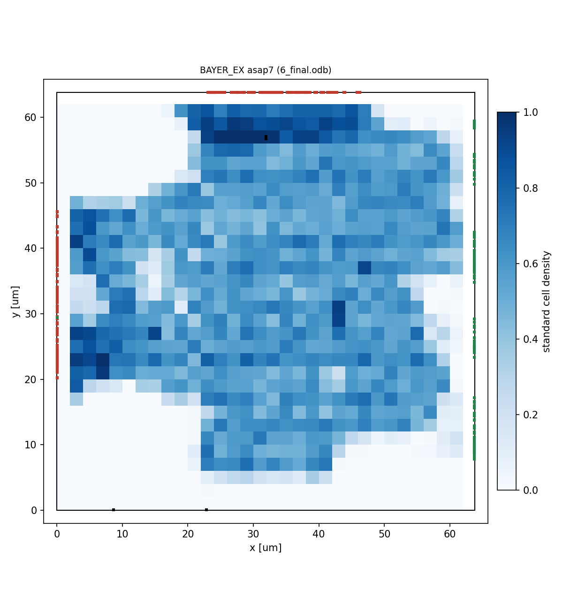

青が標準セルの密度、赤が入力の端子、緑が出力の端子です。各段階の値は `pd/openroad/results/asap7/summary.md` にあります。

### 9.3 わかったこと

**入出力のクロックの遅れ**

SDC は入出力の遅延を仮想クロック clk_io から測ります。仮想クロックはクロックツリーを通らないので、遅れの見込み(`BEX_CLK_LATENCY`)を 0 のままにすると、CTS の後は IP の中の FF のクロックだけが遅れ、入力の経路のホールドが厳しくなります。BAYER2RGB と同じく、見込み 0 で CTS まで流して遅れを測り、測った値で流し直しました(Innovus では CTS の後に update_io_latency で合わせられる [R12])。

| 項目 | 見込み 0 | 測った値 0.135 ns |
|---|---:|---:|
| 入出力につながる FF のクロックの遅れ(中央値) | 0.135 ns | 0.134 ns |
| CTS のホールドの修正の前に違反していた終点 | 353 | 6 |
| CTS で入れたホールド用バッファ | 931 | 3 |
| CTS の後のセル数 | 16,307 | 15,381 |

**フロアプランのホールド用バッファ**

フロアプランの段階で入る 239 個のホールド用バッファは、入力ポートの直後の FF(i_data → 入力段・スキッド、i_cfg → r_cfg)のホールドのためです。SDC は入力の遅延の最小を 0 にしている(IP の外の回路の遅れを 0 とみなす)ので、ホールドの不確かさ 0.03 ns と FF のホールド時間の分だけ、IP の中で遅れが要ります。SoC で外の FF の clk→Q などの最小の遅れがわかれば、`set_input_delay -min` をその値にして減らせます。

**最も厳しい経路**

配線の後も、最も余裕が小さいのは2段目の乗算の経路です(+678 ps)。BAYER2RGB では rst_n の解除が最も厳しかったのですが、BAYER_EX は非同期リセットの FF が4個だけなので、リセットの配線が短く、余裕があります(+1068 ps)。

### 9.4 Foundry の PDK の流れ(`pd/commercial`、雛形)

Cadence(Genus → Innovus → Tempus、Conformal、Pegasus)のスクリプトです。PDK の中身(ファイル名、セル名、層の名前、電源の作り方)は `setup/foundry_setup.tcl` の `<...>` に記入して使います。この環境では実行していません。BAYER_EX は製品IP(SRAM・同期化セル)を使わないので、差し替えるラッパはありません。手順は `pd/README.md` の 2章にあります。

## 10. 既知の制約と注意事項

- 設定(i_cfg)はフレームの切り替えで自動では取り込みません。コアが空のときだけ変えてください(4.7)。変える時刻を守れない使い方をするときは、sof の転送で設定を取り込み、転送と一緒にパイプラインを運ぶ形に変える必要があります。
- フレームの区切り(sof / eol / eof)の並びは確かめません。画像の大きさも見ません。
- 出力が止められたとき、全段を止めます。段の間に空きがあっても詰めません(入力段だけは、空いていれば受け取る)。
- Xcelium での実行と、Foundry の PDK の流れ(`pd/commercial`)は、この環境では行っていません(ツールと PDK がないため)。
- ASAP7 の配置配線の結果は、予測 PDK での値です。GDS は KLayout がないので作っていません(`make gds` で作れます)。
- 入力の遅延の最小を 0 にしているので、入力ポートの直後の FF にホールド用バッファが入ります(9.3)。

## 11. 参考文献

| No | 文献 | 使ったところ |
|---|---|---|
| R1 | [STMicroelectronics: How to tune ISP using the STM32 ISP IQTune](https://wiki.st.com/stm32mcu/wiki/ISP:How_to_tune_ISP_using_the_STM32_ISP_IQTune) | 黒レベル(R / G / B ごとの黒のオフセットを引く)と ISP のゲイン(R / G / B ごと)を、デモザイクの前に行う(5章) |
| R2 | [ZipCPU: Building a Skid Buffer for AXI processing](https://zipcpu.com/blog/2019/05/22/skidbuffer.html) | スキッドで、止める信号(busy)を FF から出す(6.2) |
| R3 | [Antmicro: Support for upstream UVM 2017 in Verilator](https://antmicro.com/blog/2025/10/support-for-upstream-uvm-2017-in-verilator) | Verilator での UVM 1800.2-2017-1.0(8章) |
| R4 | [OpenTitan: xcelium.hjson](https://opensecura.googlesource.com/3p/lowrisc/opentitan/+/4a6b06b28416dbb335099ead987c909e31403d78/hw/dv/data/xcelium/xcelium.hjson) / [Cadence Community: xrun dump all internal signals](https://community.cadence.com/cadence_technology_forums/f/functional-verification/57941/xrun-dump-all-internal-signals) | Xcelium の UVM の指定(-uvmhome CDNS-1.2)と波形(8.6) |
| R5 | [cocotb: Simulator Support](https://docs.cocotb.org/en/latest/simulator_support.html) / [GTKWave(Flathub)](https://flathub.org/apps/io.github.gtkwave.GTKWave) | Verilator の FST 出力と GTKWave(8章) |
| R6 | [OpenROAD-flow-scripts(GitHub)](https://github.com/The-OpenROAD-Project/OpenROAD-flow-scripts) / [Flow Variables](https://openroad-flow-scripts.readthedocs.io/en/latest/user/FlowVariables.html) | 配置配線の流れと変数(IO_CONSTRAINTS、CORE_UTILIZATION、PLACE_DENSITY、NUM_CORES)(9.2) |
| R7 | [ASAP7 PDK(GitHub)](https://github.com/The-OpenROAD-Project/asap7) | 7nm 相当の予測 PDK とセルライブラリ(9章) |
| R8 | [Yosys(GitHub)](https://github.com/YosysHQ/yosys) / [OpenROAD(GitHub)](https://github.com/The-OpenROAD-Project/OpenROAD) / [OpenSTA(GitHub)](https://github.com/parallaxsw/OpenSTA) | 論理合成、配置配線、STA(9章) |
| R9 | [sv2v(GitHub)](https://github.com/zachjs/sv2v) / [sv2v issue #230](https://github.com/zachjs/sv2v/issues/230) | SystemVerilog → Verilog の変換。インタフェースはインスタンスを展開して変換する(9.1)。トップにできないことは v0.0.13 で確かめた(「Specified top module … has interface ports. Please instantiate it somewhere and use that as your top module instead.」) |
| R10 | [IEEE 1800-2017(SystemVerilog)](https://ieeexplore.ieee.org/document/8299595) | インタフェース、modport、packed struct(4章) |
| R11 | [OpenROAD: Pin Placer(set_io_pin_constraint)](https://openroad.readthedocs.io/en/latest/main/src/ppl/README.html) | 端子を辺ごとに置く(`-pin_names`、`-region left:*`)(9.2) |
| R12 | [Cadence Community: Propagated clock for reg2out](https://community.cadence.com/cadence_technology_forums/f/digital-implementation/27219/propagated-clock-for-reg2out) | 入出力の遅延を仮想クロックから測る方法と、CTS の後の update_io_latency(9.3) |
| R13 | [WaveDrom README(svg.wavedrom.com)](https://cdn.jsdelivr.net/npm/wavedrom@3.6.1/README.md) | GitHub での WaveDrom の表示(この文書の波形図) |
| R14 | [Verilator: verilator_coverage](https://verilator.org/guide/latest/exe_verilator_coverage.html) | コードカバレッジの集計(8.5) |
