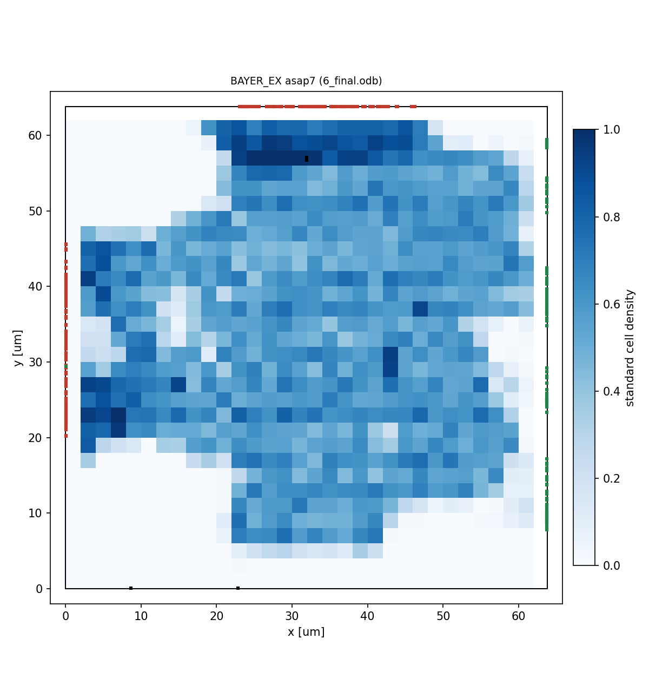

# 物理設計(配置配線とサインオフ)

論理合成(`syn/`)の後の工程です。2つの環境があります。

| ディレクトリ | ツール・PDK | 状態 |
|---|---|---|
| `pd/openroad/` | OpenROAD-flow-scripts(ORFS)+ ASAP7(公開の 7nm 相当の予測 PDK) | この環境で最後まで実行した(詳細配線・寄生抽出・配線後の STA・電力・IR ドロップ。結果は `pd/openroad/results/asap7/`)。GDS は KLayout がないので未作成 |
| `pd/commercial/` | Cadence(Genus / Innovus / Tempus / Conformal / Pegasus)+ Foundry の PDK | 雛形。PDK と商用ツールがないので未実行 |

ASAP7 の結果は、RTL・制約・流れが通ることと、面積・タイミングのおおよその傾向を見るためのものです。ASAP7 は研究用の予測 PDK で、Foundry のプロセスの性能・面積とは一致しません。

```
RTL(rtl/。トップは BAYER_EX)
  ▼
論理合成   syn/yosys(sv2v + Yosys)        または  pd/commercial/genus(Genus)
  │  制約は共通の syn/constraints/bayer_ex.sdc
  ▼
配置配線   pd/openroad(ORFS)              または  pd/commercial/innovus(Innovus)
  ▼
サインオフ OpenROAD の抽出・STA・IR       または  Quantus / Tempus / Conformal / Pegasus
```

---

## 1. OpenROAD-flow-scripts + ASAP7(`pd/openroad/`)

### 1.1 必要なもの

| もの | 確認した版 | 備考 |
|---|---|---|
| OpenROAD-flow-scripts | commit `8433e67a`(2024-12-11) | `flow/` だけを使う。`ORFS_FLOW` で場所を指定 |
| OpenROAD | v2.0-17598-ga008522d8 | ORFS がその commit で使う版 |
| Yosys | 0.48+5 | 論理合成(`syn/yosys`) |
| sv2v | v0.0.13 | SystemVerilog → Verilog の変換(`syn/yosys` の既定) |
| Python 3 | 3.13(PyYAML、matplotlib、numpy) | ORFS のスクリプト、要約、図 |
| GNU time | - | ORFS が各段階の時間とメモリを測るのに使う |
| KLayout | (この環境にはない) | GDS を作るときだけ要る(`make gds`) |
| メモリ | 詳細配線で最大 3.3 GB(2 スレッド)。ほかの段階は 1 GB 未満 | 詳細配線(TritonRoute)が最も多く使い、スレッドが多いほど多く使う。スレッドの数は `NUM_CORES`(ORFS の既定は CPU の数) |

新しい ORFS では、合成済みのネットリストを渡す変数の名前が `CACHED_NETLIST` から `SYNTH_NETLIST_FILES` に変わっています。`asap7/config.mk` は両方を設定しています。

### 1.2 使い方

下のコマンドは、全部を続けて実行するものではありません。最初に「準備」を行い、そのあとは目的に合うケースを1つ選んで実行します。どのケースも論理合成(`syn/yosys`)を自動で行うので、先に `syn/yosys` で `make` しておく必要はありません。

#### 準備(端末を開くたびに)

```sh
cd pd/openroad
export ORFS_FLOW=$HOME/OpenROAD-flow-scripts/flow
which openroad sta yosys sv2v        # 4つとも見つかることを確かめる
```

ORFS をビルドした場合は、`source <ORFS のディレクトリ>/env.sh` で `openroad`、`sta`、`yosys` が PATH に入ります。

#### ケース1: 最後まで流す(ふつうはこれ)

```sh
make
```

論理合成 → フロアプラン → 配置 → CTS → 入出力の遅れの確認 → 配線(概略・詳細)→ 最終の解析 → 要約を順に行います(400 MHz、WC コーナー。CPU 2個で約 15 分)。要約は `results/asap7/summary.md` にできます。

#### ケース2: 段階を区切って進める

```sh
make cts          # 論理合成から CTS まで
make grt          # 続けて概略配線
make route        # 続けて詳細配線
make final        # 続けて最終の解析(寄生抽出、STA、電力、IR ドロップ)
make summary      # 要約と配置の図(終わっている段階までで作る。いつでも実行できる)
```

途中の結果を見ながら進めたいときに、上から順に実行します。どの段階を指定しても、終わっていない前の段階から順に流れ、終わっている段階は飛ばします。

#### ケース3: 入出力の遅れを測って設定を直す(設定や RTL を変えたとき)

```sh
make cts
make io_latency
```

CTS の後に、入出力につながる FF のクロックの遅れ(中央値)を表示します。`asap7/config.mk` の `BEX_CLK_LATENCY` と違っていたら直して、ケース1 を流します(`config.mk` を変えると最初の段階からやり直します)。理由は 1.4 にあります。

#### ケース4: 周期やコーナーを変える

```sh
make clean                         # work/ をすべて消す
make -C ../../syn/yosys clean      # 論理合成の結果も消す
make CLK_PERIOD=2.0
```

周期やコーナーは作業用のディレクトリの名前に入らないので、変えても前の結果を使ってしまいます。配置配線(`work/`)と論理合成(`syn/yosys/out/`)の結果を先に消してください。

#### ケース5: 詳細配線の手前で止める(メモリが少ないとき)

```sh
make synth floorplan place cts io_latency grt summary
```

詳細配線のメモリ(2 スレッドで 3.3 GB)が足りないときに使います。そのあと続けるときは、スレッドの数を減らして `make ORFS_ARGS="NUM_CORES=1" route final summary` とします(`NUM_CORES` は制約や設定を変えないので、`make clean` は要りません)。

#### ケース6: GDS を作る

```sh
make gds
```

ケース1 で最後まで流したあとに実行します(KLayout が必要です)。

#### 結果の場所

結果は `work/asap7/` の下にできます(ORFS の `results/`、`reports/`、`logs/`)。`make summary` で `results/asap7/summary.md` と配置の図(`layout.png`)を作ります。

段階の要否は、この Makefile が前の段階の結果のファイルを見て決め、ORFS の `do-<段階>`(依存関係を見ない実行)を呼びます。この版の ORFS は、合成済みのネットリスト(`CACHED_NETLIST`)を使うと、呼ぶたびに合成の段階からやり直しになるためです。ネットリスト・SDC・`asap7/config.mk`・`asap7/io_constraints.tcl` を変えると最初の段階からやり直します。`ORFS_ARGS` で変数を変えたときは、`make clean` してから流してください。

### 1.3 流れ

| 段階 | ORFS の手順 | 内容 |
|---|---|---|
| synth | (ORFS では合成しない) | `syn/yosys` のネットリストと SDC をそのまま渡す(`CACHED_NETLIST`) |
| floorplan | 2_1〜2_5 | コアの大きさ(使用率 40%)、端子の配置(`asap7/io_constraints.tcl`)、タップセル、電源配線、合成後のタイミングの修正 |
| place | 3_1〜3_5 | タイミングと配線の混み具合を見た配置、バッファ挿入とサイズ変更、詳細配置 |
| cts | 4_1 | クロックツリー(clk)、ホールドの修正 |
| io_latency | (ORFS の `make run`) | 入出力につながる FF のクロックの遅れを測る(`scripts/io_latency.tcl` → `reports/.../io_latency.rpt`) |
| grt / route | 5_1〜5_3 | 概略配線と配線後の修正、詳細配線(TritonRoute)、フィラー |
| final | 6_1、6_report | 寄生抽出(OpenRCX)、配線後の STA、電力、IR ドロップ、最終のネットリスト・DEF・SPEF |

端子は、データが左から右へ流れるように置きます(`asap7/io_constraints.tcl`。OpenROAD の `set_io_pin_constraint -region`)。

| 辺 | 端子 |
|---|---|
| 左 | `i_vld`、`i_data[114:0]`、`o_busy`(入力側) |
| 右 | `o_vld`、`o_data[114:0]`、`i_busy`(出力側) |
| 上 | `i_cfg[122:0]`(設定) |
| 下 | `clk`、`rst_n` |

### 1.4 設定(`asap7/config.mk`)

| 変数 | 既定 | 内容 |
|---|---|---|
| `BEX_CLK_PERIOD` | 2.5 | clk の周期 [ns]。Makefile の `CLK_PERIOD`。SDC に渡す |
| `BEX_CLK_LATENCY` | 0.135 | 入出力の相手の仮想クロックの遅れ [ns]。SDC に渡す(下の説明) |
| `CORNER` | WC | ライブラリのコーナー(WC: SS 0.63 V 100°C、TC: TT 0.70 V 0°C、BC: FF 0.77 V 25°C) |
| `CORE_UTILIZATION` | 40 | コアの使用率 [%] |
| `PLACE_DENSITY` | 0.60 | 配置の密度 |
| `IO_CONSTRAINTS` | `asap7/io_constraints.tcl` | 端子の置き場所 |
| `MIN_ROUTING_LAYER` / `MAX_ROUTING_LAYER` | M2 / M7 | 配線層 |

SDC は論理合成と同じ `syn/constraints/bayer_ex.sdc` を、ASAP7 の単位(ps / fF)で読みます(`BEX_TIME_UNIT=ps`、`BEX_CAP_UNIT=fF`)。

SDC は入出力の遅延を、IP の外の FF のクロック(仮想クロック `clk_io`)から測ります。仮想クロックはクロックツリーを通らないので、CTS の後もクロックツリーの遅れの見込み(`BEX_CLK_LATENCY`)のままです。見込みが 0 だと、入力ポートから FF への経路のホールドが、IP の中のクロックツリーの遅れ(約 0.135 ns)だけ厳しくなり、CTS で不要なホールド用バッファが入ります(931 個。測った値にした後は 3 個)。Innovus には仮想クロックの遅れをクロックツリーに合わせる `update_io_latency` がありますが、OpenROAD にはないので、`make io_latency` で測った値(入出力につながる FF のクロックの遅れの中央値)を `asap7/config.mk` に書いています。設定や RTL を変えたときは、測り直してください(ケース3)。

### 1.5 結果

400 MHz、WC コーナーで最後まで流しました。各段階の値と配置の図は `results/asap7/summary.md` にあります。説明は仕様書 9.2 にあります。

| 項目(最終。寄生抽出の後) | 値 |
|---|---:|
| ダイの大きさ | 63.7 × 63.7 um |
| セル数 / 使用率 | 15,381 / 44.7% |
| セットアップ WNS / TNS | +678.2 ps / 0 |
| ホールド違反 | 0 |
| ホールド用バッファ(フロアプラン / CTS) | 239 / 3 |
| 遷移時間・容量の違反 | 0 / 0 |
| DRC 違反 / アンテナ違反 | 0 / 0 |
| 配線長(詳細配線) | 40,189 um |
| 電力(見積もり) | 18.3 mW |
| IR ドロップ(VDD / VSS) | 16.4 / 19.6 mV |
| 実行時間(CPU 2個) | 14.5 分(うち詳細配線 10.6 分) |

最も余裕が小さいのは2段目の乗算の経路(r_cfg のゲイン → r_data2)です。



### 1.6 注意

- フロアプランの段階で入る 239 個のホールド用バッファは、入力ポートの直後の FF のホールドのためです。SDC は入力の遅延の最小を 0 にしています(IP の外の遅れを 0 とみなす、最も厳しい見方)。SoC で最小の遅れがわかれば、SDC の `set_input_delay -min` を直すと減ります(`syn/constraints/README.md` の 4章)。
- OpenROAD の GUI が使えない環境(Qt の部品がないなど)では、ORFS の最後の画像保存(`final_report.tcl` の `save_image`)で止まることがあります。この環境では OpenROAD を起動するスクリプトで `save_image` を無効にしました。配置の図は DEF から描いています(`scripts/plot_layout.py`)。
- OpenROAD の中の Python(3.10)のために `PYTHONHOME` を設定する場合は、ORFS が呼ぶ外の `python3` に引き継がないようにしてください。
- `NUM_CORES` を増やすと、配置・詳細配線が速くなる代わりに、詳細配線のメモリが増えます(この環境では 2)。

---

## 2. 商用ツールの雛形(`pd/commercial/`、Cadence + Foundry の PDK)

Foundry の PDK と Cadence のツールで流すためのスクリプトです。PDK の中身(ファイル名、セル名、層の名前、電源の作り方)は公開されていないので、`<...>` の項目を記入して使います。**この環境では実行していません。** コマンドとオプションは Stylus Common UI(Genus / Innovus / Tempus)を想定しています。使う版のマニュアルとリファレンスフローで確認してください。

### 2.1 構成

| ファイル | 内容 |
|---|---|
| `setup/foundry_setup.tcl` | ★ PDK のパス、ライブラリ、RC コーナー、解析ビュー、セル名、配線層(記入する) |
| `setup/design_setup.tcl` | 設計の設定(周期、RTL の並び、出力先) |
| `setup/mmmc.tcl` | MMMC(ライブラリ・RC・ビュー)。Genus / Innovus / Tempus で共通 |
| `genus/syn.tcl` | 論理合成。ネットリスト、配置配線用の SDC、LEC の dofile を出す |
| `innovus/*.tcl` | 配置配線(init → floorplan → place → cts → route → signoff)。段階ごとに db を保存。CTS の後に `update_io_latency` で入出力の仮想クロックの遅れを合わせる |
| `tempus/sta.tcl` | サインオフの STA(全ビュー、SI、SDF)。Innovus が書き出した SDC(入出力の遅れを合わせたもの)を読む |
| `lec/gate2gate.do` | 合成後と配置配線後のネットリストの等価性検証 |
| `Makefile` | `make syn / lec_rtl / pnr / sta / lec_g2g / drc / lvs` |

BAYER_EX は標準セルだけでできている(SRAM・同期化セルなどの製品IPがない)ので、プロセスに合わせて差し替える RTL はありません。

### 2.2 記入する項目

1. `setup/foundry_setup.tcl` の `<...>`: PDK のパス、LEF、Liberty(コーナーごと)、qrcTechFile、ストリームの層の対応表、GDS / CDL、セル名(TIE、フィラー、デカップ、タップ、クロック用のバッファ・インバータ)、配線層の名前。
2. 電源配線: 作り方はプロセスによって違うので、PDK のリファレンスフローの電源配線のスクリプトを `BEX_PDN_TCL` に指定する。
3. `Makefile` の `LEC_LIBS`、`PEGASUS_DRC_RULES`、`PEGASUS_LVS_RULES`。

### 2.3 使い方

2.2 の記入を済ませてから実行します。こちらは選ぶものではなく、順に流す流れです。

まとめて流す場合:

```sh
cd pd/commercial
make all          # syn → lec_rtl → pnr → sta → lec_g2g を順に
make drc lvs      # 物理検証(Pegasus)
```

段階ごとに流す場合は、次の順に実行します。後の段階を指定すると、終わっていない前の段階から流れます。

| 順 | コマンド | 内容 | 出力 |
|---|---|---|---|
| 1 | `make syn` | 論理合成(Genus) | `out/foundry/genus/` |
| 2 | `make lec_rtl` | RTL と合成後の等価性検証(Conformal)。ほかの段階の前提ではない | |
| 3 | `make pnr` | 配置配線(Innovus。init → floorplan → place → cts → route → signoff) | `out/foundry/innovus/`(`db/` に段階ごとの db) |
| 4 | `make sta` | サインオフの STA(Tempus) | `out/foundry/tempus/reports/` |
| 5 | `make lec_g2g` | 合成後と配置配線後の等価性検証(Conformal) | |
| 6 | `make drc lvs` | 物理検証(Pegasus) | |

配置配線は段階ごとにも流せます(`make init`、`make floorplan` … `make signoff`)。

### 2.4 ASAP7 の環境との対応

| 項目 | ASAP7(OpenROAD) | Foundry の PDK(Cadence) |
|---|---|---|
| 制約 | `syn/constraints/bayer_ex.sdc`(ps / fF) | 同じファイル(ns / pF)→ Genus が数値の SDC を書き出す |
| インタフェース | sv2v で Verilog に変換してから読む | Genus が SystemVerilog のまま読む |
| 入出力の仮想クロックの遅れ | `make io_latency` で測って `asap7/config.mk` に書く | CTS の後に `update_io_latency`(`innovus/cts.tcl`) |
| 端子の配置 | `asap7/io_constraints.tcl`(`set_io_pin_constraint`) | `innovus/floorplan.tcl`(`edit_pin`。同じ辺の割り当て) |
| 論理合成 | Yosys + ABC | Genus |
| 配置配線 | ORFS(RePlAce、TritonCTS、FastRoute、TritonRoute) | Innovus(GigaPlace、CCOpt、NanoRoute) |
| 抽出・STA | OpenRCX + OpenSTA | Quantus + Tempus |
| 等価性検証 | (なし) | Conformal LEC |
| 物理検証 | KLayout(この環境ではなし) | Pegasus |

---

## 参考

| No | 文献 | 使ったところ |
|---|---|---|
| P1 | [OpenROAD-flow-scripts: Flow Variables](https://openroad-flow-scripts.readthedocs.io/en/latest/user/FlowVariables.html) | ORFS の変数(`IO_CONSTRAINTS`、`CORE_UTILIZATION`、`PLACE_DENSITY`、`NUM_CORES`) |
| P2 | [OpenROAD-flow-scripts(GitHub)](https://github.com/The-OpenROAD-Project/OpenROAD-flow-scripts) | 流れの本体、ASAP7 のプラットフォーム |
| P3 | [OpenROAD: Pin Placer](https://openroad.readthedocs.io/en/latest/main/src/ppl/README.html) | `set_io_pin_constraint`(端子を辺ごとに置く) |
| P4 | [ASAP7 PDK(GitHub)](https://github.com/The-OpenROAD-Project/asap7) | ASAP7 の PDK とセルライブラリ |
| P5 | [Cadence Community: Propagated clock for reg2out](https://community.cadence.com/cadence_technology_forums/f/digital-implementation/27219/propagated-clock-for-reg2out) | 入出力の遅延を仮想クロックから測る方法と、CTS の後の update_io_latency |
