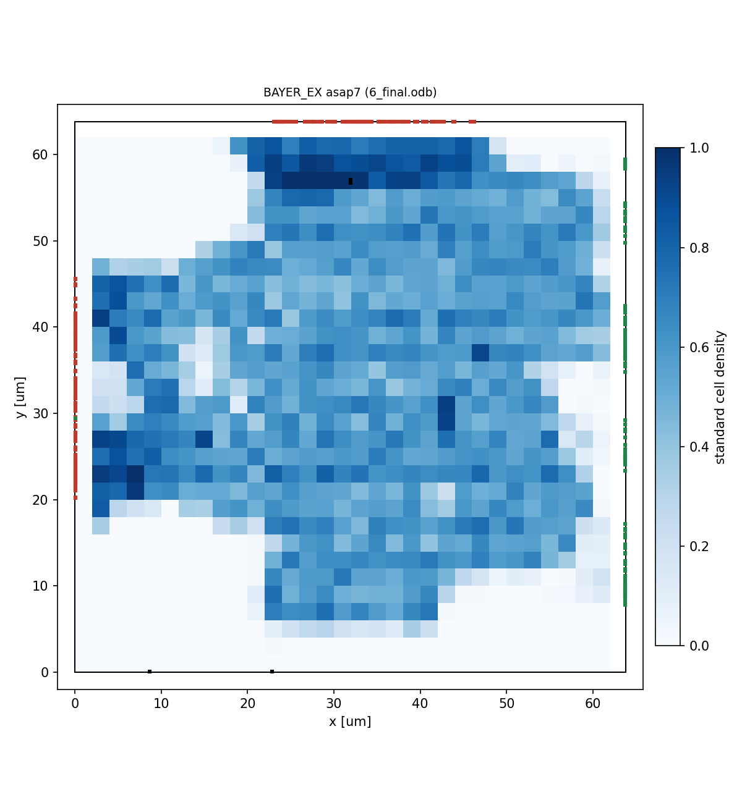

# 配置配線の結果(asap7)

OpenROAD-flow-scripts(ASAP7)の各段階の値です。`pd/openroad/scripts/pd_summary.py` で作りました。
時間の単位は ps(ASAP7 のライブラリの単位)です。

| 項目 | フロアプラン | 配置 | CTS | 概略配線 | 詳細配線 | 最終(抽出後) |
|---|---:|---:|---:|---:|---:|---:|
| セル数 | 14272 | 14836 | 16527 | 16527 | - | 34908 |
| セルの面積 [um²] | 1430.6 | 1445.7 | 1588.4 | 1588.4 | - | 1588.4 |
| 使用率 [%] | 40.3 | 40.8 | 44.8 | 44.8 | - | 44.8 |
| セットアップ WNS [ps] | 764.2 | 415.2 | 504.3 | 439.8 | - | 470.9 |
| セットアップ TNS [ps] | 0.0 | 0.0 | 0.0 | 0.0 | - | 0.0 |
| セットアップ違反 [本] | - | 0 | 0 | 0 | - | 0 |
| ホールド WNS [ps] | -80.7 | -21.1 | 0.0 | 25.7 | - | 27.5 |
| ホールド TNS [ps] | -8813.8 | -2306.8 | 0.0 | 0.0 | - | 0.0 |
| ホールド違反 [本] | - | 127 | 0 | 0 | - | 0 |
| ホールド用バッファ [個] | - | - | 1619 | 0 | - | - |
| クロックスキュー(セットアップ)[ps] | - | - | 123.2 | 113.8 | - | 116.2 |
| クロックスキュー(ホールド)[ps] | - | - | 59.9 | 51.5 | - | 52.6 |
| 遷移時間の違反 [本] | - | 0 | 0 | 0 | - | 0 |
| 容量の違反 [本] | - | 0 | 0 | 0 | - | 0 |
| 配線長 [um]。配置・CTS は見積もり | - | 31308 | 35612 | 60162 | 40309 | - |
| DRC 違反 [個] | - | - | - | - | 0 | - |
| アンテナ違反 [本] | - | - | - | 0 | 0 | - |
| 電力 [mW] | 16.07 | 17.15 | 17.48 | 18.16 | - | 17.33 |
| IR ドロップ VDD [mV] | - | - | - | - | - | 9.4 |
| IR ドロップ VSS [mV] | - | - | - | - | - | 9.1 |

- ダイの面積: 4071 um²、コアの面積: 3548 um²
- 実行時間(CPU 2個): フロアプラン 0.3 分、配置 1.8 分、CTS 0.5 分、概略配線 1.2 分、詳細配線 6.3 分、最終 0.8 分(合計 10.9 分)

## レポート

- [2_floorplan_final.rpt](2_floorplan_final.rpt)
- [3_detailed_place.rpt](3_detailed_place.rpt)
- [4_cts_final.rpt](4_cts_final.rpt)
- [5_global_route.rpt](5_global_route.rpt)
- [io_latency.rpt](io_latency.rpt)
- [5_route_drc.rpt](5_route_drc.rpt)
- [drt_antennas.log](drt_antennas.log)
- [6_finish.rpt](6_finish.rpt)

## 配置

青: 標準セルの密度、赤: 入力の端子、緑: 出力の端子(左辺: i_vld・i_data・o_busy、右辺: o_vld・o_data・i_busy、上辺: i_cfg、下辺: clk・rst_n)

